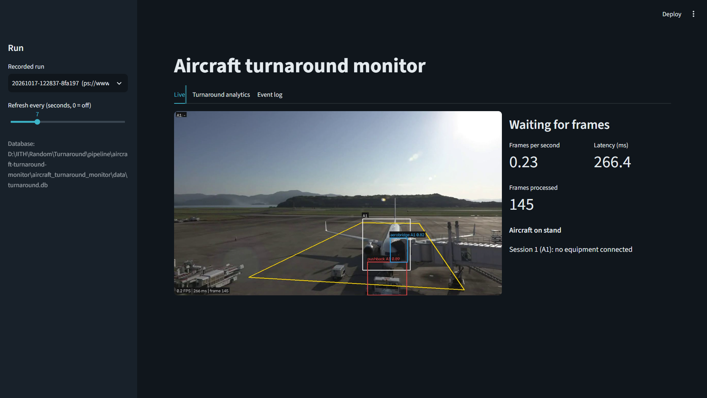
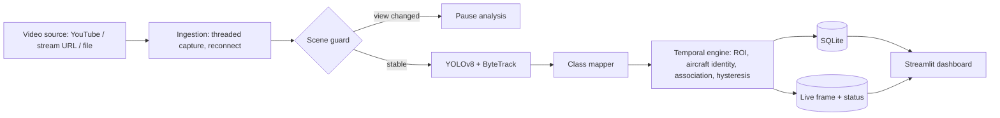

# Aircraft Turnaround Monitor

Real-time computer-vision monitoring of aircraft turnarounds from a live airport video feed (YouTube live stream) or a recorded video.

A custom-trained **YOLOv8** model detects the aircraft and four "connected" ground-equipment classes (aerobridge, catering truck, cargo loader, pushback tug). **ByteTrack** and a **temporal state-machine layer** turn noisy per-frame detections into stable service events, which are stored in **SQLite** and shown in a **Streamlit** dashboard with turnaround analytics.

<p align="center">
  
</p>

## Features

- **Live or recorded input.** YouTube live pages (resolved with `yt-dlp`), direct HLS/RTSP/HTTP URLs, or video files for reproducible replay.
- **Robust to flicker, occlusion and missed detections.**
  - A service becomes "connected" only after several positive detections within a short window (n-of-m hysteresis).
  - It is released only after a grace period without evidence.
  - Start and end times are back-dated to the first and last real detection.
  - Intervals that are too short are retracted as false triggers.
- **Stable aircraft identities.** An aircraft keeps its ID when the tracker assigns a new one (IoU re-identification) and is tracked through occlusion on its last known position.
- **Manual ROI zones.** You draw the polygon, and equipment must also overlap the aircraft to count as evidence.
- **Camera-view guard.** If the stream switches camera or pans, analysis pauses instead of producing wrong results with a fixed ROI.
- **Turnaround analytics.** Total turnaround time, per-service durations, idle gaps, utilization, concurrent services and a Gantt-style timeline.
- **Portable.** One YAML configuration, relative paths, automatic CPU fallback, an environment checker, and no hard-coded paths.
- **Tested.** 116 automated tests covering the temporal logic, storage, ingestion, a full synthetic-video pipeline run, and the dashboard.

## How it works



The pipeline and the dashboard are separate processes that communicate only through the SQLite file and two files in `runtime/`.

The code follows a layered, loosely coupled design (domain, config, ingestion, detection, spatial, temporal, analytics, storage, pipeline, dashboard). The layering rules are enforced by a test.

## Tech stack

Python 3.9+, Ultralytics YOLOv8 (ByteTrack), PyTorch, OpenCV, yt-dlp, SQLite, Streamlit, Plotly, pandas, pytest.

## Quick start

```bash
git clone https://github.com/<your-username>/aircraft-turnaround-monitor.git
cd aircraft-turnaround-monitor

python -m venv .venv
source .venv/bin/activate            # Windows: .venv\Scripts\activate

# For GPU inference, install a CUDA build of PyTorch first: https://pytorch.org/get-started/locally/
pip install -r requirements.txt
```

1. Put your trained weights at `weights/best.pt` (or set `model.weights_path` in `configs/default.yaml`).
2. Make sure the class names under `classes:` in `configs/default.yaml` match your model, then verify the setup:
   ```bash
   python scripts/check_environment.py --load-model
   ```
3. Try it on a recorded video first:
   ```bash
   python scripts/run_pipeline.py --kind file --source data/your_clip.mp4
   ```
4. Run it on a live YouTube stream:
   ```bash
   python scripts/run_pipeline.py --kind youtube --source "https://www.youtube.com/watch?v=XXXXXXXXXXX"
   ```
5. Open the dashboard in a second terminal:
   ```bash
   python scripts/run_dashboard.py
   ```
   Then go to http://localhost:8501.

## Defining the ROI

The ROI is set manually and assumes a fixed camera. Draw it on a frame of your stream:

```bash
python scripts/select_roi.py --kind youtube --source "https://www.youtube.com/watch?v=XXXXXXXXXXX"
```

Click the polygon vertices, press Enter, and paste the printed `roi:` block into `configs/default.yaml`.

## Configuration

All settings live in `configs/default.yaml`: source, model and device, class mapping, ROI, scene guard, aircraft identity, association thresholds, and per-service hysteresis rules. Relative paths resolve against the project root (override with `TURNAROUND_HOME`). Typical adjustments:

| Symptom | Setting to adjust |
|---|---|
| A service flips on and off during one real connection | `temporal.defaults.off_grace_s`, `on_window_s` |
| Short phantom intervals | `min_interval_s`, `on_min_hits`, `association.min_confidence` |
| One aircraft creates several sessions | `aircraft.lost_timeout_s`, `reid_iou_threshold` |
| Pipeline falls behind the live stream | `source.target_fps`, `model.imgsz` |

## Project structure

```text
configs/        YAML configuration (default.yaml, bytetrack.yaml)
scripts/        Entry points: run_pipeline, run_dashboard, select_roi, check_environment
src/turnaround/
  domain/         Shared value types and events
  config/         Typed schema and validating loader
  ingestion/      Live stream / file sources, YouTube resolver, bounded frame buffer
  detection/      Detector contract, class mapper, YOLOv8 + ByteTrack adapter
  spatial/        ROI polygons, equipment association, camera-view guard
  temporal/       Aircraft registry, hysteresis, sessions, engine
  analytics/      Interval math and turnaround KPIs
  storage/        SQLite schema, writer, reader
  runtime/        Live frame/status files shared with the dashboard
  visualization/  Frame overlays and video recorder
  pipeline/       Orchestrator, ports, composition root
  dashboard/      Streamlit app
tests/          Unit, integration and dashboard tests
tools/          Specification generator
docs/           PIPELINE_SPEC.md (full functional specification)
```

A complete functional specification of every module, data contract and function is in [`docs/PIPELINE_SPEC.md`](docs/PIPELINE_SPEC.md). It is generated from the code's docstrings with `python tools/generate_spec.py`.

## Testing

```bash
python -m pytest
```

The tests use synthetic data and a scripted fake detector, so they run without GPU, weights or network access. Real YOLO inference and live stream access need to be verified on your own machine with `check_environment.py`.

## Limitations

- Assumes a fixed camera. The scene guard pauses analysis on view changes but does not remap the ROI.
- The model is expected to emit a "connected" class only when the equipment is actually attached. The pipeline filters spatially and temporally but does not verify this semantically.
- An aircraft that is unseen longer than `aircraft.lost_timeout_s` is treated as departed, and a reappearance starts a new session.
- Detection accuracy and event-timing error are not measured by this repository.

## Disclaimer

This project is intended for research and demonstration. Respect YouTube's Terms of Service when using live streams, and do not redistribute stream footage.

## License

Add a `LICENSE` file and name the license here (for example MIT).
