# Aircraft Turnaround Monitor - Functional Specification (Code Surrogate)

> **Purpose of this document.** It describes the repository `aircraft-turnaround-monitor` completely enough that an LLM which
> has **never seen the code** can plan, write or modify code for it. Sections 1, 2, 4 and 5 are hand-written narrative;
> Section 3 (every file, class, function, helper, constant, test) is **generated from the code's structured docstrings** by
> `tools/generate_spec.py`, so it cannot drift from the implementation.
>
> **How to use it with limited context.** The full document is roughly 90k tokens (characters/4). Always include Sections 1, 2 and 5 (roughly 12k tokens). Then add only the Section 3
> groups relevant to the task (each `3.N Group` is self-contained): e.g. temporal logic -> `3.7`; storage/dashboard -> `3.9`, `3.13`;
> configuration -> `3.3` + Section 4.
>
> **Conventions.** `ts` = timestamp in epoch seconds on the *stream clock* (wall clock for live streams, video timeline +
> configured origin for file replay). `dt` = *observed* seconds credited between two processed frames. "Service" = one of
> `aerobridge`, `catering`, `cargo`, `pushback`. All thresholds are in **seconds**, never frames (frame rate varies).
> Python >= 3.9. Regenerate this file with `python tools/generate_spec.py` (use `--strict` to fail on undocumented code).

---

### 1. High-Level Architecture & Pipeline Workflow

#### 1.1 Pipeline Purpose

Turn a live airport video feed (YouTube live stream, any FFmpeg-readable URL) or a recorded video into **reliable, time-aware
ground-handling events and turnaround analytics**:

* A custom YOLOv8 model (5 classes) detects `aircraft` and four *"connected"* equipment classes
  (`aerobridge_connected`, `catering_truck_connected`, `cargo_loader_connected`, `pushback_tug_connected`). A "connected" class is
  only emitted by the model when that equipment is attached to the aircraft.
* ByteTrack (Ultralytics built-in) gives tracker ids. A **temporal layer** converts noisy per-frame detections into stable
  *aircraft identities* and *service intervals* that tolerate **flicker, occlusion and missed detections**, using hysteresis,
  grace periods, coasting identities, back-dated boundaries, manual ROI zones and a camera-view-change guard.
* Events are persisted to **SQLite**; a **Streamlit dashboard** shows the live annotated frame, turnaround KPIs, a Gantt timeline and the event log.
* Everything is configured by one YAML file; relative paths resolve against the project root, so copying the folder to another
  PC and installing `requirements.txt` is enough. CPU fallback is automatic. Recorded-video replay makes demos and tests reproducible.

Out of scope by design: edge deployment / model optimisation (TensorRT/ONNX), sequence-rule anomaly flags, automatic ROI discovery,
accuracy evaluation.

#### 1.2 Architectural principles (loose coupling, high cohesion)

* **Layered packages with one direction of dependency** (enforced by `tests/test_architecture.py`, see 5.2 for the table). `domain` imports nothing internal.
* **Ports and adapters.** The orchestrator depends only on abstract contracts: `FrameSource` (ingestion), `ObjectTracker` (detection), `EventSink` and `FrameSink` (pipeline/ports.py). Concrete classes are wired in exactly one place: `pipeline/builder.py` (composition root).
* **Pure core.** `temporal.engine.TurnaroundEngine`, `analytics.*`, `spatial.*` do no I/O and take time only as arguments, so they are unit-testable with synthetic data.
* **Two processes, no shared imports.** The pipeline process and the dashboard process communicate only through the SQLite file and two files in the runtime directory (`latest.jpg`, `status.json`).
* **One concern per module** (e.g. `hysteresis.py` only debounces, `association.py` only validates/assigns equipment, `writer.py` only persists).

#### 1.3 Execution flow

**Startup (`scripts/run_pipeline.py` -> `pipeline.builder.build_pipeline`)**

1. Parse CLI flags into dotted overrides; `config.loader.load_config` reads YAML, expands `${ENV}`, applies overrides, builds dataclasses strictly (unknown keys are errors), validates, resolves relative paths against the project root.
2. `utils.logging_setup.configure_logging`.
3. `UltralyticsTracker.load()`: check weights file, resolve device (`auto` -> CUDA if available else CPU; FP16 only on CUDA), load YOLO, warm up by one blank `track()` call, then `reset()`.
4. `ClassMapper.validate(model class names)` - fail fast if configured class names/ids do not match the model.
5. Build `RoiSet`, `EquipmentAssociator`, `AircraftRegistry`, `TurnaroundEngine`, optional `SceneGuard`, `SqliteEventWriter` (creates schema), `LiveStateWriter`, optional `AnnotatedVideoWriter`, `FrameAnnotator`, and the `FrameSource`.
6. `PipelineRunner.run()`: `begin_run` on event sinks (inserts the `runs` row), `source.start()`.

**Per frame (`PipelineRunner._process_packet`)**

1. `source.read(timeout)` -> `FramePacket` (None on timeout; if the source is `exhausted` the loop ends with reason `stream_end`; otherwise an idle status is published).
2. **Scene guard** (if enabled): similarity of an edge-map thumbnail vs a reference. `CHANGED` -> emit `SCENE_CHANGED` once, reset the tracker, publish a banner frame, **skip inference and the engine** (temporal state freezes). Return to `STABLE` -> emit `SCENE_RESTORED`, reset the tracker.
3. `tracker.track(frame)` -> `RawDetection[]` (YOLOv8 + ByteTrack, ids may be None).
4. `ClassMapper.resolve_all` -> `Detection[]` (aircraft / equipment+service; unmapped classes dropped).
5. `TurnaroundEngine.process(ts, detections, frame_size)`:
   1. `dt = clamp(ts - last_ts, 0, max_gap_s)` (stalls are not counted as absence).
   2. `RoiSet.bind(frame_size)`; aircraft detections are filtered by the analysis zone (if `apply_to_aircraft`).
   3. `AircraftRegistry.update`: stable aircraft ids (tracker-id binding, then IoU re-identification, then new tentative slot), confirmation after `confirm_hits`, coasting of unseen aircraft on their last box, expiry after `lost_timeout_s` of *observed* unseen time.
   4. Departed aircraft -> `session.close(last_seen_ts, AIRCRAFT_DEPARTED)`; newly confirmed aircraft -> new `TurnaroundSession` + `SESSION_STARTED`.
   5. `EquipmentAssociator.associate`: per equipment detection check confidence floor -> analysis ROI -> service ROI -> aircraft exists -> overlap with enlarged aircraft box; produce accepted (with aircraft id) / rejected (with reason).
   6. Each open session receives per-service boolean presence; each `HysteresisFilter` may transition: activation needs `on_min_hits` positives within `on_window_s` (start back-dated to the first positive); release needs `off_grace_s` of observed absence (end back-dated to the last positive); intervals shorter than `min_interval_s` are retracted (`SERVICE_DISCARDED`).
6. Events -> every `EventSink.handle` (SQLite projections update `sessions`/`service_intervals`); sink exceptions are logged, never fatal.
7. Annotated frame + `status.json` -> every `FrameSink.submit` (live view throttled to `publish_interval_s`; optional video recorder gets every frame).
8. A failing frame is logged and skipped; 50 consecutive failures abort the run.

**Shutdown (`PipelineRunner._finalize`, always executed)**

`source.stop()` -> `engine.flush(last_ts, reason)` closes every open session (`partial_end=True`, interval `end_reason` = `stream_end` or `shutdown`) -> final `finished` status -> `end_run` + `close` on all sinks. SIGINT/SIGTERM call `request_stop()` (graceful).

**Dashboard (`scripts/run_dashboard.py` -> Streamlit `dashboard/app.py`)**: reads SQLite (read-only, short-lived connections) and the runtime files; analytics are computed on read by `analytics.summary.compute_session_summary` (single source of truth, nothing derived is stored).

#### 1.4 Diagram (Mermaid)

```mermaid
flowchart LR
  subgraph ING["Ingestion (threaded, drop-oldest buffer, reconnect)"]
    YT["YouTube page URL"] -->|"yt-dlp resolve"| SS["StreamFrameSource"]
    URL["HLS/RTSP/HTTP URL"] --> SS
    VID["Video file (replay)"] --> VF["VideoFileSource"]
  end
  SS -->|FramePacket| RUN["PipelineRunner (orchestrator)"]
  VF -->|FramePacket| RUN
  RUN --> SG{"SceneGuard"}
  SG -->|"CHANGED: pause, tracker.reset, SCENE_CHANGED"| RUN
  SG -->|STABLE| TRK["UltralyticsTracker: YOLOv8 + ByteTrack"]
  TRK -->|"RawDetection[]"| CM["ClassMapper"]
  CM -->|"Detection[]"| ENG
  subgraph ENG["TurnaroundEngine (pure)"]
    ROI["RoiSet"] --> REG["AircraftRegistry: stable ids, coasting"]
    REG --> ASC["EquipmentAssociator: conf, ROI, overlap"]
    ASC --> SES["TurnaroundSession x N: 4 HysteresisFilter each"]
  end
  SES -->|"DomainEvent[]"| ES["EventSink: SqliteEventWriter"]
  RUN -->|"annotated frame + status"| FS["FrameSink: LiveStateWriter / AnnotatedVideoWriter"]
  ES --> DB[("SQLite: runs, sessions, service_intervals, events")]
  FS --> LIVE[("runtime/latest.jpg + status.json")]
  DB --> DASH["Streamlit dashboard + analytics.summary"]
  LIVE --> DASH
```



#### 1.5 Diagram (ASCII)

```text
 YouTube URL --yt-dlp--> [StreamFrameSource: thread -> LatestFrameBuffer(drop oldest) -> reconnect/backoff]
 stream URL ------------>/                                                              \
 video file ------------> [VideoFileSource: stride subsample, video-timeline timestamps] --> FramePacket
                                                                                              |
                                                                                    [PipelineRunner loop]
                                                                                              |
                                                       +--- SceneGuard: CHANGED -> pause (no inference), SCENE_CHANGED, tracker.reset
                                                       v STABLE
                                   [UltralyticsTracker: YOLOv8 + ByteTrack] -> RawDetection[]
                                                       v
                                   [ClassMapper] -> Detection[] (aircraft | equipment+service)
                                                       v
                    [TurnaroundEngine.process(ts, detections, frame_size)]
                       RoiSet.bind -> AircraftRegistry.update -> sessions open/close
                       -> EquipmentAssociator.associate -> TurnaroundSession.update (4x HysteresisFilter)
                                                       v
                                         FrameResult(events, aircraft, association, ...)
                         +-----------------------------+-----------------------------+
                         v                                                           v
         EventSink: SqliteEventWriter                         FrameSink: LiveStateWriter (+AnnotatedVideoWriter)
         (events log + sessions/intervals projections)        (latest.jpg, status.json)
                         v                                                           v
                    SQLite file  ---------------------->  Streamlit dashboard  <---- runtime files
                                 analytics.summary (KPIs computed on read)
```

#### 1.6 Repository tree (generated; one line of purpose per file)

```text
src/turnaround/__init__.py                                 Aircraft turnaround monitoring pipeline (YOLOv8 + ByteTrack + temporal state machine).
src/turnaround/domain/__init__.py                          Domain layer: immutable value types and event definitions shared by all stages.
src/turnaround/domain/events.py                            Domain events emitted by the temporal engine and consumed by sinks.
src/turnaround/domain/records.py                           Read-model records returned by the storage reader and consumed by analytics and the dashboard.
src/turnaround/domain/types.py                             Core immutable value types shared by every pipeline stage.
src/turnaround/config/__init__.py                          Configuration layer: typed schema (schema.py) and YAML loader/validator (loader.py).
src/turnaround/config/loader.py                            YAML configuration loading, override application, validation and path resolution.
src/turnaround/config/schema.py                            Typed configuration schema. Pure data: no I/O, no validation logic beyond defaults.
src/turnaround/ingestion/__init__.py                       Ingestion layer: turns a live stream or recorded video into timestamped FramePackets.
src/turnaround/ingestion/base.py                           Abstract frame-source contract implemented by every ingestion adapter.
src/turnaround/ingestion/factory.py                        Builds the right FrameSource from a SourceConfig (the only place that knows all source kinds).
src/turnaround/ingestion/file_source.py                    Recorded-video replay source (reproducible demos, development and tests).
src/turnaround/ingestion/frame_buffer.py                   Thread-safe bounded buffer that drops the oldest item when full.
src/turnaround/ingestion/stream_source.py                  Live stream source: background capture thread with throttling, drop-oldest buffering and reconnects.
src/turnaround/ingestion/youtube.py                        Resolve a YouTube (live) page URL into a directly readable stream URL via yt-dlp.
src/turnaround/detection/__init__.py                       Detection layer: detector+tracker contract, model-class mapping and the Ultralytics adapter.
src/turnaround/detection/base.py                           Abstract detector+tracker contract so the model backend can be swapped without touching the pipeline.
src/turnaround/detection/class_mapper.py                   Translates model class names/ids into pipeline roles (aircraft vs. which service equipment).
src/turnaround/detection/ultralytics_tracker.py            Ultralytics YOLOv8 + ByteTrack adapter implementing ObjectTracker.
src/turnaround/spatial/__init__.py                         Spatial layer: manual ROI polygons, equipment-aircraft association and camera-view guard.
src/turnaround/spatial/association.py                      Validates equipment detections (confidence, ROI, aircraft overlap) and assigns them to aircraft.
src/turnaround/spatial/roi.py                              Manually defined region-of-interest polygons and membership tests.
src/turnaround/spatial/scene_guard.py                      Detects camera view changes (PTZ moves, camera switches) that would invalidate the manual ROI.
src/turnaround/temporal/__init__.py                        Temporal layer: turns noisy per-frame detections into stable aircraft identities and service events.
src/turnaround/temporal/aircraft_registry.py               Stable aircraft identities across tracker id changes, occlusion and missed detections.
src/turnaround/temporal/engine.py                          TurnaroundEngine: pure (I/O-free) core turning per-frame detections into domain events.
src/turnaround/temporal/hysteresis.py                      Debounced boolean state with n-of-m activation and grace-period release (flicker/occlusion safe).
src/turnaround/temporal/session.py                         One turnaround session: per-service hysteresis filters that emit domain events.
src/turnaround/analytics/__init__.py                       Analytics layer: pure functions computing turnaround KPIs from stored intervals.
src/turnaround/analytics/intervals.py                      Pure interval arithmetic used by the turnaround analytics.
src/turnaround/analytics/summary.py                        Turnaround KPIs for one session computed from stored service intervals.
src/turnaround/storage/__init__.py                         Storage layer: SQLite schema, connection helpers, event writer (sink) and analytics reader.
src/turnaround/storage/database.py                         SQLite connection helpers shared by the writer and the reader.
src/turnaround/storage/reader.py                           Read-only SQLite access for the dashboard and offline analysis.
src/turnaround/storage/writer.py                           SQLite event sink: persists domain events and maintains the sessions/intervals projections.
src/turnaround/runtime/__init__.py                         Runtime file contract between the pipeline process and the dashboard process.
src/turnaround/runtime/live_state.py                       File-based live state (latest annotated frame + status JSON) shared with the dashboard.
src/turnaround/visualization/__init__.py                   Visualization: frame overlays and annotated video recording.
src/turnaround/visualization/annotator.py                  Draws ROI polygons, aircraft, accepted/rejected equipment and service states onto a frame.
src/turnaround/visualization/video_recorder.py             Optional annotated-video recorder (FrameSink).
src/turnaround/pipeline/__init__.py                        Pipeline layer: ports (protocols), the frame loop orchestrator and the composition root.
src/turnaround/pipeline/builder.py                         Composition root: the only module that knows every concrete class and wires them together.
src/turnaround/pipeline/orchestrator.py                    PipelineRunner: the frame loop that wires source, tracker, engine, guards and sinks together.
src/turnaround/pipeline/ports.py                           Structural interfaces (ports) the orchestrator depends on; adapters implement them.
src/turnaround/dashboard/__init__.py                       Dashboard layer: Streamlit UI reading SQLite + runtime files (never imports the pipeline).
src/turnaround/dashboard/app.py                            Streamlit dashboard: live view, turnaround analytics and event log.
src/turnaround/dashboard/charts.py                         Plotly figures for the dashboard (pure functions returning figures).
src/turnaround/dashboard/data_access.py                    Dashboard data shaping: records -> summaries -> pandas DataFrames (no Streamlit imports).
src/turnaround/utils/__init__.py                           Small cross-cutting helpers (logging).
src/turnaround/utils/logging_setup.py                      Logging configuration shared by all entry points.
scripts/_bootstrap.py                                      Makes ``src/`` importable when scripts are run without ``pip install -e .``.
scripts/check_environment.py                               Environment doctor: verifies that this PC can run the pipeline (useful after moving machines).
scripts/run_dashboard.py                                   Launch the Streamlit dashboard for a given configuration.
scripts/run_pipeline.py                                    Command-line entry point: run the turnaround monitoring pipeline.
scripts/select_roi.py                                      Interactive helper to draw the manual ROI polygon and print a ready-to-paste YAML snippet.
tools/generate_spec.py                                     Generates ``docs/PIPELINE_SPEC.md`` (the LLM-readable functional surrogate of the code base).
tests/conftest.py                                          Pytest configuration: makes sure the helpers module is importable.
tests/helpers.py                                           Shared builders for tests (no pytest imports so they can be reused anywhere).
tests/test_aircraft_registry.py                            AircraftRegistry: confirmation, id switches, coasting, departure, duplicates.
tests/test_analytics.py                                    Interval arithmetic and turnaround summary KPIs.
tests/test_architecture.py                                 Enforces the layering rules (loose coupling) by parsing the imports of every source module.
tests/test_config.py                                       Config loading, overrides, validation and path resolution.
tests/test_dashboard.py                                    Dashboard smoke tests (Streamlit AppTest) with a populated and an empty database.
tests/test_detection.py                                    ClassMapper validation/resolution and Ultralytics result parsing.
tests/test_engine.py                                       TurnaroundEngine end-to-end behaviour on synthetic 5 FPS scenarios.
tests/test_hysteresis.py                                   HysteresisFilter: activation, flicker, occlusion, gap capping, back-dated boundaries.
tests/test_ingestion.py                                    Frame buffer, YouTube URL selection, file replay and the resilient stream source.
tests/test_pipeline_integration.py                         End-to-end: synthetic video -> fake tracker -> orchestrator -> engine -> SQLite -> analytics + live files.
tests/test_roi_association.py                              ROI polygons and equipment association.
tests/test_scene_guard.py                                  SceneGuard: stable view, change detection, recovery, lighting robustness.
tests/test_spec_generator.py                               The generated specification must be complete: no doc gaps and every function present.
tests/test_storage.py                                      SQLite writer projections and read-only reader.
configs/default.yaml                                       (data/config file)
configs/bytetrack.yaml                                     (data/config file)
src/turnaround/storage/schema.sql                          (data/config file)
requirements.txt                                           (data/config file)
pyproject.toml                                             (data/config file)
.streamlit/config.toml                                     (data/config file)
.gitignore                                                 (data/config file)
README.md                                                  Human-oriented quick start (install, run, dashboard, ROI helper, portability notes).
docs/spec_template.md                                      Hand-written narrative sections (1, 2, 4, 5) with double-brace placeholder markers filled in by tools/generate_spec.py.
docs/PIPELINE_SPEC.md                                      This file (generated by tools/generate_spec.py).
```

#### 1.7 Internal import map (generated)

| Module | Imports from (internal) |
|---|---|
| `turnaround.domain.events` | `turnaround.domain.types` |
| `turnaround.config.loader` | `turnaround.config.schema`, `turnaround.domain.types` |
| `turnaround.config.schema` | `turnaround.domain.types` |
| `turnaround.ingestion.base` | `turnaround.domain.types` |
| `turnaround.ingestion.factory` | `turnaround.config.schema`, `turnaround.ingestion.base`, `turnaround.ingestion.file_source`, `turnaround.ingestion.stream_source`, `turnaround.ingestion.youtube` |
| `turnaround.ingestion.file_source` | `turnaround.domain.types`, `turnaround.ingestion.base` |
| `turnaround.ingestion.stream_source` | `turnaround.domain.types`, `turnaround.ingestion.base`, `turnaround.ingestion.frame_buffer` |
| `turnaround.detection.base` | `turnaround.domain.types` |
| `turnaround.detection.class_mapper` | `turnaround.config.schema`, `turnaround.domain.types` |
| `turnaround.detection.ultralytics_tracker` | `turnaround.detection.base`, `turnaround.domain.types` |
| `turnaround.spatial.association` | `turnaround.config.schema`, `turnaround.domain.types`, `turnaround.spatial.roi` |
| `turnaround.spatial.roi` | `turnaround.config.schema`, `turnaround.domain.types` |
| `turnaround.spatial.scene_guard` | `turnaround.config.schema` |
| `turnaround.temporal.aircraft_registry` | `turnaround.config.schema`, `turnaround.domain.types` |
| `turnaround.temporal.engine` | `turnaround.config.schema`, `turnaround.domain.events`, `turnaround.domain.types`, `turnaround.spatial.association`, `turnaround.spatial.roi`, `turnaround.temporal.aircraft_registry`, `turnaround.temporal.session` |
| `turnaround.temporal.hysteresis` | `turnaround.config.schema` |
| `turnaround.temporal.session` | `turnaround.config.schema`, `turnaround.domain.events`, `turnaround.domain.types`, `turnaround.temporal.hysteresis` |
| `turnaround.analytics.summary` | `turnaround.analytics.intervals`, `turnaround.domain.events`, `turnaround.domain.records`, `turnaround.domain.types` |
| `turnaround.storage.reader` | `turnaround.domain.records`, `turnaround.storage.database` |
| `turnaround.storage.writer` | `turnaround.domain.events`, `turnaround.domain.types`, `turnaround.storage.database` |
| `turnaround.visualization.annotator` | `turnaround.domain.types`, `turnaround.spatial.roi`, `turnaround.temporal.engine` |
| `turnaround.pipeline.builder` | `turnaround.config.schema`, `turnaround.detection.base`, `turnaround.detection.class_mapper`, `turnaround.detection.ultralytics_tracker`, `turnaround.domain.types`, `turnaround.ingestion.base`, `turnaround.ingestion.factory`, `turnaround.pipeline.orchestrator`, `turnaround.pipeline.ports`, `turnaround.runtime.live_state`, `turnaround.spatial.association`, `turnaround.spatial.roi`, `turnaround.spatial.scene_guard`, `turnaround.storage.writer`, `turnaround.temporal.aircraft_registry`, `turnaround.temporal.engine`, `turnaround.visualization.annotator`, `turnaround.visualization.video_recorder` |
| `turnaround.pipeline.orchestrator` | `turnaround.detection.base`, `turnaround.detection.class_mapper`, `turnaround.domain.events`, `turnaround.domain.types`, `turnaround.ingestion.base`, `turnaround.pipeline.ports`, `turnaround.spatial.roi`, `turnaround.spatial.scene_guard`, `turnaround.temporal.engine`, `turnaround.visualization.annotator` |
| `turnaround.pipeline.ports` | `turnaround.domain.events`, `turnaround.domain.types` |
| `turnaround.dashboard.app` | `turnaround.analytics.summary`, `turnaround.config.loader`, `turnaround.config.schema`, `turnaround.dashboard`, `turnaround.runtime.live_state`, `turnaround.storage.reader` |
| `turnaround.dashboard.charts` | `turnaround.analytics.summary`, `turnaround.dashboard.data_access`, `turnaround.domain.types` |
| `turnaround.dashboard.data_access` | `turnaround.analytics.summary`, `turnaround.domain.records`, `turnaround.domain.types`, `turnaround.storage.reader` |

---

### 2. Data Schemas & Interface Contracts

#### 2.1 Input Data Structures

**2.1.1 Configuration YAML** - schema = dataclasses in `config/schema.py`; every key, type, default and meaning is in Section 4.2. Validation (`config.loader.validate_config`, aggregated into one `ConfigError`):

* unknown keys anywhere -> error; `source.kind` in `youtube|stream|file`; `source.uri` non-empty; `target_fps>0`; `buffer_size>=1`; reconnect delays positive with max >= initial.
* `model.imgsz>0`; `model.conf`, `model.iou` in (0,1]; `max_det>=1`.
* `roi.coordinate_mode` in `normalized|pixel`; `roi.anchor` in `center|bottom_center`; when `roi.enabled`: pixel mode needs `reference_resolution=[w,h]>0`; every polygon has >= 3 `[x,y]` points; normalized coordinates in [0,1]; `service_zones` keys must be service names.
* `scene_guard`: `0 <= change_threshold <= recover_threshold <= 1`, frame counts >= 1, thumbnail >= 8x8, blend in [0,1].
* `aircraft`: confidences/IoUs in range, `confirm_hits>=1`, timeouts > 0.
* `association`: margin >= 0, overlap in [0,1], `min_confidence` has all 4 services in [0,1] (partial maps are merged over defaults by the loader).
* `temporal`: `max_gap_s>0`; override keys must be service names and valid rule fields; effective rule per service: `on_window_s>0`, `on_min_hits>=1`, `off_grace_s>0`, `min_interval_s>=0`.
* `output.jpeg_quality` in [1,100]; `logging.level` a valid level name.
* After validation every filesystem path becomes absolute (relative to `$TURNAROUND_HOME` or the repository root); `source.uri` only for `kind: file`.

**2.1.2 Video sources**

| `source.kind` | `source.uri` | Adapter | Timestamp semantics |
|---|---|---|---|
| `youtube` | YouTube watch URL (live or VOD) | `StreamFrameSource` + `resolve_youtube_stream` (re-resolved on every reconnect) | `time.time()` at retrieval |
| `stream` | direct HLS/RTSP/HTTP URL | `StreamFrameSource` | `time.time()` |
| `file` | video path | `VideoFileSource` | `start_epoch + frame_no/native_fps` (`start_time_iso` or "now"), optional real-time pacing and looping |

Frames are BGR `uint8` arrays `(H, W, 3)`; any resolution (ROI is resolution independent via normalized coordinates).

**2.1.3 Model weights and class vocabulary** - YOLOv8 `.pt` file at `model.weights_path`. Required semantic classes: aircraft + four "connected" classes. Matching to config names is case/space/hyphen-insensitive (`Catering Truck Connected` == `catering_truck_connected`); integer class ids are also accepted. Extra model classes are ignored. Missing/ambiguous/duplicated mapping -> `ClassMappingError` at startup.

**2.1.4 ROI polygons** - list of `[x, y]` points. `normalized`: fractions of frame width/height. `pixel`: pixels at `reference_resolution`, scaled to the actual frame. Membership is tested on the detection's anchor (`center` or `bottom_center`) with even-odd ray casting. `analysis_zone` applies to aircraft (if `apply_to_aircraft`) and equipment; `service_zones[service]` additionally restricts that service.

**2.1.5 CLI** - `run_pipeline.py [--config --source --kind --weights --device --db --max-frames --log-level]` (flags become dotted config overrides); `run_dashboard.py [--config --port]`; `select_roi.py [--config --source --kind]`; `check_environment.py [--config --load-model --probe-source]`; `tools/generate_spec.py [--strict --check]`.

#### 2.2 Inter-Stage Payload Schemas

All are immutable dataclasses unless stated (`domain/types.py`, `domain/events.py`, `domain/records.py`); field-level tables are in Section 3 (`3.2`).

| Hop | Payload | Key fields |
|---|---|---|
| Source -> Orchestrator | `FramePacket` | `frame` (BGR ndarray), `index` (1-based), `timestamp` (stream clock), `source_id`, `media_time_s` (file only), `size` -> (w, h) |
| Tracker -> Mapper | `list[RawDetection]` | `box` (`BoundingBox` x1,y1,x2,y2 px), `confidence`, `class_id`, `label` (model name), `track_id` (int or None) |
| Mapper -> Engine | `list[Detection]` | RawDetection fields + `kind` (`aircraft`\|`equipment`) + `service` (`ServiceType` or None for aircraft) |
| Registry -> Engine | `RegistryUpdate` (mutable) | `snapshots` (confirmed aircraft: `AircraftSnapshot`), `newly_confirmed`, `departed` (`DepartedAircraft`) |
| `AircraftSnapshot` | | `aircraft_id` (stable, per run, from 1), `box` (last observed), `confidence`, `observed` (False = coasting), `first_seen_ts`, `last_seen_ts`, `raw_track_id` |
| Associator -> Engine | `AssociationResult` (mutable) | `accepted: list[AcceptedEquipment(detection, service, aircraft_id, overlap)]`, `rejected: list[RejectedEquipment(detection, reason)]`; `presence_for(aircraft_id)` -> `{ServiceType: bool}` for all 4 services |
| Filter -> Session | `Transition` | `kind` (activated/deactivated), `effective_ts` (back-dated), `decided_ts`, `start_ts` |
| Engine -> Orchestrator | `FrameResult` (mutable) | `ts`, `dt`, `aircraft`, `association`, `events`, `session_by_aircraft`, `active_services` |
| Engine/Orchestrator -> Sinks | `DomainEvent` | `event_type`, `ts` (effective), `session_no`, `aircraft_id`, `service`, `payload` |
| Orchestrator -> EventSink | protocol `EventSink` | `begin_run(RunInfo)`, `handle(Sequence[DomainEvent])` (never empty), `end_run(ended_ts)`, `close()` |
| Orchestrator -> FrameSink | protocol `FrameSink` | `submit(frame or None, status: Mapping, force=False)`, `close()` |
| Storage -> Analytics/Dashboard | `RunRecord`, `SessionRecord`, `IntervalRecord`, `EventRecord` | mirror the DB rows (2.3) |
| Analytics -> Dashboard | `TurnaroundSummary` (+ `ServiceStats`) | KPI definitions in 2.3.3 |

**`DomainEvent` payloads (JSON-serialisable)**

| `event_type` | `ts` means | `session_no`/`aircraft_id`/`service` | `payload` |
|---|---|---|---|
| `session_started` | first sighting of the aircraft | set / set / None | `{"partial_start": bool}` |
| `service_started` | back-dated first positive evidence | set / set / set | `{"decided_at": float}` |
| `service_ended` (released) | last positive evidence | set / set / set | `{"duration_s", "decided_at", "end_reason": "released"}` |
| `service_ended` (forced) | last positive evidence clamped to session end | set / set / set | `{"duration_s", "decided_at", "end_reason": "aircraft_departed"\|"stream_end"\|"shutdown"}` |
| `service_discarded` | last positive evidence | set / set / set | `{"duration_s", "decided_at", "reason": "shorter_than_min_interval"}` |
| `session_ended` | last sighting (departure) or end of observation | set / set / None | `{"reason": EndReason, "partial_end": bool}` |
| `scene_changed` | timestamp of the first changed frame | None | `{"similarity": float\|None}` |
| `scene_restored` | timestamp of the first restored frame | None | `{}` |

Example: `{"event_type":"service_started","ts":1767225612.2,"session_no":1,"aircraft_id":1,"service":"aerobridge","payload":{"decided_at":1767225613.0}}`.

Ordering guarantees: events of one frame are ordered (departed-session closes, new sessions, then service events in canonical service order). `ts` is an *effective* time and can be earlier than the `ts` of earlier-emitted events; for one interval `service_started.ts <= service_ended.ts`.

#### 2.3 Output Data Structures

**2.3.1 SQLite database** (`storage.db_path`, WAL mode). Timestamps are REAL epoch seconds on the stream clock. Schema (verbatim `storage/schema.sql`):

```sql
-- Aircraft turnaround monitor: SQLite schema (idempotent).
-- Timestamps are REAL epoch seconds on the *stream clock* (wall clock for live, video timeline for replay).

CREATE TABLE IF NOT EXISTS runs (
    run_id       TEXT PRIMARY KEY,
    started_ts   REAL NOT NULL,
    ended_ts     REAL,
    source_uri   TEXT NOT NULL,
    config_json  TEXT NOT NULL
);

CREATE TABLE IF NOT EXISTS sessions (
    run_id         TEXT    NOT NULL REFERENCES runs(run_id),
    session_no     INTEGER NOT NULL,
    aircraft_id    INTEGER NOT NULL,
    first_seen_ts  REAL    NOT NULL,
    end_ts         REAL,
    status         TEXT    NOT NULL CHECK (status IN ('open', 'closed')),
    closure_reason TEXT,
    partial_start  INTEGER NOT NULL DEFAULT 0,
    partial_end    INTEGER NOT NULL DEFAULT 0,
    PRIMARY KEY (run_id, session_no)
);

CREATE TABLE IF NOT EXISTS service_intervals (
    run_id      TEXT    NOT NULL,
    session_no  INTEGER NOT NULL,
    service     TEXT    NOT NULL,
    start_ts    REAL    NOT NULL,
    end_ts      REAL,
    end_reason  TEXT,
    PRIMARY KEY (run_id, session_no, service, start_ts),
    FOREIGN KEY (run_id, session_no) REFERENCES sessions(run_id, session_no)
);

CREATE TABLE IF NOT EXISTS events (
    event_id     INTEGER PRIMARY KEY AUTOINCREMENT,
    run_id       TEXT NOT NULL,
    ts           REAL NOT NULL,
    event_type   TEXT NOT NULL,
    session_no   INTEGER,
    aircraft_id  INTEGER,
    service      TEXT,
    payload_json TEXT NOT NULL
);

CREATE INDEX IF NOT EXISTS idx_events_run_ts ON events (run_id, ts);
CREATE INDEX IF NOT EXISTS idx_intervals_session ON service_intervals (run_id, session_no);
CREATE INDEX IF NOT EXISTS idx_sessions_run ON sessions (run_id, first_seen_ts);
```

Semantics and invariants:

* `runs`: one row per pipeline start (`run_id` like `20260101-120000-a1b2c3`); `ended_ts` is NULL while running or after a hard kill; `config_json` is the effective config snapshot.
* `sessions`: identity = `(run_id, session_no)`; `session_no` and `aircraft_id` are per-run counters starting at 1. `status='open'` until `session_ended`; `closure_reason` in `aircraft_departed|stream_end|shutdown`; `partial_start`: aircraft already present at pipeline start; `partial_end`: cut by end of observation.
* `service_intervals`: one row per connection interval; open interval has `end_ts IS NULL`. **At most one open interval per (session, service)** (guaranteed by the filter state machine). `end_reason` in `released|aircraft_departed|stream_end|shutdown`. Retracted (discarded) intervals are **deleted** here but remain visible in `events`.
* `events`: append-only audit log of every domain event (including `scene_*` events with NULL session).
* Writes: one transaction per event batch (all or nothing). Readers use read-only short-lived connections.

**2.3.2 Live state files** (`output.runtime_dir`, atomic replace):

* `latest.jpg` - last annotated frame (JPEG, quality `output.jpeg_quality`).
* `status.json`:

```json
{
  "run_id": "20260101-120000-a1b2c3",
  "state": "running",
  "updated_wall_ts": 1767225613.4,
  "stream_ts": 1767225612.8,
  "frame_index": 1234,
  "fps": 4.9,
  "latency_ms": 41.3,
  "frames_processed": 1200,
  "frames_paused": 0,
  "source": "https://www.youtube.com/watch?v=...",
  "source_stats": {"frames_emitted": 1234.0, "frames_dropped": 3.0, "reconnects": 1.0, "last_frame_age_s": 0.2},
  "scene_similarity": 0.91,
  "sessions": [{"session_no": 1, "aircraft_id": 1, "active_services": ["aerobridge", "catering"]}]
}
```

`state` in `running | paused_scene_change | waiting_for_frames | finished`. `scene_similarity` is null when the guard is disabled. `source_stats` content depends on the source (file source: `frames_emitted`, `native_fps`, `stride`).

**2.3.3 Analytics output - `TurnaroundSummary` (computed on read, never stored)**

* `session_duration_s` = reference_end - first_seen (reference_end = session end, or "now" while open).
* Per service: `total_s` = length of the union of its intervals; `count`; `first_start_ts`; `last_end_ts`; `is_open`; `censored` (open, or ended by `stream_end`/`shutdown`).
* **Service window** = [earliest service start, start of the first pushback interval if any else latest service end]. `turnaround_time_s` = window length (the on-stand service period from first equipment connection to pushback start).
* `busy_s` = union of all intervals clipped to the window; `idle_gaps`/`idle_s` = window minus busy; `utilization` = busy/window; `parallel_s` = time with >= 2 services connected; `max_concurrent`.
* `arrival_to_first_service_s` = window start - first_seen; `pushback_to_departure_s` = reference_end - pushback start.
* `is_complete` (reliable) = session closed AND pushback observed AND not `partial_start` AND not `partial_end`. Headline statistics in the dashboard use reliable sessions only.

**2.3.4 Other outputs** - annotated video (`output.record_path`, mp4v or MJPG for `.avi`), logs (console + optional rotating file), this specification (`docs/PIPELINE_SPEC.md`).

---

### 3. Comprehensive File & Function Specification

Generated from the code (Section 3 is exhaustive: every module, class, dataclass field, enum member, method, nested function, constant and test). Entry format: **Signature**, **Purpose**, **Parameters** (name, type, default, description), **Return Value**, **Internal Logic & Algorithms** (documented step list; short bodies are reproduced in normalised form), **Dependencies & Side Effects** (auto-detected calls and raises plus documented side effects). Trivial accessors use a compact 4-line form. Test and tool files use a compact listing (signature + purpose). `Calls` lists omit builtins, trivial container/string methods, logging and Streamlit widget calls.

### 3.1 Group: `src/turnaround/__init__.py`

#### `src/turnaround/__init__.py`

**Primary purpose:** Aircraft turnaround monitoring pipeline (YOLOv8 + ByteTrack + temporal state machine).

**Global variables / constants / imports**

- Imports: none
- Constants / globals:
  - `__version__` = `'1.0.0'`

_No classes or functions (package marker / constants only)._

### 3.2 Group: `src/turnaround/domain`

#### `src/turnaround/domain/__init__.py`

**Primary purpose:** Domain layer: immutable value types and event definitions shared by all stages.

**Global variables / constants / imports**

- Imports: none
- Constants / globals: none

_No classes or functions (package marker / constants only)._

#### `src/turnaround/domain/events.py`

**Primary purpose:** Domain events emitted by the temporal engine and consumed by sinks.

Events are the only way the temporal layer communicates state changes to the outside world (storage, logging, future alerting). They are immutable.

**Global variables / constants / imports**

- Imports: `from __future__ import annotations`; `from dataclasses import dataclass, field`; `from enum import Enum`; `from typing import Any, Dict, Mapping, Optional`; `from turnaround.domain.types import ServiceType`
- Constants / globals: none

##### class `EventType(str, Enum)`

- **Purpose**: Kinds of domain events.
- **Enum members**:

  | Member | Value | Meaning |
  |---|---|---|
  | `SESSION_STARTED` | `'session_started'` | A confirmed aircraft opened a turnaround session. ts = first sighting. |
  | `SESSION_ENDED` | `'session_ended'` | A session closed. ts = session end. payload: reason, partial_end. |
  | `SERVICE_STARTED` | `'service_started'` | A service became connected. ts = back-dated first positive evidence. |
  | `SERVICE_ENDED` | `'service_ended'` | A service interval closed. ts = last positive evidence (clamped to session end). |
  | `SERVICE_DISCARDED` | `'service_discarded'` | A too-short interval was retracted as a false trigger. |
  | `SCENE_CHANGED` | `'scene_changed'` | The scene guard detected a camera view change; analysis paused. |
  | `SCENE_RESTORED` | `'scene_restored'` | The original view returned; analysis resumed. |


##### class `EndReason(str, Enum)`

- **Purpose**: Why an interval or a session ended.
- **Enum members**:

  | Member | Value | Meaning |
  |---|---|---|
  | `RELEASED` | `'released'` | Interval ended because evidence vanished for the grace period (normal). |
  | `AIRCRAFT_DEPARTED` | `'aircraft_departed'` | Aircraft was lost beyond the lost timeout, closing the session. |
  | `STREAM_END` | `'stream_end'` | The finite source (video file) ended. |
  | `SHUTDOWN` | `'shutdown'` | The pipeline was stopped by the operator or a signal. |


##### class `DomainEvent`

- **Decorators**: `@dataclass(frozen=True)`
- **Purpose**: One immutable state-change notification.
- **Fields**:

  | Name | Type | Default | Meaning |
  |---|---|---|---|
  | `event_type` | `EventType` | `(required)` | Kind of event. |
  | `ts` | `float` | `(required)` | Effective stream timestamp (epoch seconds) the event refers to. |
  | `session_no` | `Optional[int]` | `None` | Turnaround session number within the run, None for scene-level events. |
  | `aircraft_id` | `Optional[int]` | `None` | Pipeline aircraft id, None for scene-level events. |
  | `service` | `Optional[ServiceType]` | `None` | Service concerned, None for session/scene events. |
  | `payload` | `Mapping[str, Any]` | `field(default_factory=dict)` | Extra JSON-serialisable details (decided_at, duration_s, reason, ...). |


##### `DomainEvent.to_dict`

- **Signature**: `def to_dict(self) -> Dict[str, Any]`
- **Purpose**: JSON-friendly dictionary form (enums replaced by their string values).
- **Parameters**: none
- **Return Value**: `Dict[str, Any]`
- **Internal Logic & Algorithms**:
  Short body, reproduced in normalised form:

  ```python
  return {'event_type': self.event_type.value, 'ts': self.ts, 'session_no': self.session_no, 'aircraft_id': self.aircraft_id, 'service': self.service.value if self.service else None, 'payload': dict(self.payload)}
  ```
- **Dependencies & Side Effects**:
  - Side effects: none documented (pure or in-memory only)

#### `src/turnaround/domain/records.py`

**Primary purpose:** Read-model records returned by the storage reader and consumed by analytics and the dashboard.

**Global variables / constants / imports**

- Imports: `from __future__ import annotations`; `from dataclasses import dataclass`; `from typing import Any, Dict, Optional`
- Constants / globals: none

##### class `RunRecord`

- **Decorators**: `@dataclass(frozen=True)`
- **Purpose**: One pipeline run.
- **Fields**:

  | Name | Type | Default | Meaning |
  |---|---|---|---|
  | `run_id` | `str` | `(required)` | Unique run id. |
  | `started_ts` | `float` | `(required)` | Wall-clock start (epoch seconds). |
  | `ended_ts` | `Optional[float]` | `(required)` | Wall-clock end, None while running or if the process was killed. |
  | `source_uri` | `str` | `(required)` | Source URL or path. |


##### class `SessionRecord`

- **Decorators**: `@dataclass(frozen=True)`
- **Purpose**: One stored turnaround session.
- **Fields**:

  | Name | Type | Default | Meaning |
  |---|---|---|---|
  | `run_id` | `str` | `(required)` | Run id. |
  | `session_no` | `int` | `(required)` | Session number within the run. |
  | `aircraft_id` | `int` | `(required)` | Pipeline aircraft id. |
  | `first_seen_ts` | `float` | `(required)` | Session start (stream clock). |
  | `end_ts` | `Optional[float]` | `(required)` | Session end, None while open. |
  | `status` | `str` | `(required)` | ``open`` or ``closed``. |
  | `closure_reason` | `Optional[str]` | `(required)` | EndReason value, None while open. |
  | `partial_start` | `bool` | `(required)` | Aircraft already present at pipeline start. |
  | `partial_end` | `bool` | `(required)` | Session cut by end of observation. |


##### class `IntervalRecord`

- **Decorators**: `@dataclass(frozen=True)`
- **Purpose**: One stored service interval.
- **Fields**:

  | Name | Type | Default | Meaning |
  |---|---|---|---|
  | `run_id` | `str` | `(required)` | Run id. |
  | `session_no` | `int` | `(required)` | Session number. |
  | `service` | `str` | `(required)` | Service name. |
  | `start_ts` | `float` | `(required)` | Interval start (stream clock). |
  | `end_ts` | `Optional[float]` | `(required)` | Interval end, None while open. |
  | `end_reason` | `Optional[str]` | `(required)` | EndReason value, None while open. |


##### class `EventRecord`

- **Decorators**: `@dataclass(frozen=True)`
- **Purpose**: One stored domain event.
- **Fields**:

  | Name | Type | Default | Meaning |
  |---|---|---|---|
  | `event_id` | `int` | `(required)` | Auto-increment id. |
  | `run_id` | `str` | `(required)` | Run id. |
  | `ts` | `float` | `(required)` | Effective event timestamp. |
  | `event_type` | `str` | `(required)` | EventType value. |
  | `session_no` | `Optional[int]` | `(required)` | Session number or None. |
  | `aircraft_id` | `Optional[int]` | `(required)` | Aircraft id or None. |
  | `service` | `Optional[str]` | `(required)` | Service name or None. |
  | `payload` | `Dict[str, Any]` | `(required)` | Decoded payload JSON. |


#### `src/turnaround/domain/types.py`

**Primary purpose:** Core immutable value types shared by every pipeline stage.

This module performs no I/O and imports no other ``turnaround`` package. Every other package may import from it. numpy is used only to type the frame array.

**Global variables / constants / imports**

- Imports: `from __future__ import annotations`; `from dataclasses import dataclass, field`; `from enum import Enum`; `from typing import Any, Dict, Optional, Tuple`; `import numpy as np`
- Constants / globals:
  - `ANCHOR_MODES`: `Tuple[str, ...]` = `('center', 'bottom_center')`
  - `ALL_SERVICES`: `Tuple[ServiceType, ...]` = `tuple(ServiceType)`
  - `SERVICE_NAMES`: `Tuple[str, ...]` = `tuple((s.value for s in ServiceType))`

##### class `ServiceType(str, Enum)`

- **Purpose**: Ground-service equipment categories tracked per aircraft.
- **Enum members**:

  | Member | Value | Meaning |
  |---|---|---|
  | `AEROBRIDGE` | `'aerobridge'` | Passenger boarding bridge connected to the aircraft. |
  | `CATERING` | `'catering'` | Catering truck connected to the aircraft. |
  | `CARGO` | `'cargo'` | Cargo / baggage loader connected to the aircraft. |
  | `PUSHBACK` | `'pushback'` | Pushback tug connected to the aircraft. |


##### class `DetectionKind(str, Enum)`

- **Purpose**: Semantic role of a detection after class mapping.
- **Enum members**:

  | Member | Value | Meaning |
  |---|---|---|
  | `AIRCRAFT` | `'aircraft'` | The detection is an aircraft. |
  | `EQUIPMENT` | `'equipment'` | The detection is a "connected" ground-service equipment class. |


##### class `BoundingBox`

- **Decorators**: `@dataclass(frozen=True)`
- **Purpose**: Axis-aligned box in pixel coordinates (x2 >= x1, y2 >= y1 expected).
- **Fields**:

  | Name | Type | Default | Meaning |
  |---|---|---|---|
  | `x1` | `float` | `(required)` | Left edge. |
  | `y1` | `float` | `(required)` | Top edge. |
  | `x2` | `float` | `(required)` | Right edge. |
  | `y2` | `float` | `(required)` | Bottom edge. |


##### `BoundingBox.width`

- **Signature**: `def width(self) -> float` (decorators: `@property`); **Parameters**: none; **Return Value**: `float`
- **Purpose**: Box width, never negative.
- **Internal Logic**: `return max(0.0, self.x2 - self.x1)`
- **Dependencies & Side Effects**: no side effects

##### `BoundingBox.height`

- **Signature**: `def height(self) -> float` (decorators: `@property`); **Parameters**: none; **Return Value**: `float`
- **Purpose**: Box height, never negative.
- **Internal Logic**: `return max(0.0, self.y2 - self.y1)`
- **Dependencies & Side Effects**: no side effects

##### `BoundingBox.area`

- **Signature**: `def area(self) -> float` (decorators: `@property`); **Parameters**: none; **Return Value**: `float`
- **Purpose**: Box area in px^2.
- **Internal Logic**: `return self.width * self.height`
- **Dependencies & Side Effects**: no side effects

##### `BoundingBox.center`

- **Signature**: `def center(self) -> Tuple[float, float]` (decorators: `@property`); **Parameters**: none; **Return Value**: `Tuple[float, float]`
- **Purpose**: Geometric center (cx, cy).
- **Internal Logic**: `return ((self.x1 + self.x2) / 2.0, (self.y1 + self.y2) / 2.0)`
- **Dependencies & Side Effects**: no side effects

##### `BoundingBox.intersection_area`

- **Signature**: `def intersection_area(self, other: 'BoundingBox') -> float`
- **Purpose**: Area of the overlap between two boxes.
- **Parameters**:

  | Name | Type | Default | Description |
  |---|---|---|---|
  | `other` | `'BoundingBox'` | `(required)` | Box to intersect with. |

- **Return Value**: `float` - Overlap area in px^2, 0.0 when the boxes are disjoint.
- **Internal Logic & Algorithms**:
  Short body, reproduced in normalised form:

  ```python
  ix = min(self.x2, other.x2) - max(self.x1, other.x1)
  iy = min(self.y2, other.y2) - max(self.y1, other.y1)
  if ix <= 0.0 or iy <= 0.0:
      return 0.0
  return ix * iy
  ```
- **Dependencies & Side Effects**:
  - Side effects: none documented (pure or in-memory only)

##### `BoundingBox.iou`

- **Signature**: `def iou(self, other: 'BoundingBox') -> float`
- **Purpose**: Intersection-over-union of two boxes.
- **Parameters**:

  | Name | Type | Default | Description |
  |---|---|---|---|
  | `other` | `'BoundingBox'` | `(required)` | Box to compare with. |

- **Return Value**: `float` - IoU in [0, 1]; 0.0 when the union has zero area.
- **Internal Logic & Algorithms**:
  Short body, reproduced in normalised form:

  ```python
  inter = self.intersection_area(other)
  union = self.area + other.area - inter
  return inter / union if union > 0.0 else 0.0
  ```
- **Dependencies & Side Effects**:
  - Calls: `self.intersection_area`
  - Side effects: none documented (pure or in-memory only)

##### `BoundingBox.expanded`

- **Signature**: `def expanded(self, margin_ratio: float) -> 'BoundingBox'`
- **Purpose**: Return a copy grown on every side by a fraction of its own size.
- **Parameters**:

  | Name | Type | Default | Description |
  |---|---|---|---|
  | `margin_ratio` | `float` | `(required)` | Margin as a fraction of width (horizontal) and height (vertical). |

- **Return Value**: `'BoundingBox'` - A new, larger BoundingBox (not clipped to the frame).
- **Internal Logic & Algorithms**:
  Short body, reproduced in normalised form:

  ```python
  mx = self.width * margin_ratio
  my = self.height * margin_ratio
  return BoundingBox(self.x1 - mx, self.y1 - my, self.x2 + mx, self.y2 + my)
  ```
- **Dependencies & Side Effects**:
  - Calls: `BoundingBox`
  - Side effects: none documented (pure or in-memory only)

##### `BoundingBox.anchor`

- **Signature**: `def anchor(self, mode: str='center') -> Tuple[float, float]`
- **Purpose**: Reference point used for ROI membership tests.
- **Parameters**:

  | Name | Type | Default | Description |
  |---|---|---|---|
  | `mode` | `str` | `'center'` | ``"center"`` (box center) or ``"bottom_center"`` (middle of bottom edge). |

- **Return Value**: `Tuple[float, float]` - The (x, y) anchor point.
- **Internal Logic & Algorithms**:
  Short body, reproduced in normalised form:

  ```python
  if mode == 'center':
      return self.center
  if mode == 'bottom_center':
      return ((self.x1 + self.x2) / 2.0, self.y2)
  raise ValueError(f'Unknown anchor mode {mode!r}; expected one of {ANCHOR_MODES}')
  ```
- **Dependencies & Side Effects**:
  - Raises (detected): `ValueError`
  - Raises (documented): ValueError: If ``mode`` is not one of ANCHOR_MODES.
  - Side effects: none documented (pure or in-memory only)

##### `BoundingBox.as_int_tuple`

- **Signature**: `def as_int_tuple(self) -> Tuple[int, int, int, int]`; **Parameters**: none; **Return Value**: `Tuple[int, int, int, int]`
- **Purpose**: Rounded integer corners (x1, y1, x2, y2) for drawing.
- **Internal Logic**: `return (int(round(self.x1)), int(round(self.y1)), int(round(self.x2)), int(round(self.y2)))`
- **Dependencies & Side Effects**: no side effects

##### class `RawDetection`

- **Decorators**: `@dataclass(frozen=True)`
- **Purpose**: Detector/tracker output before class mapping (model vocabulary).
- **Fields**:

  | Name | Type | Default | Meaning |
  |---|---|---|---|
  | `box` | `BoundingBox` | `(required)` | Bounding box in frame pixels. |
  | `confidence` | `float` | `(required)` | Detector confidence in [0, 1]. |
  | `class_id` | `int` | `(required)` | Integer class index of the model. |
  | `label` | `str` | `(required)` | Class name as stored in the model. |
  | `track_id` | `Optional[int]` | `None` | Tracker-assigned id, or None when the tracker produced no id. |


##### class `Detection`

- **Decorators**: `@dataclass(frozen=True)`
- **Purpose**: Detection after class mapping (pipeline vocabulary).
- **Fields**:

  | Name | Type | Default | Meaning |
  |---|---|---|---|
  | `box` | `BoundingBox` | `(required)` | Bounding box in frame pixels. |
  | `confidence` | `float` | `(required)` | Detector confidence in [0, 1]. |
  | `class_id` | `int` | `(required)` | Integer class index of the model. |
  | `label` | `str` | `(required)` | Class name as stored in the model. |
  | `track_id` | `Optional[int]` | `(required)` | Tracker-assigned id, or None. |
  | `kind` | `DetectionKind` | `(required)` | AIRCRAFT or EQUIPMENT. |
  | `service` | `Optional[ServiceType]` | `None` | The ServiceType for EQUIPMENT detections, None for aircraft. |


##### class `AircraftSnapshot`

- **Decorators**: `@dataclass(frozen=True)`
- **Purpose**: Stable-identity view of one confirmed aircraft for the current frame.
- **Fields**:

  | Name | Type | Default | Meaning |
  |---|---|---|---|
  | `aircraft_id` | `int` | `(required)` | Pipeline-stable id (survives tracker id changes), unique per run. |
  | `box` | `BoundingBox` | `(required)` | Last observed box (equals the current box when ``observed`` is True). |
  | `confidence` | `float` | `(required)` | Confidence of the last observation. |
  | `observed` | `bool` | `(required)` | True if detected in the current frame, False if coasting on its last box. |
  | `first_seen_ts` | `float` | `(required)` | Stream timestamp of the first detection of this aircraft. |
  | `last_seen_ts` | `float` | `(required)` | Stream timestamp of the most recent detection. |
  | `raw_track_id` | `Optional[int]` | `None` | ByteTrack id of the last observation, or None. |


##### class `FramePacket`

- **Decorators**: `@dataclass(frozen=True)`
- **Purpose**: One frame leaving the ingestion stage.
- **Fields**:

  | Name | Type | Default | Meaning |
  |---|---|---|---|
  | `frame` | `np.ndarray` | `(required)` | BGR uint8 image of shape (H, W, 3). |
  | `index` | `int` | `(required)` | Monotonic index of emitted frames of this source (starts at 1). |
  | `timestamp` | `float` | `(required)` | Stream clock in epoch seconds (wall clock for live, video timeline for files). |
  | `source_id` | `str` | `(required)` | Human-readable identifier of the source. |
  | `media_time_s` | `Optional[float]` | `None` | Seconds since the start of the video file, None for live streams. |


##### `FramePacket.size`

- **Signature**: `def size(self) -> Tuple[int, int]` (decorators: `@property`); **Parameters**: none; **Return Value**: `Tuple[int, int]`
- **Purpose**: Frame size as (width, height).
- **Internal Logic**: `return (int(self.frame.shape[1]), int(self.frame.shape[0]))`
- **Dependencies & Side Effects**: no side effects

##### class `RunInfo`

- **Decorators**: `@dataclass(frozen=True)`
- **Purpose**: Metadata describing one pipeline run, handed to sinks at start.
- **Fields**:

  | Name | Type | Default | Meaning |
  |---|---|---|---|
  | `run_id` | `str` | `(required)` | Unique run identifier. |
  | `started_ts` | `float` | `(required)` | Wall-clock epoch seconds when the run started. |
  | `source_uri` | `str` | `(required)` | Source URL or path. |
  | `config` | `Dict[str, Any]` | `field(default_factory=dict)` | JSON-serialisable snapshot of the effective configuration. |


### 3.3 Group: `src/turnaround/config`

#### `src/turnaround/config/__init__.py`

**Primary purpose:** Configuration layer: typed schema (schema.py) and YAML loader/validator (loader.py).

**Global variables / constants / imports**

- Imports: none
- Constants / globals: none

_No classes or functions (package marker / constants only)._

#### `src/turnaround/config/loader.py`

**Primary purpose:** YAML configuration loading, override application, validation and path resolution.

**Global variables / constants / imports**

- Imports: `from __future__ import annotations`; `import copy`; `import dataclasses`; `import logging`; `import os`; `import typing`; `from pathlib import Path`; `from typing import Any, Dict, List, Mapping, Optional, Union`; `import yaml`; `from turnaround.config.schema import AppConfig, AssociationConfig, ServiceRuleConfig`; `from turnaround.domain.types import ANCHOR_MODES, SERVICE_NAMES`
- Constants / globals:
  - `logger` = `logging.getLogger(__name__)`
  - `ENV_HOME` = `'TURNAROUND_HOME'`
  - `DEFAULT_CONFIG_RELATIVE` = `'configs/default.yaml'`
  - `SOURCE_KINDS` = `('youtube', 'stream', 'file')`
  - `ROI_MODES` = `('normalized', 'pixel')`
  - `LOG_LEVELS` = `('DEBUG', 'INFO', 'WARNING', 'ERROR', 'CRITICAL')`

##### class `ConfigError(ValueError)`

- **Purpose**: Raised when the configuration file is missing, malformed or invalid.

##### `resolve_project_root`

- **Signature**: `def resolve_project_root() -> Path`
- **Purpose**: Locate the project root used to resolve relative paths.
- **Parameters**: none
- **Return Value**: `Path` - ``$TURNAROUND_HOME`` if set, else the repository root inferred from this file's location (``src/turnaround/config/loader.py`` -> three levels up).
- **Internal Logic & Algorithms**:
  Short body, reproduced in normalised form:

  ```python
  env = os.environ.get(ENV_HOME)
  if env:
      return Path(env).expanduser().resolve()
  return Path(__file__).resolve().parents[3]
  ```
- **Dependencies & Side Effects**:
  - Calls: `...resolve`, `...expanduser`, `Path`
  - Side effects: none documented (pure or in-memory only)

##### `load_config`

- **Signature**: `def load_config(path: Optional[Union[str, Path]]=None, overrides: Optional[Mapping[str, Any]]=None) -> AppConfig`
- **Purpose**: Load, override, validate and path-resolve the configuration.
- **Parameters**:

  | Name | Type | Default | Description |
  |---|---|---|---|
  | `path` | `Optional[Union[str, Path]]` | `None` | YAML file path; None uses ``<project_root>/configs/default.yaml``. |
  | `overrides` | `Optional[Mapping[str, Any]]` | `None` | Dotted-key overrides applied after parsing, e.g. ``{"source.uri": "x.mp4"}``. |

- **Return Value**: `AppConfig` - A fully validated AppConfig whose filesystem paths are absolute.
- **Internal Logic & Algorithms**:
  1. Locate the file (``_locate_config``).
  2. ``yaml.safe_load``; require a mapping (empty file -> empty mapping).
  3. Expand ``${VAR}`` / ``$VAR`` in every string (``_expand_env``).
  4. Apply dotted overrides (``_apply_overrides``).
  5. Build nested dataclasses strictly (``_build_dataclass``): unknown keys raise; partial
     ``association.min_confidence`` maps are merged over the defaults.
  6. ``validate_config`` aggregates all rule violations into one ConfigError.
  7. ``_resolve_paths`` turns relative paths absolute against the project root.
  8. Store the YAML location in ``config_path``.
- **Dependencies & Side Effects**:
  - Calls: `resolve_project_root`, `_locate_config`, `yaml.safe_load`, `cfg_path.read_text`, `_expand_env`, `_apply_overrides`, `_build_dataclass`, `AssociationConfig`, `validate_config`, `_resolve_paths`
  - Raises (detected): `ConfigError`
  - Raises (documented): ConfigError: File not found, not a mapping, unknown key, or any validation failure.
  - Side effects: Reads the YAML file; reads environment variables.

##### `_locate_config`

- **Signature**: `def _locate_config(path: Optional[Union[str, Path]], root: Path) -> Path`
- **Purpose**: Find the YAML file.
- **Parameters**:

  | Name | Type | Default | Description |
  |---|---|---|---|
  | `path` | `Optional[Union[str, Path]]` | `(required)` | User supplied path or None. |
  | `root` | `Path` | `(required)` | Project root. |

- **Return Value**: `Path` - Existing absolute path.
- **Internal Logic & Algorithms**:
  1. None -> ``root/configs/default.yaml``.
  2. Absolute path -> used as is.
  3. Relative path -> try the current working directory, then the project root.
- **Dependencies & Side Effects**:
  - Calls: `...expanduser`, `Path`, `p.is_absolute`, `Path.cwd`, `candidate.is_file`, `candidate.resolve`
  - Raises (detected): `ConfigError`
  - Raises (documented): ConfigError: If no candidate exists.
  - Side effects: none documented (pure or in-memory only)

##### `_expand_env`

- **Signature**: `def _expand_env(obj: Any) -> Any`
- **Purpose**: Recursively expand environment variables in all strings.
- **Parameters**:

  | Name | Type | Default | Description |
  |---|---|---|---|
  | `obj` | `Any` | `(required)` | Parsed YAML value (dict, list, str or scalar). |

- **Return Value**: `Any` - Same structure with ``os.path.expandvars`` applied to each string (unknown variables stay literal).
- **Internal Logic & Algorithms**:
  Short body, reproduced in normalised form:

  ```python
  if isinstance(obj, str):
      return os.path.expandvars(obj)
  if isinstance(obj, list):
      return [_expand_env(v) for v in obj]
  if isinstance(obj, dict):
      return {k: _expand_env(v) for k, v in obj.items()}
  return obj
  ```
- **Dependencies & Side Effects**:
  - Calls: `os.path.expandvars`, `_expand_env`
  - Side effects: none documented (pure or in-memory only)

##### `_apply_overrides`

- **Signature**: `def _apply_overrides(raw: Dict[str, Any], overrides: Mapping[str, Any]) -> Dict[str, Any]`
- **Purpose**: Apply dotted-key overrides to a raw config dict.
- **Parameters**:

  | Name | Type | Default | Description |
  |---|---|---|---|
  | `raw` | `Dict[str, Any]` | `(required)` | Parsed YAML mapping. |
  | `overrides` | `Mapping[str, Any]` | `(required)` | Mapping such as ``{"model.device": "cpu"}``; values of None are ignored. |

- **Return Value**: `Dict[str, Any]` - A deep copy of ``raw`` with overrides applied (intermediate dicts are created).
- **Internal Logic & Algorithms**:
  Short body, reproduced in normalised form:

  ```python
  result = copy.deepcopy(raw)
  for dotted, value in overrides.items():
      if value is None:
          continue
      parts = dotted.split('.')
      node = result
      for part in parts[:-1]:
          nxt = node.get(part)
          if not isinstance(nxt, dict):
              nxt = {}
              node[part] = nxt
          node = nxt
      node[parts[-1]] = value
  return result
  ```
- **Dependencies & Side Effects**:
  - Calls: `copy.deepcopy`
  - Side effects: none documented (pure or in-memory only)

##### `_build_dataclass`

- **Signature**: `def _build_dataclass(cls: type, data: Any, where: str) -> Any`
- **Purpose**: Strictly build a (possibly nested) dataclass from a mapping.
- **Parameters**:

  | Name | Type | Default | Description |
  |---|---|---|---|
  | `cls` | `type` | `(required)` | Dataclass type to instantiate. |
  | `data` | `Any` | `(required)` | Mapping of field values (None is treated as empty). |
  | `where` | `str` | `(required)` | Dotted path used in error messages. |

- **Return Value**: `Any` - Instance of ``cls`` with defaults for missing keys.
- **Internal Logic & Algorithms**:
  1. Resolve field type hints.
  2. Reject keys that are not dataclass fields.
  3. Recurse for fields whose type is itself a dataclass; copy other values verbatim.
- **Dependencies & Side Effects**:
  - Calls: `dataclasses.fields`, `typing.get_type_hints`, `dataclasses.is_dataclass`, `_build_dataclass`, `cls`
  - Raises (detected): `ConfigError`
  - Raises (documented): ConfigError: If ``data`` is not a mapping or contains unknown keys.
  - Side effects: none documented (pure or in-memory only)

##### `_polygon_errors`

- **Signature**: `def _polygon_errors(points: Any, name: str, mode: str) -> List[str]`
- **Purpose**: Validate one ROI polygon.
- **Parameters**:

  | Name | Type | Default | Description |
  |---|---|---|---|
  | `points` | `Any` | `(required)` | Candidate polygon (list of [x, y]). |
  | `name` | `str` | `(required)` | Label for messages. |
  | `mode` | `str` | `(required)` | ``"normalized"`` or ``"pixel"``. |

- **Return Value**: `List[str]` - List of human-readable problems (empty when valid).
- **Internal Logic & Algorithms**:
  Short body, reproduced in normalised form:

  ```python
  errors: List[str] = []
  if not isinstance(points, list) or len(points) < 3:
      return [f"roi polygon '{name}' needs at least 3 points"]
  for pt in points:
      if not (isinstance(pt, (list, tuple)) and len(pt) == 2 and all((isinstance(v, (int, float)) for v in pt))):
          errors.append(f"roi polygon '{name}' has an invalid point {pt!r}; expected [x, y]")
          continue
      if mode == 'normalized' and (not all((0.0 <= v <= 1.0 for v in pt))):
          errors.append(f"roi polygon '{name}' point {pt!r} outside [0, 1] for normalized mode")
  return errors
  ```
- **Dependencies & Side Effects**:
  - Side effects: none documented (pure or in-memory only)

##### `validate_config`

- **Signature**: `def validate_config(cfg: AppConfig) -> None`
- **Purpose**: Check every value range / enum / cross-field rule.
- **Parameters**:

  | Name | Type | Default | Description |
  |---|---|---|---|
  | `cfg` | `AppConfig` | `(required)` | Configuration to validate (not modified). |

- **Return Value**: `None`
- **Internal Logic & Algorithms**:
  Collect violations for source, model, ROI (modes, resolution, polygons, zone keys), scene guard
  thresholds, aircraft, association (keys and ranges), temporal (global caps, default rule and every
  override key/value), output and logging; raise once if the list is non-empty.
- **Dependencies & Side Effects**:
  - Calls: `check`, `_polygon_errors`, `dataclasses.fields`, `t.rule_for`
  - Raises (detected): `ConfigError`
  - Raises (documented): ConfigError: One error listing all violations.
  - Side effects: none documented (pure or in-memory only)

##### `validate_config.check`

- **Signature**: `def check(cond: bool, msg: str) -> None`
- **Purpose**: Record ``msg`` as a violation when ``cond`` is False.
- **Parameters**:

  | Name | Type | Default | Description |
  |---|---|---|---|
  | `cond` | `bool` | `(required)` | Rule outcome (True = rule satisfied). |
  | `msg` | `str` | `(required)` | Message appended to the shared error list when the rule fails. |

- **Return Value**: `None`
- **Internal Logic & Algorithms**:
  Short body, reproduced in normalised form:

  ```python
  if not cond:
      errs.append(msg)
  ```
- **Dependencies & Side Effects**:
  - Side effects: none documented (pure or in-memory only)

##### `_abs`

- **Signature**: `def _abs(value: str, root: Path) -> str`
- **Purpose**: Make a path absolute.
- **Parameters**:

  | Name | Type | Default | Description |
  |---|---|---|---|
  | `value` | `str` | `(required)` | Absolute or relative path string (``~`` allowed). |
  | `root` | `Path` | `(required)` | Base directory for relative paths. |

- **Return Value**: `str` - Absolute path string.
- **Internal Logic & Algorithms**:
  Short body, reproduced in normalised form:

  ```python
  p = Path(value).expanduser()
  return str(p if p.is_absolute() else (root / p).resolve())
  ```
- **Dependencies & Side Effects**:
  - Calls: `...expanduser`, `Path`, `p.is_absolute`, `...resolve`
  - Side effects: none documented (pure or in-memory only)

##### `_resolve_paths`

- **Signature**: `def _resolve_paths(cfg: AppConfig, root: Path) -> None`
- **Purpose**: Rewrite every filesystem path of the config to an absolute path (in place).
- **Parameters**:

  | Name | Type | Default | Description |
  |---|---|---|---|
  | `cfg` | `AppConfig` | `(required)` | Configuration to modify. |
  | `root` | `Path` | `(required)` | Project root for relative paths. |

- **Return Value**: `None`
- **Internal Logic & Algorithms**:
  Resolve model.weights_path, model.tracker_config, storage.db_path, output.runtime_dir, and the
  optional scene_guard.reference_image, output.record_path, logging.file; resolve source.uri only
  when source.kind == "file".
- **Dependencies & Side Effects**:
  - Calls: `_abs`
  - Side effects: none documented (pure or in-memory only)

#### `src/turnaround/config/schema.py`

**Primary purpose:** Typed configuration schema. Pure data: no I/O, no validation logic beyond defaults.

Every tunable of the pipeline lives here so that moving to another PC only requires editing one YAML file. Validation lives in ``config.loader``.

**Global variables / constants / imports**

- Imports: `from __future__ import annotations`; `import dataclasses`; `from dataclasses import dataclass, field`; `from typing import Any, Dict, List, Optional, Union`; `from turnaround.domain.types import SERVICE_NAMES`
- Constants / globals: none

##### class `SourceConfig`

- **Decorators**: `@dataclass`
- **Purpose**: Where frames come from.
- **Fields**:

  | Name | Type | Default | Meaning |
  |---|---|---|---|
  | `kind` | `str` | `'file'` | ``"youtube"`` (live/VOD page URL resolved by yt-dlp), ``"stream"`` (direct HLS/RTSP/HTTP URL) or ``"file"`` (recorded video replay). |
  | `uri` | `str` | `''` | YouTube page URL, stream URL or video file path (relative paths resolve against the project root for kind=file). |
  | `target_fps` | `float` | `5.0` | Maximum frames per second handed to the pipeline (extra frames are skipped). |
  | `max_height` | `int` | `720` | Preferred maximum video height when resolving YouTube streams. |
  | `buffer_size` | `int` | `2` | Bounded frame-buffer length for live sources (older frames are dropped when full). |
  | `read_timeout_s` | `float` | `20.0` | Network read timeout hint passed to the FFmpeg backend. |
  | `reconnect_initial_s` | `float` | `2.0` | First reconnect delay after a stream failure. |
  | `reconnect_max_s` | `float` | `60.0` | Upper bound of the exponential reconnect delay. |
  | `realtime_pacing` | `bool` | `False` | File replay only: sleep so frames are emitted at real-time speed. |
  | `loop` | `bool` | `False` | File replay only: restart the video at EOF (timeline keeps increasing). |
  | `start_time_iso` | `Optional[str]` | `None` | File replay only: ISO-8601 wall-clock origin of the video timeline (default: now). |


##### class `ModelConfig`

- **Decorators**: `@dataclass`
- **Purpose**: Detector + tracker settings.
- **Fields**:

  | Name | Type | Default | Meaning |
  |---|---|---|---|
  | `weights_path` | `str` | `'weights/best.pt'` | Path to the YOLOv8 ``.pt`` weights (relative to the project root). |
  | `device` | `str` | `'auto'` | ``"auto"`` (CUDA if available else CPU), ``"cpu"``, ``"cuda:0"`` or ``"0"``. |
  | `half` | `Optional[bool]` | `None` | FP16 inference: True/False, or None for automatic (on for CUDA only). |
  | `imgsz` | `int` | `640` | Inference image size. |
  | `conf` | `float` | `0.25` | Detector confidence floor (stage-specific thresholds are applied later). |
  | `iou` | `float` | `0.5` | NMS IoU threshold. |
  | `tracker_config` | `str` | `'configs/bytetrack.yaml'` | Path to the ByteTrack YAML (relative to the project root). |
  | `max_det` | `int` | `100` | Maximum detections per frame. |


##### class `ClassMapConfig`

- **Decorators**: `@dataclass`
- **Purpose**: Mapping from pipeline roles to model class names (or integer class ids).
  - Details: Names are compared after normalisation (lowercase, spaces/hyphens -> underscores).
- **Fields**:

  | Name | Type | Default | Meaning |
  |---|---|---|---|
  | `aircraft` | `Union[str, int]` | `'aircraft'` | Model class for the aircraft. |
  | `aerobridge` | `Union[str, int]` | `'aerobridge_connected'` | Model class meaning "aerobridge connected". |
  | `catering` | `Union[str, int]` | `'catering_truck_connected'` | Model class meaning "catering truck connected". |
  | `cargo` | `Union[str, int]` | `'cargo_loader_connected'` | Model class meaning "cargo loader connected". |
  | `pushback` | `Union[str, int]` | `'pushback_tug_connected'` | Model class meaning "pushback tug connected". |


##### class `RoiConfig`

- **Decorators**: `@dataclass`
- **Purpose**: Manually defined regions of interest.
- **Fields**:

  | Name | Type | Default | Meaning |
  |---|---|---|---|
  | `enabled` | `bool` | `False` | Master switch; when False no ROI filtering happens. |
  | `coordinate_mode` | `str` | `'normalized'` | ``"normalized"`` (x,y in [0,1]) or ``"pixel"`` (needs reference_resolution). |
  | `reference_resolution` | `Optional[List[int]]` | `None` | [width, height] the pixel polygons were drawn at. |
  | `anchor` | `str` | `'center'` | Box point tested against polygons: ``"center"`` or ``"bottom_center"``. |
  | `apply_to_aircraft` | `bool` | `True` | Also require aircraft detections to lie inside analysis_zone. |
  | `analysis_zone` | `List[List[float]]` | `field(default_factory=list)` | Polygon (list of [x, y]) outside of which detections are ignored. |
  | `service_zones` | `Dict[str, List[List[float]]]` | `field(default_factory=dict)` | Optional per-service polygons keyed by service name. |


##### class `SceneGuardConfig`

- **Decorators**: `@dataclass`
- **Purpose**: Camera-view-change detection (protects the fixed manual ROI).
- **Fields**:

  | Name | Type | Default | Meaning |
  |---|---|---|---|
  | `enabled` | `bool` | `True` | Master switch. |
  | `reference_image` | `Optional[str]` | `None` | Optional image path defining the expected view (default: first frame). |
  | `thumbnail_size` | `List[int]` | `field(default_factory=lambda: [96, 54])` | [width, height] of the edge-map signature. |
  | `change_threshold` | `float` | `0.3` | Similarity below this counts as a different view. |
  | `recover_threshold` | `float` | `0.55` | Similarity at/above this counts as the original view again. |
  | `trigger_frames` | `int` | `3` | Consecutive low-similarity frames required to declare a change. |
  | `recover_frames` | `int` | `3` | Consecutive high-similarity frames required to declare recovery. |
  | `reference_blend` | `float` | `0.02` | Per-frame exponential blend of the reference toward the current view while stable. |


##### class `AircraftConfig`

- **Decorators**: `@dataclass`
- **Purpose**: Aircraft identity resolution (stable ids across tracker id switches and occlusion).
- **Fields**:

  | Name | Type | Default | Meaning |
  |---|---|---|---|
  | `min_confidence` | `float` | `0.4` | Minimum detector confidence for an aircraft detection to be used. |
  | `confirm_hits` | `int` | `3` | Detections needed before a tentative aircraft is confirmed (opens a session). |
  | `tentative_timeout_s` | `float` | `3.0` | Observed seconds a tentative aircraft may stay unseen before being dropped. |
  | `lost_timeout_s` | `float` | `120.0` | Observed seconds a confirmed aircraft may stay unseen before it is declared departed. |
  | `reid_iou_threshold` | `float` | `0.3` | Minimum IoU to re-attach a new tracker id to a recently lost aircraft. |
  | `duplicate_iou_threshold` | `float` | `0.8` | Aircraft boxes overlapping above this IoU in one frame are merged (higher confidence wins). |


##### class `AssociationConfig`

- **Decorators**: `@dataclass`
- **Purpose**: Equipment-to-aircraft association and per-service confidence floors.
- **Fields**:

  | Name | Type | Default | Meaning |
  |---|---|---|---|
  | `aircraft_box_margin` | `float` | `0.15` | Fraction by which aircraft boxes are enlarged before overlap testing. |
  | `min_equipment_overlap` | `float` | `0.2` | Required fraction of the equipment box lying inside the enlarged aircraft box. |
  | `min_confidence` | `Dict[str, float]` | `field(default_factory=lambda: {name: 0.35 for name in SERVICE_NAMES})` | Per-service minimum confidence (keys: aerobridge, catering, cargo, pushback). |


##### class `ServiceRuleConfig`

- **Decorators**: `@dataclass`
- **Purpose**: Hysteresis rule for one service.
- **Fields**:

  | Name | Type | Default | Meaning |
  |---|---|---|---|
  | `on_window_s` | `float` | `3.0` | Sliding window in which positive samples are counted for activation. |
  | `on_min_hits` | `int` | `4` | Positive samples required inside on_window_s to activate. |
  | `off_grace_s` | `float` | `8.0` | Observed seconds without positive evidence tolerated before release (occlusion tolerance). |
  | `min_interval_s` | `float` | `5.0` | Intervals shorter than this are retracted as false triggers on normal release. |


##### class `TemporalConfig`

- **Decorators**: `@dataclass`
- **Purpose**: Temporal reasoning parameters.
- **Fields**:

  | Name | Type | Default | Meaning |
  |---|---|---|---|
  | `max_gap_s` | `float` | `3.0` | Cap on the time delta credited between two processed frames (stalls/pauses are not counted as absence). |
  | `partial_start_window_s` | `float` | `5.0` | Aircraft first seen within this many seconds of the first processed frame are flagged partial_start. |
  | `defaults` | `ServiceRuleConfig` | `field(default_factory=ServiceRuleConfig)` | Rule applied to every service unless overridden. |
  | `overrides` | `Dict[str, Dict[str, Any]]` | `field(default_factory=dict)` | Per-service partial overrides, e.g. ``{"pushback": {"off_grace_s": 5.0}}``. |


##### `TemporalConfig.rule_for`

- **Signature**: `def rule_for(self, service: str) -> ServiceRuleConfig`
- **Purpose**: Effective rule for a service (defaults merged with its override).
- **Parameters**:

  | Name | Type | Default | Description |
  |---|---|---|---|
  | `service` | `str` | `(required)` | Service name (a ServiceType value). |

- **Return Value**: `ServiceRuleConfig` - A new ServiceRuleConfig with overrides applied.
- **Internal Logic & Algorithms**:
  Short body, reproduced in normalised form:

  ```python
  return dataclasses.replace(self.defaults, **self.overrides.get(service, {}))
  ```
- **Dependencies & Side Effects**:
  - Side effects: none documented (pure or in-memory only)

##### class `StorageConfig`

- **Decorators**: `@dataclass`
- **Purpose**: SQLite persistence.
- **Fields**:

  | Name | Type | Default | Meaning |
  |---|---|---|---|
  | `db_path` | `str` | `'data/turnaround.db'` | SQLite file path (relative to the project root); parent directories are created. |


##### class `OutputConfig`

- **Decorators**: `@dataclass`
- **Purpose**: Live view, recording and overlay options.
- **Fields**:

  | Name | Type | Default | Meaning |
  |---|---|---|---|
  | `runtime_dir` | `str` | `'runtime'` | Directory for latest.jpg and status.json (the dashboard's live feed). |
  | `publish_interval_s` | `float` | `0.5` | Minimum seconds between live-state file updates. |
  | `jpeg_quality` | `int` | `80` | JPEG quality of latest.jpg (1-100). |
  | `draw_rejected` | `bool` | `False` | Draw rejected equipment detections in gray with the rejection reason. |
  | `record_path` | `Optional[str]` | `None` | Optional path of an annotated output video (mp4/avi); None disables recording. |


##### class `LoggingConfig`

- **Decorators**: `@dataclass`
- **Purpose**: Logging options.
- **Fields**:

  | Name | Type | Default | Meaning |
  |---|---|---|---|
  | `level` | `str` | `'INFO'` | Python logging level name. |
  | `file` | `Optional[str]` | `None` | Optional log file path (rotating); None logs to console only. |


##### class `AppConfig`

- **Decorators**: `@dataclass`
- **Purpose**: Root configuration object.
- **Fields**:

  | Name | Type | Default | Meaning |
  |---|---|---|---|
  | `source` | `SourceConfig` | `field(default_factory=SourceConfig)` | Frame source settings. |
  | `model` | `ModelConfig` | `field(default_factory=ModelConfig)` | Detector/tracker settings. |
  | `classes` | `ClassMapConfig` | `field(default_factory=ClassMapConfig)` | Model-class mapping. |
  | `roi` | `RoiConfig` | `field(default_factory=RoiConfig)` | Manual regions of interest. |
  | `scene_guard` | `SceneGuardConfig` | `field(default_factory=SceneGuardConfig)` | View-change guard. |
  | `aircraft` | `AircraftConfig` | `field(default_factory=AircraftConfig)` | Aircraft identity resolution. |
  | `association` | `AssociationConfig` | `field(default_factory=AssociationConfig)` | Equipment association. |
  | `temporal` | `TemporalConfig` | `field(default_factory=TemporalConfig)` | Hysteresis / temporal reasoning. |
  | `storage` | `StorageConfig` | `field(default_factory=StorageConfig)` | SQLite settings. |
  | `output` | `OutputConfig` | `field(default_factory=OutputConfig)` | Live view / recording settings. |
  | `logging` | `LoggingConfig` | `field(default_factory=LoggingConfig)` | Logging settings. |
  | `config_path` | `Optional[str]` | `None` | Absolute path of the YAML file the config was loaded from (set by the loader). |


##### `AppConfig.to_dict`

- **Signature**: `def to_dict(self) -> Dict[str, Any]`; **Parameters**: none; **Return Value**: `Dict[str, Any]`
- **Purpose**: Plain nested-dict snapshot of the configuration (JSON-serialisable).
- **Internal Logic**: `return dataclasses.asdict(self)`
- **Dependencies & Side Effects**: Calls: `dataclasses.asdict`; no side effects

### 3.4 Group: `src/turnaround/ingestion`

#### `src/turnaround/ingestion/__init__.py`

**Primary purpose:** Ingestion layer: turns a live stream or recorded video into timestamped FramePackets.

**Global variables / constants / imports**

- Imports: none
- Constants / globals: none

_No classes or functions (package marker / constants only)._

#### `src/turnaround/ingestion/base.py`

**Primary purpose:** Abstract frame-source contract implemented by every ingestion adapter.

**Global variables / constants / imports**

- Imports: `from __future__ import annotations`; `from abc import ABC, abstractmethod`; `from typing import Dict, Optional`; `from turnaround.domain.types import FramePacket`
- Constants / globals: none

##### class `FrameSource(ABC)`

- **Purpose**: Contract between the orchestrator and any frame provider (live or recorded).

##### `FrameSource.start`

- **Signature**: `def start(self) -> None` (decorators: `@abstractmethod`)
- **Purpose**: Open the source and begin producing frames (may spawn a background thread).
- **Parameters**: none
- **Return Value**: `None`
- **Internal Logic & Algorithms**:
  (see Purpose)
- **Dependencies & Side Effects**:
  - Side effects: none documented (pure or in-memory only)

##### `FrameSource.read`

- **Signature**: `def read(self, timeout_s: float=1.0) -> Optional[FramePacket]` (decorators: `@abstractmethod`)
- **Purpose**: Fetch the next frame.
- **Parameters**:

  | Name | Type | Default | Description |
  |---|---|---|---|
  | `timeout_s` | `float` | `1.0` | Maximum seconds to wait for a frame. |

- **Return Value**: `Optional[FramePacket]` - The next FramePacket, or None if none is available (timeout, or end of a finite source).
- **Internal Logic & Algorithms**:
  (see Purpose)
- **Dependencies & Side Effects**:
  - Side effects: none documented (pure or in-memory only)

##### `FrameSource.stop`

- **Signature**: `def stop(self) -> None` (decorators: `@abstractmethod`)
- **Purpose**: Stop producing frames and release all resources (idempotent).
- **Parameters**: none
- **Return Value**: `None`
- **Internal Logic & Algorithms**:
  (see Purpose)
- **Dependencies & Side Effects**:
  - Side effects: none documented (pure or in-memory only)

##### `FrameSource.exhausted`

- **Signature**: `def exhausted(self) -> bool` (decorators: `@property`, `@abstractmethod`)
- **Purpose**: True once a finite source can never deliver another frame (always False for live sources).
- **Parameters**: none
- **Return Value**: `bool`
- **Internal Logic & Algorithms**:
  (see Purpose)
- **Dependencies & Side Effects**:
  - Side effects: none documented (pure or in-memory only)

##### `FrameSource.stats`

- **Signature**: `def stats(self) -> Dict[str, float]`; **Parameters**: none; **Return Value**: `Dict[str, float]`
- **Purpose**: Diagnostic counters (frames emitted, dropped, reconnects, ...). Default: empty.
- **Internal Logic**: `return {}`
- **Dependencies & Side Effects**: no side effects

##### `FrameSource.__enter__`

- **Signature**: `def __enter__(self) -> 'FrameSource'`; **Parameters**: none; **Return Value**: `'FrameSource'`
- **Purpose**: Start the source when entering a ``with`` block and return it.
- **Internal Logic**: `self.start(); return self`
- **Dependencies & Side Effects**: Calls: `self.start`; no side effects

##### `FrameSource.__exit__`

- **Signature**: `def __exit__(self, exc_type, exc, tb) -> None`
- **Purpose**: Stop the source when leaving a ``with`` block.
- **Parameters**:

  | Name | Type | Default | Description |
  |---|---|---|---|
  | `exc_type` | `-` | `(required)` | (undocumented) |
  | `exc` | `-` | `(required)` | (undocumented) |
  | `tb` | `-` | `(required)` | (undocumented) |

- **Return Value**: `None`
- **Internal Logic & Algorithms**:
  Short body, reproduced in normalised form:

  ```python
  self.stop()
  ```
- **Dependencies & Side Effects**:
  - Calls: `self.stop`
  - Side effects: none documented (pure or in-memory only)

#### `src/turnaround/ingestion/factory.py`

**Primary purpose:** Builds the right FrameSource from a SourceConfig (the only place that knows all source kinds).

**Global variables / constants / imports**

- Imports: `from __future__ import annotations`; `from datetime import datetime`; `from typing import Optional`; `from turnaround.config.schema import SourceConfig`; `from turnaround.ingestion.base import FrameSource`; `from turnaround.ingestion.file_source import VideoFileSource`; `from turnaround.ingestion.stream_source import StreamFrameSource`; `from turnaround.ingestion.youtube import resolve_youtube_stream`
- Constants / globals: none

##### `build_source`

- **Signature**: `def build_source(cfg: SourceConfig) -> FrameSource`
- **Purpose**: Create a frame source for the configured kind.
- **Parameters**:

  | Name | Type | Default | Description |
  |---|---|---|---|
  | `cfg` | `SourceConfig` | `(required)` | Validated SourceConfig. |

- **Return Value**: `FrameSource` - A not-yet-started FrameSource.
- **Internal Logic & Algorithms**:
  ``youtube`` -> StreamFrameSource whose resolver calls ``resolve_youtube_stream`` (re-resolved on
  every reconnect); ``stream`` -> StreamFrameSource with a constant resolver; ``file`` ->
  VideoFileSource with the optional ISO start time converted to epoch seconds.
- **Dependencies & Side Effects**:
  - Calls: `StreamFrameSource`, `...timestamp`, `datetime.fromisoformat`, `VideoFileSource`
  - Raises (detected): `ValueError`
  - Raises (documented): ValueError: Unknown ``cfg.kind`` or malformed ``start_time_iso``.
  - Side effects: none documented (pure or in-memory only)

#### `src/turnaround/ingestion/file_source.py`

**Primary purpose:** Recorded-video replay source (reproducible demos, development and tests).

**Global variables / constants / imports**

- Imports: `from __future__ import annotations`; `import logging`; `import time`; `from typing import Dict, Optional`; `from turnaround.domain.types import FramePacket`; `from turnaround.ingestion.base import FrameSource`
- Constants / globals:
  - `logger` = `logging.getLogger(__name__)`

##### class `VideoFileSource(FrameSource)`

- **Purpose**: Sequential video reader that subsamples to ``target_fps`` and stamps video-timeline timestamps.
  - Details: Timestamps are ``start_epoch + frame_no / native_fps`` so analytics are identical whether the replay is paced in real time or run as fast as possible.

##### `VideoFileSource.__init__`

- **Signature**: `def __init__(self, path: str, target_fps: float, realtime_pacing: bool=False, loop: bool=False, start_epoch: Optional[float]=None, source_id: Optional[str]=None) -> None`
- **Purpose**: Configure the reader (opens the file in ``start``).
- **Parameters**:

  | Name | Type | Default | Description |
  |---|---|---|---|
  | `path` | `str` | `(required)` | Video file path. |
  | `target_fps` | `float` | `(required)` | Desired emitted frame rate (frames are skipped by an integer stride). |
  | `realtime_pacing` | `bool` | `False` | Sleep so emission follows the video timeline in real time. |
  | `loop` | `bool` | `False` | Restart at EOF; the timeline keeps increasing across loops. |
  | `start_epoch` | `Optional[float]` | `None` | Epoch seconds assigned to video time 0 (None -> time of ``start``). |
  | `source_id` | `Optional[str]` | `None` | Identifier copied to each FramePacket (default: the path). |

- **Return Value**: `None`
- **Internal Logic & Algorithms**:
  Short body, reproduced in normalised form:

  ```python
  self._path = path
  self._target_fps = target_fps
  self._pacing = realtime_pacing
  self._loop = loop
  self._start_epoch = start_epoch
  self._source_id = source_id or path
  self._cap = None
  self._native_fps = 25.0
  self._stride = 1
  self._base_epoch = 0.0
  self._frame_no = 0
  self._loop_offset_s = 0.0
  self._emitted = 0
  self._wall_start = 0.0
  self._exhausted = False
  ```
- **Dependencies & Side Effects**:
  - Side effects: none documented (pure or in-memory only)

##### `VideoFileSource.start`

- **Signature**: `def start(self) -> None`
- **Purpose**: Open the video and derive the frame stride.
- **Parameters**: none
- **Return Value**: `None`
- **Internal Logic & Algorithms**:
  Read native fps (fallback 25 when invalid); ``stride = max(1, round(native_fps / target_fps))``;
  fix the timeline origin and the pacing wall-clock origin.
- **Dependencies & Side Effects**:
  - Calls: `cv2.VideoCapture`, `self._cap.isOpened`, `time.time`, `time.monotonic`
  - Raises (detected): `FileNotFoundError`
  - Raises (documented): FileNotFoundError: If the file cannot be opened by OpenCV.
  - Side effects: none documented (pure or in-memory only)

##### `VideoFileSource.read`

- **Signature**: `def read(self, timeout_s: float=1.0) -> Optional[FramePacket]`
- **Purpose**: Return the next sampled frame.
- **Parameters**:

  | Name | Type | Default | Description |
  |---|---|---|---|
  | `timeout_s` | `float` | `1.0` | Unused (reads are blocking and fast); kept for interface compatibility. |

- **Return Value**: `Optional[FramePacket]` - FramePacket, or None at EOF (then ``exhausted`` is True).
- **Internal Logic & Algorithms**:
  1. ``grab()`` each frame; on failure either rewind (loop: add the pass duration to the
     timeline offset) or mark exhausted and return None.
  2. Skip frames whose ``frame_no % stride != 0``.
  3. ``retrieve()``; compute media_time = frame_no/native_fps + loop offset.
  4. If pacing is enabled sleep until ``wall_start + media_time``.
- **Dependencies & Side Effects**:
  - Calls: `self._cap.grab`, `self._cap.retrieve`, `time.monotonic`, `time.sleep`, `FramePacket`
  - Side effects: none documented (pure or in-memory only)

##### `VideoFileSource.stop`

- **Signature**: `def stop(self) -> None`; **Parameters**: none; **Return Value**: `None`
- **Purpose**: Release the video capture (idempotent).
- **Internal Logic**: `if self._cap is not None:;     self._cap.release();     self._cap = None`
- **Dependencies & Side Effects**: Calls: `self._cap.release`; no side effects

##### `VideoFileSource.exhausted`

- **Signature**: `def exhausted(self) -> bool` (decorators: `@property`); **Parameters**: none; **Return Value**: `bool`
- **Purpose**: True after EOF was reached and looping is disabled.
- **Internal Logic**: `return self._exhausted`
- **Dependencies & Side Effects**: no side effects

##### `VideoFileSource.stats`

- **Signature**: `def stats(self) -> Dict[str, float]`; **Parameters**: none; **Return Value**: `Dict[str, float]`
- **Purpose**: Counters: frames_emitted, native_fps, stride.
- **Internal Logic**: `return {'frames_emitted': float(self._emitted), 'native_fps': self._native_fps, 'stride': float(self._stride)}`
- **Dependencies & Side Effects**: no side effects

#### `src/turnaround/ingestion/frame_buffer.py`

**Primary purpose:** Thread-safe bounded buffer that drops the oldest item when full.

**Global variables / constants / imports**

- Imports: `from __future__ import annotations`; `import threading`; `import time`; `from collections import deque`; `from typing import Deque, Generic, Optional, TypeVar`
- Constants / globals:
  - `T` = `TypeVar('T')`

##### class `LatestFrameBuffer(Generic[T])`

- **Purpose**: Bounded FIFO between a capture thread and the inference loop.
  - Details: Keeps latency bounded: when the consumer is slower than the producer the oldest items are discarded and counted, so inference never falls behind real time.

##### `LatestFrameBuffer.__init__`

- **Signature**: `def __init__(self, maxsize: int=2) -> None`
- **Purpose**: Create the buffer.
- **Parameters**:

  | Name | Type | Default | Description |
  |---|---|---|---|
  | `maxsize` | `int` | `2` | Maximum number of buffered items (>= 1). |

- **Return Value**: `None`
- **Internal Logic & Algorithms**:
  Short body, reproduced in normalised form:

  ```python
  if maxsize < 1:
      raise ValueError('maxsize must be >= 1')
  self._items: Deque[T] = deque()
  self._maxsize = maxsize
  self._cond = threading.Condition()
  self._dropped = 0
  self._closed = False
  ```
- **Dependencies & Side Effects**:
  - Calls: `deque`, `threading.Condition`
  - Raises (detected): `ValueError`
  - Raises (documented): ValueError: If maxsize < 1.
  - Side effects: none documented (pure or in-memory only)

##### `LatestFrameBuffer.put`

- **Signature**: `def put(self, item: T) -> bool`
- **Purpose**: Append an item, evicting the oldest one if the buffer is full.
- **Parameters**:

  | Name | Type | Default | Description |
  |---|---|---|---|
  | `item` | `T` | `(required)` | Object to enqueue. |

- **Return Value**: `bool` - True if an older item had to be dropped to make room.
- **Internal Logic & Algorithms**:
  Short body, reproduced in normalised form:

  ```python
  with self._cond:
      dropped = False
      if len(self._items) >= self._maxsize:
          self._items.popleft()
          self._dropped += 1
          dropped = True
      self._items.append(item)
      self._cond.notify()
      return dropped
  ```
- **Dependencies & Side Effects**:
  - Side effects: Increments the dropped counter and wakes one waiting consumer.

##### `LatestFrameBuffer.get`

- **Signature**: `def get(self, timeout_s: float=1.0) -> Optional[T]`
- **Purpose**: Remove and return the oldest buffered item.
- **Parameters**:

  | Name | Type | Default | Description |
  |---|---|---|---|
  | `timeout_s` | `float` | `1.0` | Maximum seconds to wait for an item. |

- **Return Value**: `Optional[T]` - The item, or None on timeout or when the buffer was closed while empty.
- **Internal Logic & Algorithms**:
  Loop on the condition variable until an item exists, the buffer is closed, or the
  deadline passes (guards against spurious wake-ups).
- **Dependencies & Side Effects**:
  - Calls: `time.monotonic`
  - Side effects: none documented (pure or in-memory only)

##### `LatestFrameBuffer.close`

- **Signature**: `def close(self) -> None`; **Parameters**: none; **Return Value**: `None`
- **Purpose**: Mark the buffer closed and wake all waiting consumers.
- **Internal Logic**: `with self._cond:;     self._closed = True;     self._cond.notify_all()`
- **Dependencies & Side Effects**: no side effects

##### `LatestFrameBuffer.dropped`

- **Signature**: `def dropped(self) -> int` (decorators: `@property`); **Parameters**: none; **Return Value**: `int`
- **Purpose**: Number of items evicted because the consumer was too slow.
- **Internal Logic**: `with self._cond:;     return self._dropped`
- **Dependencies & Side Effects**: no side effects

#### `src/turnaround/ingestion/stream_source.py`

**Primary purpose:** Live stream source: background capture thread with throttling, drop-oldest buffering and reconnects.

**Global variables / constants / imports**

- Imports: `from __future__ import annotations`; `import logging`; `import os`; `import threading`; `import time`; `from typing import Any, Callable, Dict, Optional`; `from turnaround.domain.types import FramePacket`; `from turnaround.ingestion.base import FrameSource`; `from turnaround.ingestion.frame_buffer import LatestFrameBuffer`
- Constants / globals:
  - `logger` = `logging.getLogger(__name__)`
  - `CaptureFactory` = `Callable[[str], Any]`

##### class `StreamFrameSource(FrameSource)`

- **Purpose**: Resilient live frame source.
  - Details: A daemon thread grabs frames continuously (so the decoder never backs up), keeps only frames spaced by 1/target_fps, pushes them into a bounded drop-oldest buffer and reconnects with exponential backoff (re-resolving the URL) after any failure.

##### `StreamFrameSource.__init__`

- **Signature**: `def __init__(self, resolver: Callable[[], str], target_fps: float, buffer_size: int=2, reconnect_initial_s: float=2.0, reconnect_max_s: float=60.0, source_id: str='stream', capture_factory: Optional[CaptureFactory]=None, read_timeout_s: float=20.0, clock: Callable[[], float]=time.time) -> None`
- **Purpose**: Configure the source (does not connect yet).
- **Parameters**:

  | Name | Type | Default | Description |
  |---|---|---|---|
  | `resolver` | `Callable[[], str]` | `(required)` | Zero-argument callable returning the current stream URL (re-called on every reconnect). |
  | `target_fps` | `float` | `(required)` | Maximum emitted frame rate. |
  | `buffer_size` | `int` | `2` | Bounded buffer length. |
  | `reconnect_initial_s` | `float` | `2.0` | First backoff delay. |
  | `reconnect_max_s` | `float` | `60.0` | Backoff ceiling. |
  | `source_id` | `str` | `'stream'` | Identifier copied to each FramePacket. |
  | `capture_factory` | `Optional[CaptureFactory]` | `None` | ``url -> capture`` factory; None builds the default OpenCV factory (injectable for tests). |
  | `read_timeout_s` | `float` | `20.0` | FFmpeg network timeout hint used by the default factory. |
  | `clock` | `Callable[[], float]` | `time.time` | Wall-clock function used for FramePacket timestamps. |

- **Return Value**: `None`
- **Internal Logic & Algorithms**:
  Short body, reproduced in normalised form:

  ```python
  self._resolver = resolver
  self._interval = 1.0 / target_fps
  self._buffer: LatestFrameBuffer[FramePacket] = LatestFrameBuffer(buffer_size)
  self._initial = reconnect_initial_s
  self._max = reconnect_max_s
  self._source_id = source_id
  self._capture_factory = capture_factory
  self._read_timeout_s = read_timeout_s
  self._clock = clock
  self._stop = threading.Event()
  self._thread: Optional[threading.Thread] = None
  self._frame_index = 0
  self._reconnects = 0
  self._last_frame_wall = 0.0
  ```
- **Dependencies & Side Effects**:
  - Calls: `LatestFrameBuffer`, `threading.Event`
  - Side effects: none documented (pure or in-memory only)

##### `StreamFrameSource.start`

- **Signature**: `def start(self) -> None`
- **Purpose**: Start the capture thread (no-op if already running).
- **Parameters**: none
- **Return Value**: `None`
- **Internal Logic & Algorithms**:
  Short body, reproduced in normalised form:

  ```python
  if self._thread and self._thread.is_alive():
      return
  if self._capture_factory is None:
      self._capture_factory = default_capture_factory(self._read_timeout_s)
  self._stop.clear()
  self._thread = threading.Thread(target=self._run, name='frame-grabber', daemon=True)
  self._thread.start()
  ```
- **Dependencies & Side Effects**:
  - Calls: `self._thread.is_alive`, `default_capture_factory`, `threading.Thread`, `self._thread.start`
  - Side effects: Creates the default capture factory if none was injected; spawns a daemon thread.

##### `StreamFrameSource.read`

- **Signature**: `def read(self, timeout_s: float=1.0) -> Optional[FramePacket]`
- **Purpose**: Pop the oldest buffered frame.
- **Parameters**:

  | Name | Type | Default | Description |
  |---|---|---|---|
  | `timeout_s` | `float` | `1.0` | Maximum seconds to wait. |

- **Return Value**: `Optional[FramePacket]` - FramePacket or None on timeout.
- **Internal Logic & Algorithms**:
  Short body, reproduced in normalised form:

  ```python
  return self._buffer.get(timeout_s)
  ```
- **Dependencies & Side Effects**:
  - Side effects: none documented (pure or in-memory only)

##### `StreamFrameSource.stop`

- **Signature**: `def stop(self) -> None`
- **Purpose**: Signal the thread to stop, close the buffer and join the thread (max 5 s).
- **Parameters**: none
- **Return Value**: `None`
- **Internal Logic & Algorithms**:
  Short body, reproduced in normalised form:

  ```python
  self._stop.set()
  self._buffer.close()
  if self._thread:
      self._thread.join(timeout=5.0)
  ```
- **Dependencies & Side Effects**:
  - Calls: `self._buffer.close`
  - Side effects: none documented (pure or in-memory only)

##### `StreamFrameSource.exhausted`

- **Signature**: `def exhausted(self) -> bool` (decorators: `@property`); **Parameters**: none; **Return Value**: `bool`
- **Purpose**: Always False: a live stream is never finished, only reconnecting.
- **Internal Logic**: `return False`
- **Dependencies & Side Effects**: no side effects

##### `StreamFrameSource.stats`

- **Signature**: `def stats(self) -> Dict[str, float]`
- **Purpose**: Counters: frames_emitted, frames_dropped, reconnects, last_frame_age_s (inf before first frame).
- **Parameters**: none
- **Return Value**: `Dict[str, float]`
- **Internal Logic & Algorithms**:
  Short body, reproduced in normalised form:

  ```python
  age = time.time() - self._last_frame_wall if self._last_frame_wall else float('inf')
  return {'frames_emitted': float(self._frame_index), 'frames_dropped': float(self._buffer.dropped), 'reconnects': float(self._reconnects), 'last_frame_age_s': age}
  ```
- **Dependencies & Side Effects**:
  - Calls: `time.time`
  - Side effects: none documented (pure or in-memory only)

##### `StreamFrameSource._backoff_delay`

- **Signature**: `def _backoff_delay(self, attempt: int) -> float`
- **Purpose**: Exponential reconnect delay.
- **Parameters**:

  | Name | Type | Default | Description |
  |---|---|---|---|
  | `attempt` | `int` | `(required)` | 1-based consecutive failure count. |

- **Return Value**: `float` - ``min(reconnect_max_s, reconnect_initial_s * 2**(attempt-1))`` seconds.
- **Internal Logic & Algorithms**:
  Short body, reproduced in normalised form:

  ```python
  return min(self._max, self._initial * 2 ** max(0, attempt - 1))
  ```
- **Dependencies & Side Effects**:
  - Side effects: none documented (pure or in-memory only)

##### `StreamFrameSource._run`

- **Signature**: `def _run(self) -> None`
- **Purpose**: Thread body: connect, pump frames, reconnect with backoff until stopped.
- **Parameters**: none
- **Return Value**: `None`
- **Internal Logic & Algorithms**:
  1. ``_open`` (resolve URL + open capture); on failure back off and retry.
  2. ``_pump`` until the stream fails or stop is requested.
  3. Release the capture; if frames were received reset the failure counter.
  4. Count a reconnect, wait the backoff delay (interruptible by stop) and loop.
- **Dependencies & Side Effects**:
  - Calls: `self._open`, `self._backoff_delay`, `self._pump`, `cap.release`
  - Side effects: none documented (pure or in-memory only)

##### `StreamFrameSource._open`

- **Signature**: `def _open(self) -> Optional[Any]`
- **Purpose**: Resolve the URL and open a capture.
- **Parameters**: none
- **Return Value**: `Optional[Any]` - An opened capture, or None if resolution or opening failed (logged).
- **Internal Logic & Algorithms**:
  Short body, reproduced in normalised form:

  ```python
  try:
      url = self._resolver()
      cap = self._capture_factory(url)
  except Exception as exc:
      logger.error('Could not resolve/open stream: %s', exc)
      return None
  if not cap.isOpened():
      logger.error('Capture failed to open')
      try:
          cap.release()
      except Exception:
          pass
      return None
  logger.info('Stream opened')
  return cap
  ```
- **Dependencies & Side Effects**:
  - Calls: `self._resolver`, `self._capture_factory`, `cap.isOpened`, `cap.release`
  - Side effects: none documented (pure or in-memory only)

##### `StreamFrameSource._pump`

- **Signature**: `def _pump(self, cap: Any) -> int`
- **Purpose**: Read frames from an open capture until it fails or stop is requested.
- **Parameters**:

  | Name | Type | Default | Description |
  |---|---|---|---|
  | `cap` | `Any` | `(required)` | Opened capture exposing grab() and retrieve(). |

- **Return Value**: `int` - Number of frames pushed to the buffer during this connection.
- **Internal Logic & Algorithms**:
  1. ``grab()`` every iteration so the decoder is drained at stream speed.
  2. Skip ``retrieve()`` unless at least 1/target_fps seconds passed since the last emitted frame.
  3. Wrap the frame into a FramePacket stamped with ``clock()`` and put it into the buffer.
  4. A failed grab ends the loop (caller reconnects).
- **Dependencies & Side Effects**:
  - Calls: `cap.grab`, `time.monotonic`, `cap.retrieve`, `time.time`, `self._buffer.put`, `FramePacket`, `self._clock`
  - Side effects: none documented (pure or in-memory only)

##### `default_capture_factory`

- **Signature**: `def default_capture_factory(read_timeout_s: float) -> CaptureFactory`
- **Purpose**: Build a factory creating OpenCV FFmpeg captures with a network read timeout.
- **Parameters**:

  | Name | Type | Default | Description |
  |---|---|---|---|
  | `read_timeout_s` | `float` | `(required)` | Read/write timeout hint for the FFmpeg backend, in seconds. |

- **Return Value**: `CaptureFactory` - A callable ``url -> cv2.VideoCapture``.
- **Internal Logic & Algorithms**:
  Short body, reproduced in normalised form:

  ```python
  import cv2
  os.environ.setdefault('OPENCV_FFMPEG_CAPTURE_OPTIONS', f'rw_timeout;{int(read_timeout_s * 1000000)}')
  def factory(url: str) -> Any:
      """Open ``url`` with the FFmpeg backend.

          Args:
              url: Stream URL or file path.
          Returns:
              An (possibly unopened) ``cv2.VideoCapture``; callers check ``isOpened()``.
          """
      return cv2.VideoCapture(url, cv2.CAP_FFMPEG)
  return factory
  ```
- **Dependencies & Side Effects**:
  - Side effects: Sets ``OPENCV_FFMPEG_CAPTURE_OPTIONS`` (rw_timeout in microseconds) if not already set.

##### `default_capture_factory.factory`

- **Signature**: `def factory(url: str) -> Any`
- **Purpose**: Open ``url`` with the FFmpeg backend.
- **Parameters**:

  | Name | Type | Default | Description |
  |---|---|---|---|
  | `url` | `str` | `(required)` | Stream URL or file path. |

- **Return Value**: `Any` - An (possibly unopened) ``cv2.VideoCapture``; callers check ``isOpened()``.
- **Internal Logic & Algorithms**:
  Short body, reproduced in normalised form:

  ```python
  return cv2.VideoCapture(url, cv2.CAP_FFMPEG)
  ```
- **Dependencies & Side Effects**:
  - Calls: `cv2.VideoCapture`
  - Side effects: none documented (pure or in-memory only)

#### `src/turnaround/ingestion/youtube.py`

**Primary purpose:** Resolve a YouTube (live) page URL into a directly readable stream URL via yt-dlp.

**Global variables / constants / imports**

- Imports: `from __future__ import annotations`; `import logging`; `from typing import Any, Mapping`
- Constants / globals:
  - `logger` = `logging.getLogger(__name__)`

##### class `StreamResolutionError(RuntimeError)`

- **Purpose**: Raised when yt-dlp cannot produce a playable stream URL.

##### `pick_stream_url`

- **Signature**: `def pick_stream_url(info: Mapping[str, Any]) -> str`
- **Purpose**: Choose the playable URL from a yt-dlp ``extract_info`` result.
- **Parameters**:

  | Name | Type | Default | Description |
  |---|---|---|---|
  | `info` | `Mapping[str, Any]` | `(required)` | Dictionary returned by ``YoutubeDL.extract_info(download=False)``. |

- **Return Value**: `str` - A direct media/manifest URL.
- **Internal Logic & Algorithms**:
  1. Prefer top-level ``info["url"]`` (single selected format).
  2. Else the first ``requested_formats`` entry that has a URL.
  3. Else the last entry of ``formats`` that has a URL (yt-dlp sorts worst -> best).
- **Dependencies & Side Effects**:
  - Raises (detected): `StreamResolutionError`
  - Raises (documented): StreamResolutionError: If no usable URL exists in ``info``.
  - Side effects: none documented (pure or in-memory only)

##### `resolve_youtube_stream`

- **Signature**: `def resolve_youtube_stream(page_url: str, max_height: int=720) -> str`
- **Purpose**: Resolve a YouTube page URL to a stream URL.
- **Parameters**:

  | Name | Type | Default | Description |
  |---|---|---|---|
  | `page_url` | `str` | `(required)` | ``https://www.youtube.com/watch?v=...`` (live or VOD) URL. |
  | `max_height` | `int` | `720` | Preferred maximum video height in pixels. |

- **Return Value**: `str` - Direct stream URL (typically an HLS ``.m3u8`` for live streams). It expires, so callers must re-resolve on reconnect.
- **Internal Logic & Algorithms**:
  1. Import yt_dlp lazily.
  2. Format selector prefers muxed HLS up to ``max_height``, then any format up to it, then best.
  3. ``extract_info(download=False)`` then ``pick_stream_url``.
- **Dependencies & Side Effects**:
  - Calls: `yt_dlp.YoutubeDL`, `ydl.extract_info`, `pick_stream_url`
  - Raises (detected): `StreamResolutionError`
  - Raises (documented): StreamResolutionError: yt-dlp missing, extraction failed, or no URL found.
  - Side effects: Network access to YouTube through yt-dlp.

### 3.5 Group: `src/turnaround/detection`

#### `src/turnaround/detection/__init__.py`

**Primary purpose:** Detection layer: detector+tracker contract, model-class mapping and the Ultralytics adapter.

**Global variables / constants / imports**

- Imports: none
- Constants / globals: none

_No classes or functions (package marker / constants only)._

#### `src/turnaround/detection/base.py`

**Primary purpose:** Abstract detector+tracker contract so the model backend can be swapped without touching the pipeline.

**Global variables / constants / imports**

- Imports: `from __future__ import annotations`; `from abc import ABC, abstractmethod`; `from typing import Dict, List`; `import numpy as np`; `from turnaround.domain.types import RawDetection`
- Constants / globals: none

##### class `ObjectTracker(ABC)`

- **Purpose**: A stateful object detector that also assigns persistent track ids across frames.

##### `ObjectTracker.load`

- **Signature**: `def load(self) -> None` (decorators: `@abstractmethod`)
- **Purpose**: Load model weights and warm the backend up (raises if weights are missing).
- **Parameters**: none
- **Return Value**: `None`
- **Internal Logic & Algorithms**:
  (see Purpose)
- **Dependencies & Side Effects**:
  - Side effects: none documented (pure or in-memory only)

##### `ObjectTracker.track`

- **Signature**: `def track(self, frame: np.ndarray) -> List[RawDetection]` (decorators: `@abstractmethod`)
- **Purpose**: Detect and track objects in one frame.
- **Parameters**:

  | Name | Type | Default | Description |
  |---|---|---|---|
  | `frame` | `np.ndarray` | `(required)` | BGR uint8 image (H, W, 3). |

- **Return Value**: `List[RawDetection]` - Detections in model vocabulary with tracker ids (None when no id was assigned).
- **Internal Logic & Algorithms**:
  (see Purpose)
- **Dependencies & Side Effects**:
  - Side effects: none documented (pure or in-memory only)

##### `ObjectTracker.reset`

- **Signature**: `def reset(self) -> None` (decorators: `@abstractmethod`)
- **Purpose**: Clear tracker state (call after a camera cut so stale tracks are not carried over).
- **Parameters**: none
- **Return Value**: `None`
- **Internal Logic & Algorithms**:
  (see Purpose)
- **Dependencies & Side Effects**:
  - Side effects: none documented (pure or in-memory only)

##### `ObjectTracker.class_names`

- **Signature**: `def class_names(self) -> Dict[int, str]` (decorators: `@property`, `@abstractmethod`)
- **Purpose**: Mapping class id -> class name of the loaded model.
- **Parameters**: none
- **Return Value**: `Dict[int, str]`
- **Internal Logic & Algorithms**:
  (see Purpose)
- **Dependencies & Side Effects**:
  - Side effects: none documented (pure or in-memory only)

##### `ObjectTracker.device_description`

- **Signature**: `def device_description(self) -> str` (decorators: `@property`); **Parameters**: none; **Return Value**: `str`
- **Purpose**: Human-readable description of the compute device (default: 'unknown').
- **Internal Logic**: `return 'unknown'`
- **Dependencies & Side Effects**: no side effects

#### `src/turnaround/detection/class_mapper.py`

**Primary purpose:** Translates model class names/ids into pipeline roles (aircraft vs. which service equipment).

**Global variables / constants / imports**

- Imports: `from __future__ import annotations`; `import logging`; `from typing import Dict, Iterable, List, Mapping, Optional, Tuple, Union`; `from turnaround.config.schema import ClassMapConfig`; `from turnaround.domain.types import Detection, DetectionKind, RawDetection, ServiceType`
- Constants / globals:
  - `logger` = `logging.getLogger(__name__)`
  - `Role` = `Tuple[DetectionKind, Optional[ServiceType]]`

##### class `ClassMappingError(ValueError)`

- **Purpose**: Raised when the configured classes cannot be matched against the model's class names.

##### class `ClassMapper`

- **Purpose**: Maps RawDetection -> Detection using the YAML class map and the loaded model's names.

##### `ClassMapper.__init__`

- **Signature**: `def __init__(self, cfg: ClassMapConfig) -> None`
- **Purpose**: Store the role targets (resolution to ids happens in ``validate``).
- **Parameters**:

  | Name | Type | Default | Description |
  |---|---|---|---|
  | `cfg` | `ClassMapConfig` | `(required)` | Class-map configuration. |

- **Return Value**: `None`
- **Internal Logic & Algorithms**:
  Short body, reproduced in normalised form:

  ```python
  self._targets: List[Tuple[Union[str, int], Role]] = [(cfg.aircraft, (DetectionKind.AIRCRAFT, None)), (cfg.aerobridge, (DetectionKind.EQUIPMENT, ServiceType.AEROBRIDGE)), (cfg.catering, (DetectionKind.EQUIPMENT, ServiceType.CATERING)), (cfg.cargo, (DetectionKind.EQUIPMENT, ServiceType.CARGO)), (cfg.pushback, (DetectionKind.EQUIPMENT, ServiceType.PUSHBACK))]
  self._by_id: Optional[Dict[int, Role]] = None
  ```
- **Dependencies & Side Effects**:
  - Side effects: none documented (pure or in-memory only)

##### `ClassMapper.validate`

- **Signature**: `def validate(self, class_names: Mapping[int, str]) -> None`
- **Purpose**: Resolve every configured role to a model class id (fail fast on mismatch).
- **Parameters**:

  | Name | Type | Default | Description |
  |---|---|---|---|
  | `class_names` | `Mapping[int, str]` | `(required)` | Model vocabulary, class id -> name. |

- **Return Value**: `None`
- **Internal Logic & Algorithms**:
  For each target: an int must be a key of ``class_names``; a str is compared after
  ``normalize_label`` with every model name and must match exactly one. Two roles may not
  resolve to the same class id. On success ``_by_id`` is populated.
- **Dependencies & Side Effects**:
  - Calls: `normalize_label`
  - Raises (detected): `ClassMappingError`
  - Raises (documented): ClassMappingError: A configured name/id is missing, ambiguous, or mapped twice.
  - Side effects: none documented (pure or in-memory only)

##### `ClassMapper.resolve`

- **Signature**: `def resolve(self, raw: RawDetection) -> Optional[Detection]`
- **Purpose**: Convert one raw detection.
- **Parameters**:

  | Name | Type | Default | Description |
  |---|---|---|---|
  | `raw` | `RawDetection` | `(required)` | Detection in model vocabulary. |

- **Return Value**: `Optional[Detection]` - The mapped Detection, or None when the class is not part of the role map (ignored class).
- **Internal Logic & Algorithms**:
  Short body, reproduced in normalised form:

  ```python
  if self._by_id is None:
      raise RuntimeError('ClassMapper.validate() must be called before resolve()')
  role = self._by_id.get(raw.class_id)
  if role is None:
      return None
  kind, service = role
  return Detection(box=raw.box, confidence=raw.confidence, class_id=raw.class_id, label=raw.label, track_id=raw.track_id, kind=kind, service=service)
  ```
- **Dependencies & Side Effects**:
  - Calls: `Detection`
  - Raises (detected): `RuntimeError`
  - Raises (documented): RuntimeError: If ``validate`` has not been called.
  - Side effects: none documented (pure or in-memory only)

##### `ClassMapper.resolve_all`

- **Signature**: `def resolve_all(self, raws: Iterable[RawDetection]) -> List[Detection]`
- **Purpose**: Convert many detections, dropping unmapped classes.
- **Parameters**:

  | Name | Type | Default | Description |
  |---|---|---|---|
  | `raws` | `Iterable[RawDetection]` | `(required)` | Raw detections of one frame. |

- **Return Value**: `List[Detection]` - Mapped detections in input order.
- **Internal Logic & Algorithms**:
  Short body, reproduced in normalised form:

  ```python
  out: List[Detection] = []
  for raw in raws:
      det = self.resolve(raw)
      if det is not None:
          out.append(det)
  return out
  ```
- **Dependencies & Side Effects**:
  - Calls: `self.resolve`
  - Side effects: none documented (pure or in-memory only)

##### `normalize_label`

- **Signature**: `def normalize_label(label: Union[str, int]) -> str`
- **Purpose**: Normalise a class label for tolerant comparison.
- **Parameters**:

  | Name | Type | Default | Description |
  |---|---|---|---|
  | `label` | `Union[str, int]` | `(required)` | Class name (or id, which is stringified). |

- **Return Value**: `str` - Lowercase string with spaces and hyphens replaced by underscores and trimmed.
- **Internal Logic & Algorithms**:
  Short body, reproduced in normalised form:

  ```python
  return str(label).strip().lower().replace(' ', '_').replace('-', '_')
  ```
- **Dependencies & Side Effects**:
  - Side effects: none documented (pure or in-memory only)

#### `src/turnaround/detection/ultralytics_tracker.py`

**Primary purpose:** Ultralytics YOLOv8 + ByteTrack adapter implementing ObjectTracker.

**Global variables / constants / imports**

- Imports: `from __future__ import annotations`; `import logging`; `from pathlib import Path`; `from typing import Any, Dict, List, Optional, Tuple`; `import numpy as np`; `from turnaround.detection.base import ObjectTracker`; `from turnaround.domain.types import BoundingBox, RawDetection`
- Constants / globals:
  - `logger` = `logging.getLogger(__name__)`

##### class `UltralyticsTracker(ObjectTracker)`

- **Purpose**: YOLOv8 detector with Ultralytics' built-in ByteTrack (``model.track(persist=True)``).

##### `UltralyticsTracker.__init__`

- **Signature**: `def __init__(self, weights_path: str, device: str='auto', half: Optional[bool]=None, imgsz: int=640, conf: float=0.25, iou: float=0.5, tracker_config: str='bytetrack.yaml', max_det: int=100) -> None`
- **Purpose**: Store settings; the model is loaded by ``load``.
- **Parameters**:

  | Name | Type | Default | Description |
  |---|---|---|---|
  | `weights_path` | `str` | `(required)` | Path to the ``.pt`` file. |
  | `device` | `str` | `'auto'` | Requested device (see ``resolve_device``). |
  | `half` | `Optional[bool]` | `None` | Requested FP16 flag or None for auto. |
  | `imgsz` | `int` | `640` | Inference size. |
  | `conf` | `float` | `0.25` | Detector confidence floor. |
  | `iou` | `float` | `0.5` | NMS IoU threshold. |
  | `tracker_config` | `str` | `'bytetrack.yaml'` | ByteTrack YAML path (or the Ultralytics built-in name). |
  | `max_det` | `int` | `100` | Maximum detections per frame. |

- **Return Value**: `None`
- **Internal Logic & Algorithms**:
  Short body, reproduced in normalised form:

  ```python
  self._weights = weights_path
  self._requested_device = device
  self._requested_half = half
  self._imgsz = imgsz
  self._conf = conf
  self._iou = iou
  self._tracker_cfg = tracker_config
  self._max_det = max_det
  self._model: Any = None
  self._device = 'cpu'
  self._half = False
  ```
- **Dependencies & Side Effects**:
  - Side effects: none documented (pure or in-memory only)

##### `UltralyticsTracker.load`

- **Signature**: `def load(self) -> None`
- **Purpose**: Load YOLO weights and warm up the tracking path.
- **Parameters**: none
- **Return Value**: `None`
- **Internal Logic & Algorithms**:
  1. Check the weights file; resolve device/FP16.
  2. Import ultralytics lazily and create ``YOLO``.
  3. Run one ``track`` call on a blank frame (initialises CUDA, predictor and tracker), then
     ``reset`` so the warm-up leaves no track state.
- **Dependencies & Side Effects**:
  - Calls: `Path`, `path.is_file`, `resolve_device`, `YOLO`, `np.zeros`, `self._run_track`, `self.reset`
  - Raises (detected): `FileNotFoundError`
  - Raises (documented): FileNotFoundError: Weights file does not exist. ImportError: ultralytics is not installed.
  - Side effects: Reads weights from disk; may allocate GPU memory.

##### `UltralyticsTracker._run_track`

- **Signature**: `def _run_track(self, frame: np.ndarray) -> Any`
- **Purpose**: Invoke ``model.track`` with the configured parameters.
- **Parameters**:

  | Name | Type | Default | Description |
  |---|---|---|---|
  | `frame` | `np.ndarray` | `(required)` | BGR image. |

- **Return Value**: `Any` - The Ultralytics results list.
- **Internal Logic & Algorithms**:
  Short body, reproduced in normalised form:

  ```python
  return self._model.track(frame, persist=True, tracker=self._tracker_cfg, conf=self._conf, iou=self._iou, imgsz=self._imgsz, device=self._device, half=self._half, max_det=self._max_det, verbose=False)
  ```
- **Dependencies & Side Effects**:
  - Calls: `self._model.track`
  - Side effects: none documented (pure or in-memory only)

##### `UltralyticsTracker.track`

- **Signature**: `def track(self, frame: np.ndarray) -> List[RawDetection]`
- **Purpose**: Detect + track in one frame.
- **Parameters**:

  | Name | Type | Default | Description |
  |---|---|---|---|
  | `frame` | `np.ndarray` | `(required)` | BGR uint8 image. |

- **Return Value**: `List[RawDetection]` - Parsed detections (empty list when nothing is found).
- **Internal Logic & Algorithms**:
  Short body, reproduced in normalised form:

  ```python
  if self._model is None:
      raise RuntimeError('UltralyticsTracker.load() must be called before track()')
  results = self._run_track(frame)
  if not results:
      return []
  return self._parse(results[0])
  ```
- **Dependencies & Side Effects**:
  - Calls: `self._run_track`, `self._parse`
  - Raises (detected): `RuntimeError`
  - Raises (documented): RuntimeError: If ``load`` was not called.
  - Side effects: none documented (pure or in-memory only)

##### `UltralyticsTracker._parse`

- **Signature**: `def _parse(self, result: Any) -> List[RawDetection]`
- **Purpose**: Convert one Ultralytics ``Results`` object to RawDetections.
- **Parameters**:

  | Name | Type | Default | Description |
  |---|---|---|---|
  | `result` | `Any` | `(required)` | Object exposing ``boxes`` (xyxy, conf, cls, optional id) and ``names``. |

- **Return Value**: `List[RawDetection]` - List of RawDetection; track_id is None for every box when the tracker returned no ids.
- **Internal Logic & Algorithms**:
  Return [] if there are no boxes; convert tensors to numpy; resolve the label from
  ``result.names`` (fallback ``model.names``); read ids only if ``boxes.id`` is not None.
- **Dependencies & Side Effects**:
  - Calls: `_to_numpy`, `RawDetection`, `BoundingBox`
  - Side effects: none documented (pure or in-memory only)

##### `UltralyticsTracker.reset`

- **Signature**: `def reset(self) -> None`
- **Purpose**: Best-effort reset of ByteTrack state (no-op if the predictor has no trackers yet).
- **Parameters**: none
- **Return Value**: `None`
- **Internal Logic & Algorithms**:
  Look up ``model.predictor.trackers`` and call ``reset()`` on each tracker that has it;
  swallow exceptions because Ultralytics internals vary between versions.
- **Dependencies & Side Effects**:
  - Calls: `tracker.reset`
  - Side effects: none documented (pure or in-memory only)

##### `UltralyticsTracker.class_names`

- **Signature**: `def class_names(self) -> Dict[int, str]` (decorators: `@property`)
- **Purpose**: Model vocabulary (class id -> name).
- **Parameters**: none
- **Return Value**: `Dict[int, str]`
- **Internal Logic & Algorithms**:
  Short body, reproduced in normalised form:

  ```python
  if self._model is None:
      raise RuntimeError('Model not loaded')
  return {int(k): str(v) for k, v in self._model.names.items()}
  ```
- **Dependencies & Side Effects**:
  - Raises (detected): `RuntimeError`
  - Raises (documented): RuntimeError: If the model is not loaded.
  - Side effects: none documented (pure or in-memory only)

##### `UltralyticsTracker.device_description`

- **Signature**: `def device_description(self) -> str` (decorators: `@property`); **Parameters**: none; **Return Value**: `str`
- **Purpose**: Device string such as ``cuda:0 (fp16)`` or ``cpu (fp32)``.
- **Internal Logic**: `return f'{self._device} ({('fp16' if self._half else 'fp32')})'`
- **Dependencies & Side Effects**: no side effects

##### `_to_numpy`

- **Signature**: `def _to_numpy(value: Any) -> np.ndarray`
- **Purpose**: Convert a torch tensor or array-like to a numpy array.
- **Parameters**:

  | Name | Type | Default | Description |
  |---|---|---|---|
  | `value` | `Any` | `(required)` | Object with ``.cpu().numpy()`` (torch) or anything ``np.asarray`` accepts. |

- **Return Value**: `np.ndarray` - numpy array.
- **Internal Logic & Algorithms**:
  Short body, reproduced in normalised form:

  ```python
  if hasattr(value, 'cpu'):
      return value.cpu().numpy()
  return np.asarray(value)
  ```
- **Dependencies & Side Effects**:
  - Calls: `...numpy`, `value.cpu`, `np.asarray`
  - Side effects: none documented (pure or in-memory only)

##### `resolve_device`

- **Signature**: `def resolve_device(requested: str, half: Optional[bool]) -> Tuple[str, bool]`
- **Purpose**: Pick the inference device and FP16 flag with graceful CPU fallback.
- **Parameters**:

  | Name | Type | Default | Description |
  |---|---|---|---|
  | `requested` | `str` | `(required)` | ``"auto"``, ``"cpu"``, ``"cuda:N"`` or a bare GPU index like ``"0"``. |
  | `half` | `Optional[bool]` | `(required)` | Requested FP16 setting; None means automatic. |

- **Return Value**: `Tuple[str, bool]` - Tuple (device string for Ultralytics, use_half).
- **Internal Logic & Algorithms**:
  1. Import torch lazily; if unavailable fall back to CPU.
  2. ``auto`` -> ``cuda:0`` if CUDA is available else ``cpu``.
  3. An explicit CUDA request without CUDA falls back to CPU with a warning.
  4. FP16 defaults to True only on CUDA; an explicit True on CPU is switched off with a warning.
- **Dependencies & Side Effects**:
  - Calls: `torch.cuda.is_available`
  - Side effects: none documented (pure or in-memory only)

### 3.6 Group: `src/turnaround/spatial`

#### `src/turnaround/spatial/__init__.py`

**Primary purpose:** Spatial layer: manual ROI polygons, equipment-aircraft association and camera-view guard.

**Global variables / constants / imports**

- Imports: none
- Constants / globals: none

_No classes or functions (package marker / constants only)._

#### `src/turnaround/spatial/association.py`

**Primary purpose:** Validates equipment detections (confidence, ROI, aircraft overlap) and assigns them to aircraft.

**Global variables / constants / imports**

- Imports: `from __future__ import annotations`; `from dataclasses import dataclass, field`; `from enum import Enum`; `from typing import Dict, List, Sequence, Tuple`; `from turnaround.config.schema import AssociationConfig`; `from turnaround.domain.types import ALL_SERVICES, AircraftSnapshot, Detection, ServiceType`; `from turnaround.spatial.roi import RoiSet`
- Constants / globals: none

##### class `RejectionReason(str, Enum)`

- **Purpose**: Why an equipment detection did not count as evidence.
- **Enum members**:

  | Member | Value | Meaning |
  |---|---|---|
  | `LOW_CONFIDENCE` | `'low_confidence'` | Below the per-service confidence floor. |
  | `OUTSIDE_ANALYSIS_ZONE` | `'outside_analysis_zone'` | Anchor outside the analysis polygon. |
  | `OUTSIDE_SERVICE_ZONE` | `'outside_service_zone'` | Anchor outside the service-specific polygon. |
  | `NO_AIRCRAFT_CONTEXT` | `'no_aircraft_context'` | No confirmed aircraft exists in this frame. |
  | `NOT_ON_AIRCRAFT` | `'not_on_aircraft'` | Overlap with every (enlarged) aircraft box is below the threshold. |


##### class `AcceptedEquipment`

- **Decorators**: `@dataclass(frozen=True)`
- **Purpose**: An equipment detection accepted as evidence for one aircraft.
- **Fields**:

  | Name | Type | Default | Meaning |
  |---|---|---|---|
  | `detection` | `Detection` | `(required)` | The detection. |
  | `service` | `ServiceType` | `(required)` | Its service type. |
  | `aircraft_id` | `int` | `(required)` | Aircraft it was assigned to. |
  | `overlap` | `float` | `(required)` | Fraction of the equipment box inside the enlarged aircraft box. |


##### class `RejectedEquipment`

- **Decorators**: `@dataclass(frozen=True)`
- **Purpose**: An equipment detection that was filtered out.
- **Fields**:

  | Name | Type | Default | Meaning |
  |---|---|---|---|
  | `detection` | `Detection` | `(required)` | The detection. |
  | `reason` | `RejectionReason` | `(required)` | Why it was rejected. |


##### class `AssociationResult`

- **Decorators**: `@dataclass`
- **Purpose**: Outcome of associating one frame's equipment detections.
- **Fields**:

  | Name | Type | Default | Meaning |
  |---|---|---|---|
  | `accepted` | `List[AcceptedEquipment]` | `field(default_factory=list)` | Detections accepted as evidence. |
  | `rejected` | `List[RejectedEquipment]` | `field(default_factory=list)` | Detections filtered out, with reasons. |


##### `AssociationResult.presence_for`

- **Signature**: `def presence_for(self, aircraft_id: int) -> Dict[ServiceType, bool]`
- **Purpose**: Per-service boolean evidence for one aircraft in this frame.
- **Parameters**:

  | Name | Type | Default | Description |
  |---|---|---|---|
  | `aircraft_id` | `int` | `(required)` | Aircraft id. |

- **Return Value**: `Dict[ServiceType, bool]` - Dict with an entry for every ServiceType (True if at least one accepted detection).
- **Internal Logic & Algorithms**:
  Short body, reproduced in normalised form:

  ```python
  present = {svc: False for svc in ALL_SERVICES}
  for acc in self.accepted:
      if acc.aircraft_id == aircraft_id:
          present[acc.service] = True
  return present
  ```
- **Dependencies & Side Effects**:
  - Side effects: none documented (pure or in-memory only)

##### class `EquipmentAssociator`

- **Purpose**: Turns raw equipment detections into per-aircraft per-service evidence.

##### `EquipmentAssociator.__init__`

- **Signature**: `def __init__(self, cfg: AssociationConfig, roi: RoiSet) -> None`
- **Purpose**: Store thresholds and the ROI set.
- **Parameters**:

  | Name | Type | Default | Description |
  |---|---|---|---|
  | `cfg` | `AssociationConfig` | `(required)` | Association configuration. |
  | `roi` | `RoiSet` | `(required)` | Bound-per-frame ROI set shared with the engine. |

- **Return Value**: `None`
- **Internal Logic & Algorithms**:
  Short body, reproduced in normalised form:

  ```python
  self._cfg = cfg
  self._roi = roi
  ```
- **Dependencies & Side Effects**:
  - Side effects: none documented (pure or in-memory only)

##### `EquipmentAssociator.associate`

- **Signature**: `def associate(self, equipment: Sequence[Detection], aircraft: Sequence[AircraftSnapshot]) -> AssociationResult`
- **Purpose**: Validate and assign every equipment detection of the frame.
- **Parameters**:

  | Name | Type | Default | Description |
  |---|---|---|---|
  | `equipment` | `Sequence[Detection]` | `(required)` | Equipment detections (``service`` not None); others are ignored. |
  | `aircraft` | `Sequence[AircraftSnapshot]` | `(required)` | Confirmed aircraft snapshots (observed or coasting) for this frame. |

- **Return Value**: `AssociationResult` - AssociationResult with accepted and rejected detections.
- **Internal Logic & Algorithms**:
  For each detection, in this order: (1) confidence >= per-service floor, (2) anchor inside the
  analysis zone, (3) anchor inside the service zone, (4) at least one aircraft exists, (5) for
  every aircraft compute ``intersection(det_box, aircraft_box.expanded(margin)) / det_area`` and
  take the maximum (ties -> lowest aircraft id); reject if below ``min_equipment_overlap``.
  The first failing check decides the RejectionReason.
- **Dependencies & Side Effects**:
  - Calls: `AssociationResult`, `RejectedEquipment`, `self._roi.allows_equipment`, `self._roi.allows_service`, `self._best_aircraft`, `AcceptedEquipment`
  - Side effects: none documented (pure or in-memory only)

##### `EquipmentAssociator._best_aircraft`

- **Signature**: `def _best_aircraft(self, det: Detection, aircraft: Sequence[AircraftSnapshot]) -> Tuple[int, float]`
- **Purpose**: Find the aircraft with the largest overlap fraction.
- **Parameters**:

  | Name | Type | Default | Description |
  |---|---|---|---|
  | `det` | `Detection` | `(required)` | Equipment detection. |
  | `aircraft` | `Sequence[AircraftSnapshot]` | `(required)` | Non-empty aircraft snapshots. |

- **Return Value**: `Tuple[int, float]` - (aircraft_id, overlap fraction); overlap is 0.0 for a zero-area detection box.
- **Internal Logic & Algorithms**:
  Short body, reproduced in normalised form:

  ```python
  area = det.box.area
  best_id = -1
  best = -1.0
  for ac in sorted(aircraft, key=lambda a: a.aircraft_id):
      inter = det.box.intersection_area(ac.box.expanded(self._cfg.aircraft_box_margin))
      ratio = inter / area if area > 0 else 0.0
      if ratio > best:
          best, best_id = (ratio, ac.aircraft_id)
  return (best_id, best)
  ```
- **Dependencies & Side Effects**:
  - Calls: `det.box.intersection_area`, `ac.box.expanded`
  - Side effects: none documented (pure or in-memory only)

#### `src/turnaround/spatial/roi.py`

**Primary purpose:** Manually defined region-of-interest polygons and membership tests.

**Global variables / constants / imports**

- Imports: `from __future__ import annotations`; `from dataclasses import dataclass`; `from typing import Dict, List, Optional, Tuple`; `from turnaround.config.schema import RoiConfig`; `from turnaround.domain.types import BoundingBox, ServiceType`
- Constants / globals:
  - `Point` = `Tuple[float, float]`
  - `ANALYSIS_KEY` = `'analysis'`

##### class `Polygon`

- **Decorators**: `@dataclass(frozen=True)`
- **Purpose**: Simple polygon in pixel space.
- **Fields**:

  | Name | Type | Default | Meaning |
  |---|---|---|---|
  | `points` | `Tuple[Point, ...]` | `(required)` | Ordered vertices (x, y); the polygon is implicitly closed. |


##### `Polygon.contains`

- **Signature**: `def contains(self, x: float, y: float) -> bool`
- **Purpose**: Point-in-polygon test (even-odd ray casting).
- **Parameters**:

  | Name | Type | Default | Description |
  |---|---|---|---|
  | `x` | `float` | `(required)` | Point x coordinate. |
  | `y` | `float` | `(required)` | Point y coordinate. |

- **Return Value**: `bool` - True if the point is inside (points exactly on an edge may fall either way).
- **Internal Logic & Algorithms**:
  Cast a horizontal ray to +x; toggle ``inside`` for every polygon edge whose y-span straddles
  ``y`` and whose crossing x is to the right of the point.
- **Dependencies & Side Effects**:
  - Side effects: none documented (pure or in-memory only)

##### `Polygon.scaled`

- **Signature**: `def scaled(self, sx: float, sy: float) -> 'Polygon'`
- **Purpose**: Return a copy with x scaled by ``sx`` and y by ``sy``.
- **Parameters**:

  | Name | Type | Default | Description |
  |---|---|---|---|
  | `sx` | `float` | `(required)` | Horizontal factor. |
  | `sy` | `float` | `(required)` | Vertical factor. |

- **Return Value**: `'Polygon'` - New Polygon.
- **Internal Logic & Algorithms**:
  Short body, reproduced in normalised form:

  ```python
  return Polygon(tuple(((x * sx, y * sy) for x, y in self.points)))
  ```
- **Dependencies & Side Effects**:
  - Calls: `Polygon`
  - Side effects: none documented (pure or in-memory only)

##### class `RoiSet`

- **Purpose**: All configured ROI polygons, resolved to the pixel size of the current frame.
  - Details: ``bind`` must be called with the frame size before membership queries when ROI is enabled. The engine does this on every frame; it is cheap because results are cached per size.

##### `RoiSet.__init__`

- **Signature**: `def __init__(self, cfg: RoiConfig) -> None`
- **Purpose**: Parse the configured polygons (kept in their config coordinate system).
- **Parameters**:

  | Name | Type | Default | Description |
  |---|---|---|---|
  | `cfg` | `RoiConfig` | `(required)` | ROI configuration (already validated). |

- **Return Value**: `None`
- **Internal Logic & Algorithms**:
  Short body, reproduced in normalised form:

  ```python
  self._cfg = cfg
  self._raw: Dict[str, Polygon] = {}
  if cfg.enabled:
      if cfg.analysis_zone:
          self._raw[ANALYSIS_KEY] = _to_polygon(cfg.analysis_zone)
      for service, pts in cfg.service_zones.items():
          self._raw[service] = _to_polygon(pts)
  self._bound_size: Optional[Tuple[int, int]] = None
  self._pixel: Dict[str, Polygon] = {}
  ```
- **Dependencies & Side Effects**:
  - Calls: `_to_polygon`
  - Side effects: none documented (pure or in-memory only)

##### `RoiSet.enabled`

- **Signature**: `def enabled(self) -> bool` (decorators: `@property`); **Parameters**: none; **Return Value**: `bool`
- **Purpose**: True if ROI filtering is switched on in the configuration.
- **Internal Logic**: `return self._cfg.enabled`
- **Dependencies & Side Effects**: no side effects

##### `RoiSet.bind`

- **Signature**: `def bind(self, frame_width: int, frame_height: int) -> None`
- **Purpose**: Convert polygons to pixel coordinates of the given frame size.
- **Parameters**:

  | Name | Type | Default | Description |
  |---|---|---|---|
  | `frame_width` | `int` | `(required)` | Frame width in px. |
  | `frame_height` | `int` | `(required)` | Frame height in px. |

- **Return Value**: `None`
- **Internal Logic & Algorithms**:
  No-op if already bound to this size. Normalized mode multiplies by (W, H); pixel mode scales
  by (W / ref_w, H / ref_h) using ``reference_resolution``.
- **Dependencies & Side Effects**:
  - Calls: `poly.scaled`
  - Side effects: none documented (pure or in-memory only)

##### `RoiSet.pixel_polygons`

- **Signature**: `def pixel_polygons(self) -> Dict[str, Polygon]`; **Parameters**: none; **Return Value**: `Dict[str, Polygon]`
- **Purpose**: Polygons in the bound frame's pixel space, keyed by ``"analysis"`` or service name (empty if unbound).
- **Internal Logic**: `return dict(self._pixel)`
- **Dependencies & Side Effects**: no side effects

##### `RoiSet._inside`

- **Signature**: `def _inside(self, key: str, box: BoundingBox) -> bool`
- **Purpose**: Test the box anchor against one named polygon.
- **Parameters**:

  | Name | Type | Default | Description |
  |---|---|---|---|
  | `key` | `str` | `(required)` | ``"analysis"`` or a service name. |
  | `box` | `BoundingBox` | `(required)` | Detection box. |

- **Return Value**: `bool` - True when ROI is disabled, the polygon is not defined, or the anchor lies inside it.
- **Internal Logic & Algorithms**:
  Short body, reproduced in normalised form:

  ```python
  if not self._cfg.enabled or key not in self._raw:
      return True
  if self._bound_size is None:
      raise RuntimeError('RoiSet.bind() must be called before membership queries')
  x, y = box.anchor(self._cfg.anchor)
  return self._pixel[key].contains(x, y)
  ```
- **Dependencies & Side Effects**:
  - Calls: `box.anchor`, `...contains`
  - Raises (detected): `RuntimeError`
  - Raises (documented): RuntimeError: If ROI is enabled and a polygon exists but ``bind`` was never called.
  - Side effects: none documented (pure or in-memory only)

##### `RoiSet.allows_aircraft`

- **Signature**: `def allows_aircraft(self, box: BoundingBox) -> bool`
- **Purpose**: Whether an aircraft box passes the analysis zone.
- **Parameters**:

  | Name | Type | Default | Description |
  |---|---|---|---|
  | `box` | `BoundingBox` | `(required)` | Aircraft detection box. |

- **Return Value**: `bool` - True if ``apply_to_aircraft`` is False or the box anchor is inside the analysis zone.
- **Internal Logic & Algorithms**:
  Short body, reproduced in normalised form:

  ```python
  if not self._cfg.apply_to_aircraft:
      return True
  return self._inside(ANALYSIS_KEY, box)
  ```
- **Dependencies & Side Effects**:
  - Calls: `self._inside`
  - Side effects: none documented (pure or in-memory only)

##### `RoiSet.allows_equipment`

- **Signature**: `def allows_equipment(self, box: BoundingBox) -> bool`
- **Purpose**: Whether an equipment box lies in the analysis zone.
- **Parameters**:

  | Name | Type | Default | Description |
  |---|---|---|---|
  | `box` | `BoundingBox` | `(required)` | Equipment detection box. |

- **Return Value**: `bool` - True if the anchor is inside the analysis zone (or no zone is configured).
- **Internal Logic & Algorithms**:
  Short body, reproduced in normalised form:

  ```python
  return self._inside(ANALYSIS_KEY, box)
  ```
- **Dependencies & Side Effects**:
  - Calls: `self._inside`
  - Side effects: none documented (pure or in-memory only)

##### `RoiSet.allows_service`

- **Signature**: `def allows_service(self, service: ServiceType, box: BoundingBox) -> bool`
- **Purpose**: Whether an equipment box lies in the zone dedicated to its service.
- **Parameters**:

  | Name | Type | Default | Description |
  |---|---|---|---|
  | `service` | `ServiceType` | `(required)` | Equipment service type. |
  | `box` | `BoundingBox` | `(required)` | Equipment detection box. |

- **Return Value**: `bool` - True if the service has no dedicated zone or the anchor is inside it.
- **Internal Logic & Algorithms**:
  Short body, reproduced in normalised form:

  ```python
  return self._inside(service.value, box)
  ```
- **Dependencies & Side Effects**:
  - Calls: `self._inside`
  - Side effects: none documented (pure or in-memory only)

##### `_to_polygon`

- **Signature**: `def _to_polygon(points: List[List[float]]) -> Polygon`
- **Purpose**: Build a Polygon from YAML-style [[x, y], ...].
- **Parameters**:

  | Name | Type | Default | Description |
  |---|---|---|---|
  | `points` | `List[List[float]]` | `(required)` | List of two-element lists. |

- **Return Value**: `Polygon` - Polygon with float tuples.
- **Internal Logic & Algorithms**:
  Short body, reproduced in normalised form:

  ```python
  return Polygon(tuple(((float(x), float(y)) for x, y in points)))
  ```
- **Dependencies & Side Effects**:
  - Calls: `Polygon`
  - Side effects: none documented (pure or in-memory only)

#### `src/turnaround/spatial/scene_guard.py`

**Primary purpose:** Detects camera view changes (PTZ moves, camera switches) that would invalidate the manual ROI.

**Global variables / constants / imports**

- Imports: `from __future__ import annotations`; `import logging`; `from enum import Enum`; `from typing import Optional`; `import cv2`; `import numpy as np`; `from turnaround.config.schema import SceneGuardConfig`
- Constants / globals:
  - `logger` = `logging.getLogger(__name__)`

##### class `SceneState(str, Enum)`

- **Purpose**: Result of the guard for a frame.
- **Enum members**:

  | Member | Value | Meaning |
  |---|---|---|
  | `STABLE` | `'stable'` | The view matches the reference; analysis may proceed. |
  | `CHANGED` | `'changed'` | The view differs from the reference; analysis must be paused. |


##### class `SceneGuard`

- **Purpose**: Compares a gradient-magnitude thumbnail of each frame with a reference signature.
  - Details: Edge maps make the comparison robust to day/night brightness shifts; the reference slowly follows the stable view (exponential blend) and is frozen while a change is active, so recovery is judged against the last good view.

##### `SceneGuard.__init__`

- **Signature**: `def __init__(self, cfg: SceneGuardConfig) -> None`
- **Purpose**: Create the guard, optionally loading a reference image.
- **Parameters**:

  | Name | Type | Default | Description |
  |---|---|---|---|
  | `cfg` | `SceneGuardConfig` | `(required)` | Scene guard configuration. |

- **Return Value**: `None`
- **Internal Logic & Algorithms**:
  Short body, reproduced in normalised form:

  ```python
  self._cfg = cfg
  self._size = (int(cfg.thumbnail_size[0]), int(cfg.thumbnail_size[1]))
  self._reference: Optional[np.ndarray] = None
  self._state = SceneState.STABLE
  self._bad = 0
  self._good = 0
  self._last_score = 1.0
  if cfg.reference_image:
      img = cv2.imread(cfg.reference_image)
      if img is None:
          raise FileNotFoundError(f'Cannot read scene_guard.reference_image: {cfg.reference_image}')
      self._reference = self._signature(img)
  ```
- **Dependencies & Side Effects**:
  - Calls: `cv2.imread`, `self._signature`
  - Raises (detected): `FileNotFoundError`
  - Raises (documented): FileNotFoundError: ``reference_image`` is set but cannot be read.
  - Side effects: none documented (pure or in-memory only)

##### `SceneGuard.last_score`

- **Signature**: `def last_score(self) -> float` (decorators: `@property`); **Parameters**: none; **Return Value**: `float`
- **Purpose**: Similarity score computed for the most recent frame (1.0 before any frame).
- **Internal Logic**: `return self._last_score`
- **Dependencies & Side Effects**: no side effects

##### `SceneGuard.state`

- **Signature**: `def state(self) -> SceneState` (decorators: `@property`); **Parameters**: none; **Return Value**: `SceneState`
- **Purpose**: Current state.
- **Internal Logic**: `return self._state`
- **Dependencies & Side Effects**: no side effects

##### `SceneGuard._signature`

- **Signature**: `def _signature(self, frame: np.ndarray) -> np.ndarray`
- **Purpose**: Compute the comparison signature of a frame.
- **Parameters**:

  | Name | Type | Default | Description |
  |---|---|---|---|
  | `frame` | `np.ndarray` | `(required)` | BGR (or gray) image. |

- **Return Value**: `np.ndarray` - float32 gradient-magnitude map of the blurred, downsized grayscale image.
- **Internal Logic & Algorithms**:
  Short body, reproduced in normalised form:

  ```python
  gray = cv2.cvtColor(frame, cv2.COLOR_BGR2GRAY) if frame.ndim == 3 else frame
  small = cv2.resize(gray, self._size, interpolation=cv2.INTER_AREA)
  small = cv2.GaussianBlur(small, (3, 3), 0).astype(np.float32)
  gx = cv2.Sobel(small, cv2.CV_32F, 1, 0, ksize=3)
  gy = cv2.Sobel(small, cv2.CV_32F, 0, 1, ksize=3)
  return np.sqrt(gx * gx + gy * gy)
  ```
- **Dependencies & Side Effects**:
  - Calls: `cv2.cvtColor`, `cv2.resize`, `cv2.GaussianBlur`, `cv2.Sobel`, `np.sqrt`
  - Side effects: none documented (pure or in-memory only)

##### `SceneGuard._similarity`

- **Signature**: `def _similarity(a: np.ndarray, b: np.ndarray) -> float` (decorators: `@staticmethod`)
- **Purpose**: Pearson correlation of two signatures.
- **Parameters**:

  | Name | Type | Default | Description |
  |---|---|---|---|
  | `a` | `np.ndarray` | `(required)` | First signature. |
  | `b` | `np.ndarray` | `(required)` | Second signature (same shape). |

- **Return Value**: `float` - Correlation in [-1, 1]; 0.0 when either signature has no variance.
- **Internal Logic & Algorithms**:
  Short body, reproduced in normalised form:

  ```python
  av = a.ravel() - a.mean()
  bv = b.ravel() - b.mean()
  denom = float(np.linalg.norm(av) * np.linalg.norm(bv))
  if denom < 1e-09:
      return 0.0
  return float(np.dot(av, bv) / denom)
  ```
- **Dependencies & Side Effects**:
  - Calls: `np.linalg.norm`, `np.dot`
  - Side effects: none documented (pure or in-memory only)

##### `SceneGuard.evaluate`

- **Signature**: `def evaluate(self, frame: np.ndarray) -> SceneState`
- **Purpose**: Update the guard with a new frame.
- **Parameters**:

  | Name | Type | Default | Description |
  |---|---|---|---|
  | `frame` | `np.ndarray` | `(required)` | BGR image. |

- **Return Value**: `SceneState` - Current SceneState after this frame.
- **Internal Logic & Algorithms**:
  1. First frame without reference image becomes the reference (STABLE).
  2. STABLE: score >= change_threshold -> reset bad counter and blend the reference toward
     the frame; otherwise count a bad frame and switch to CHANGED after ``trigger_frames``
     consecutive bad frames (reference not updated while bad).
  3. CHANGED: score >= recover_threshold -> count good frames; after ``recover_frames``
     consecutive good frames return to STABLE; any lower score resets the good counter.
- **Dependencies & Side Effects**:
  - Calls: `self._signature`, `self._similarity`
  - Side effects: none documented (pure or in-memory only)

### 3.7 Group: `src/turnaround/temporal`

#### `src/turnaround/temporal/__init__.py`

**Primary purpose:** Temporal layer: turns noisy per-frame detections into stable aircraft identities and service events.

**Global variables / constants / imports**

- Imports: none
- Constants / globals: none

_No classes or functions (package marker / constants only)._

#### `src/turnaround/temporal/aircraft_registry.py`

**Primary purpose:** Stable aircraft identities across tracker id changes, occlusion and missed detections.

**Global variables / constants / imports**

- Imports: `from __future__ import annotations`; `import logging`; `from dataclasses import dataclass, field`; `from typing import Dict, List, Optional, Sequence`; `from turnaround.config.schema import AircraftConfig`; `from turnaround.domain.types import AircraftSnapshot, BoundingBox, Detection`
- Constants / globals:
  - `logger` = `logging.getLogger(__name__)`

##### class `_Slot`

- **Decorators**: `@dataclass`
- **Purpose**: Mutable bookkeeping for one aircraft identity.
- **Fields**:

  | Name | Type | Default | Meaning |
  |---|---|---|---|
  | `aircraft_id` | `int` | `(required)` | Pipeline aircraft id. |
  | `first_seen_ts` | `float` | `(required)` | Stream timestamp of the first detection. |
  | `last_seen_ts` | `float` | `(required)` | Stream timestamp of the latest detection. |
  | `box` | `BoundingBox` | `(required)` | Latest observed box. |
  | `confidence` | `float` | `(required)` | Latest observed confidence. |
  | `hits` | `int` | `0` | Number of frames in which the aircraft was detected. |
  | `confirmed` | `bool` | `False` | True once hits >= confirm_hits. |
  | `unseen_s` | `float` | `0.0` | Observed seconds since the last detection. |
  | `observed` | `bool` | `False` | Whether it was detected in the current frame. |
  | `raw_track_id` | `Optional[int]` | `None` | Tracker id of the latest detection. |


##### class `DepartedAircraft`

- **Decorators**: `@dataclass(frozen=True)`
- **Purpose**: A confirmed aircraft that has been unseen longer than ``lost_timeout_s``.
- **Fields**:

  | Name | Type | Default | Meaning |
  |---|---|---|---|
  | `aircraft_id` | `int` | `(required)` | Aircraft id. |
  | `first_seen_ts` | `float` | `(required)` | First detection timestamp. |
  | `last_seen_ts` | `float` | `(required)` | Last detection timestamp (used as the session end). |


##### class `RegistryUpdate`

- **Decorators**: `@dataclass`
- **Purpose**: Result of one registry update.
- **Fields**:

  | Name | Type | Default | Meaning |
  |---|---|---|---|
  | `snapshots` | `List[AircraftSnapshot]` | `field(default_factory=list)` | Confirmed aircraft (observed or coasting) for this frame. |
  | `newly_confirmed` | `List[AircraftSnapshot]` | `field(default_factory=list)` | Aircraft that crossed the confirmation threshold in this frame. |
  | `departed` | `List[DepartedAircraft]` | `field(default_factory=list)` | Confirmed aircraft that expired in this frame. |


##### class `AircraftRegistry`

- **Purpose**: Maintains aircraft identities ("slots") independent of raw ByteTrack ids.
  - Details: Matching per frame: (A) a detection whose tracker id is already bound to a slot continues that slot; (B) remaining detections are re-attached to remaining slots by greedy IoU matching (handles tracker id switches after occlusion); (C) anything left starts a tentative slot. Slots not matched coast on their last box until their observed-unseen time exceeds a timeout.

##### `AircraftRegistry.__init__`

- **Signature**: `def __init__(self, cfg: AircraftConfig) -> None`
- **Purpose**: Create an empty registry.
- **Parameters**:

  | Name | Type | Default | Description |
  |---|---|---|---|
  | `cfg` | `AircraftConfig` | `(required)` | Aircraft identity configuration. |

- **Return Value**: `None`
- **Internal Logic & Algorithms**:
  Short body, reproduced in normalised form:

  ```python
  self._cfg = cfg
  self._slots: Dict[int, _Slot] = {}
  self._track_to_slot: Dict[int, int] = {}
  self._next_id = 1
  ```
- **Dependencies & Side Effects**:
  - Side effects: none documented (pure or in-memory only)

##### `AircraftRegistry.update`

- **Signature**: `def update(self, ts: float, dt: float, detections: Sequence[Detection]) -> RegistryUpdate`
- **Purpose**: Advance the registry by one frame.
- **Parameters**:

  | Name | Type | Default | Description |
  |---|---|---|---|
  | `ts` | `float` | `(required)` | Stream timestamp of the frame. |
  | `dt` | `float` | `(required)` | Observed seconds since the previous processed frame (already capped by the engine). |
  | `detections` | `Sequence[Detection]` | `(required)` | Aircraft detections of the frame (ROI-filtered). |

- **Return Value**: `RegistryUpdate` - RegistryUpdate with confirmed snapshots, newly confirmed and departed aircraft.
- **Internal Logic & Algorithms**:
  1. ``_prepare``: drop low-confidence boxes and near-duplicate boxes.
  2. Phase A: bind by tracker id when the id maps to a live slot not yet matched.
  3. Phase B: for unmatched detections x unmatched slots, sort pairs by IoU descending and
     greedily match while IoU >= reid_iou_threshold; rebind the tracker id to the slot.
  4. Phase C: unmatched detections become new tentative slots.
  5. Update matched slots (box, confidence, last_seen_ts, hits, unseen_s=0, observed=True) and
     confirm those reaching confirm_hits.
  6. Unmatched slots: unseen_s += dt; tentative slots expire after tentative_timeout_s
     (dropped silently), confirmed slots after lost_timeout_s (reported as departed).
  7. Snapshots are produced only for confirmed slots.
- **Dependencies & Side Effects**:
  - Calls: `self._prepare`, `det.box.iou`, `_Slot`, `RegistryUpdate`, `self._snapshot`, `self._drop`, `DepartedAircraft`
  - Side effects: none documented (pure or in-memory only)

##### `AircraftRegistry.confirmed_ids`

- **Signature**: `def confirmed_ids(self) -> List[int]`; **Parameters**: none; **Return Value**: `List[int]`
- **Purpose**: Ids of all currently confirmed (observed or coasting) aircraft, ascending.
- **Internal Logic**: `return sorted((sid for sid, slot in self._slots.items() if slot.confirmed))`
- **Dependencies & Side Effects**: no side effects

##### `AircraftRegistry._prepare`

- **Signature**: `def _prepare(self, detections: Sequence[Detection]) -> List[Detection]`
- **Purpose**: Filter and de-duplicate aircraft detections.
- **Parameters**:

  | Name | Type | Default | Description |
  |---|---|---|---|
  | `detections` | `Sequence[Detection]` | `(required)` | Raw aircraft detections. |

- **Return Value**: `List[Detection]` - Detections with confidence >= min_confidence, sorted by confidence descending, where any box overlapping an already kept box with IoU >= duplicate_iou_threshold is removed.
- **Internal Logic & Algorithms**:
  Short body, reproduced in normalised form:

  ```python
  kept: List[Detection] = []
  for det in sorted(detections, key=lambda d: d.confidence, reverse=True):
      if det.confidence < self._cfg.min_confidence:
          continue
      if any((det.box.iou(k.box) >= self._cfg.duplicate_iou_threshold for k in kept)):
          continue
      kept.append(det)
  return kept
  ```
- **Dependencies & Side Effects**:
  - Calls: `det.box.iou`
  - Side effects: none documented (pure or in-memory only)

##### `AircraftRegistry._drop`

- **Signature**: `def _drop(self, sid: int) -> None`
- **Purpose**: Remove a slot and every tracker-id binding that points to it.
- **Parameters**:

  | Name | Type | Default | Description |
  |---|---|---|---|
  | `sid` | `int` | `(required)` | Aircraft id to remove. |

- **Return Value**: `None`
- **Internal Logic & Algorithms**:
  Short body, reproduced in normalised form:

  ```python
  self._slots.pop(sid, None)
  for track_id in [t for t, s in self._track_to_slot.items() if s == sid]:
      del self._track_to_slot[track_id]
  ```
- **Dependencies & Side Effects**:
  - Side effects: none documented (pure or in-memory only)

##### `AircraftRegistry._snapshot`

- **Signature**: `def _snapshot(slot: _Slot) -> AircraftSnapshot` (decorators: `@staticmethod`)
- **Purpose**: Freeze a slot into an immutable AircraftSnapshot.
- **Parameters**:

  | Name | Type | Default | Description |
  |---|---|---|---|
  | `slot` | `_Slot` | `(required)` | Slot to convert. |

- **Return Value**: `AircraftSnapshot` - Snapshot with ``observed`` taken from the slot.
- **Internal Logic & Algorithms**:
  Short body, reproduced in normalised form:

  ```python
  return AircraftSnapshot(aircraft_id=slot.aircraft_id, box=slot.box, confidence=slot.confidence, observed=slot.observed, first_seen_ts=slot.first_seen_ts, last_seen_ts=slot.last_seen_ts, raw_track_id=slot.raw_track_id)
  ```
- **Dependencies & Side Effects**:
  - Calls: `AircraftSnapshot`
  - Side effects: none documented (pure or in-memory only)

#### `src/turnaround/temporal/engine.py`

**Primary purpose:** TurnaroundEngine: pure (I/O-free) core turning per-frame detections into domain events.

**Global variables / constants / imports**

- Imports: `from __future__ import annotations`; `import logging`; `from dataclasses import dataclass, field`; `from typing import Dict, List, Optional, Sequence, Tuple`; `from turnaround.config.schema import TemporalConfig`; `from turnaround.domain.events import DomainEvent, EndReason`; `from turnaround.domain.types import ALL_SERVICES, AircraftSnapshot, Detection, DetectionKind, ServiceType`; `from turnaround.spatial.association import AssociationResult, EquipmentAssociator`; `from turnaround.spatial.roi import RoiSet`; `from turnaround.temporal.aircraft_registry import AircraftRegistry`; `from turnaround.temporal.session import TurnaroundSession`
- Constants / globals:
  - `logger` = `logging.getLogger(__name__)`

##### class `FrameResult`

- **Decorators**: `@dataclass`
- **Purpose**: Everything the engine produced for one frame (consumed by sinks and the annotator).
- **Fields**:

  | Name | Type | Default | Meaning |
  |---|---|---|---|
  | `ts` | `float` | `(required)` | Frame timestamp. |
  | `dt` | `float` | `(required)` | Observed seconds credited for this frame (capped by max_gap_s). |
  | `aircraft` | `List[AircraftSnapshot]` | `field(default_factory=list)` | Confirmed aircraft snapshots (observed and coasting). |
  | `association` | `AssociationResult` | `field(default_factory=AssociationResult)` | Accepted/rejected equipment detections. |
  | `events` | `List[DomainEvent]` | `field(default_factory=list)` | Domain events emitted in this frame. |
  | `session_by_aircraft` | `Dict[int, int]` | `field(default_factory=dict)` | aircraft_id -> session_no for open sessions. |
  | `active_services` | `Dict[int, List[ServiceType]]` | `field(default_factory=dict)` | aircraft_id -> services currently debounced as connected. |


##### class `TurnaroundEngine`

- **Purpose**: Orchestrates registry -> association -> per-session hysteresis for each frame.
  - Details: The engine owns no I/O. It receives detections and returns events, which makes it fully unit-testable with synthetic data and reusable behind any frontend.

##### `TurnaroundEngine.__init__`

- **Signature**: `def __init__(self, cfg: TemporalConfig, registry: AircraftRegistry, associator: EquipmentAssociator, roi: RoiSet) -> None`
- **Purpose**: Wire the engine's collaborators.
- **Parameters**:

  | Name | Type | Default | Description |
  |---|---|---|---|
  | `cfg` | `TemporalConfig` | `(required)` | Temporal configuration (gap cap, partial-start window, per-service rules). |
  | `registry` | `AircraftRegistry` | `(required)` | Aircraft identity registry. |
  | `associator` | `EquipmentAssociator` | `(required)` | Equipment associator. |
  | `roi` | `RoiSet` | `(required)` | ROI set (bound to the frame size on every ``process`` call). |

- **Return Value**: `None`
- **Internal Logic & Algorithms**:
  Short body, reproduced in normalised form:

  ```python
  self._cfg = cfg
  self._registry = registry
  self._associator = associator
  self._roi = roi
  self._rules = {svc: cfg.rule_for(svc.value) for svc in ALL_SERVICES}
  self._sessions: Dict[int, TurnaroundSession] = {}
  self._next_session_no = 1
  self._first_ts: Optional[float] = None
  self._last_ts: Optional[float] = None
  ```
- **Dependencies & Side Effects**:
  - Calls: `cfg.rule_for`
  - Side effects: none documented (pure or in-memory only)

##### `TurnaroundEngine.last_ts`

- **Signature**: `def last_ts(self) -> Optional[float]` (decorators: `@property`); **Parameters**: none; **Return Value**: `Optional[float]`
- **Purpose**: Timestamp of the last processed frame (None before the first).
- **Internal Logic**: `return self._last_ts`
- **Dependencies & Side Effects**: no side effects

##### `TurnaroundEngine.open_sessions`

- **Signature**: `def open_sessions(self) -> List[TurnaroundSession]`; **Parameters**: none; **Return Value**: `List[TurnaroundSession]`
- **Purpose**: Currently open sessions ordered by session number.
- **Internal Logic**: `return sorted(self._sessions.values(), key=lambda s: s.session_no)`
- **Dependencies & Side Effects**: no side effects

##### `TurnaroundEngine.process`

- **Signature**: `def process(self, ts: float, detections: Sequence[Detection], frame_size: Tuple[int, int]) -> FrameResult`
- **Purpose**: Process one frame of detections.
- **Parameters**:

  | Name | Type | Default | Description |
  |---|---|---|---|
  | `ts` | `float` | `(required)` | Frame timestamp (stream clock, monotonic non-decreasing). |
  | `detections` | `Sequence[Detection]` | `(required)` | Mapped detections of the frame (aircraft and equipment). |
  | `frame_size` | `Tuple[int, int]` | `(required)` | (width, height) of the frame, used to bind ROI polygons. |

- **Return Value**: `FrameResult` - FrameResult with events and renderable state.
- **Internal Logic & Algorithms**:
  1. Compute ``dt = clamp(ts - last_ts, 0, max_gap_s)`` (0 for the first frame).
  2. Bind ROI to the frame size; split detections into ROI-filtered aircraft and equipment.
  3. ``registry.update``; close sessions of departed aircraft (end = last sighting,
     reason AIRCRAFT_DEPARTED); open sessions for newly confirmed aircraft
     (partial_start if first seen within ``partial_start_window_s`` of the first frame).
  4. ``associator.associate`` against confirmed snapshots (observed + coasting).
  5. Feed each open session with its per-service presence and collect events.
- **Dependencies & Side Effects**:
  - Calls: `self._roi.bind`, `self._roi.allows_aircraft`, `session.close`, `TurnaroundSession`, `session.start_event`, `self._associator.associate`, `association.presence_for`, `FrameResult`, `s.active_services`
  - Side effects: none documented (pure or in-memory only)

##### `TurnaroundEngine.flush`

- **Signature**: `def flush(self, ts: float, reason: EndReason) -> List[DomainEvent]`
- **Purpose**: Close every open session (end of stream or shutdown).
- **Parameters**:

  | Name | Type | Default | Description |
  |---|---|---|---|
  | `ts` | `float` | `(required)` | End timestamp (typically the last frame timestamp). |
  | `reason` | `EndReason` | `(required)` | STREAM_END or SHUTDOWN. |

- **Return Value**: `List[DomainEvent]` - SERVICE_ENDED / SESSION_ENDED events for all open sessions (partial_end=True).
- **Internal Logic & Algorithms**:
  Short body, reproduced in normalised form:

  ```python
  events: List[DomainEvent] = []
  for aircraft_id in sorted(self._sessions):
      events.extend(self._sessions[aircraft_id].close(ts, reason, partial_end=True))
  self._sessions.clear()
  return events
  ```
- **Dependencies & Side Effects**:
  - Calls: `...close`
  - Side effects: none documented (pure or in-memory only)

#### `src/turnaround/temporal/hysteresis.py`

**Primary purpose:** Debounced boolean state with n-of-m activation and grace-period release (flicker/occlusion safe).

**Global variables / constants / imports**

- Imports: `from __future__ import annotations`; `from collections import deque`; `from dataclasses import dataclass`; `from enum import Enum`; `from typing import Deque, Optional`; `from turnaround.config.schema import ServiceRuleConfig`
- Constants / globals: none

##### class `TransitionKind(str, Enum)`

- **Purpose**: Direction of a state change.
- **Enum members**:

  | Member | Value | Meaning |
  |---|---|---|
  | `ACTIVATED` | `'activated'` | Inactive -> active. |
  | `DEACTIVATED` | `'deactivated'` | Active -> inactive. |


##### class `Transition`

- **Decorators**: `@dataclass(frozen=True)`
- **Purpose**: A state change reported by the filter.
- **Fields**:

  | Name | Type | Default | Meaning |
  |---|---|---|---|
  | `kind` | `TransitionKind` | `(required)` | ACTIVATED or DEACTIVATED. |
  | `effective_ts` | `float` | `(required)` | When the change really happened (first positive for activation, last positive for release). |
  | `decided_ts` | `float` | `(required)` | Timestamp of the frame in which the filter decided (>= effective_ts). |
  | `start_ts` | `float` | `(required)` | Effective start of the active interval (equals effective_ts for ACTIVATED). |


##### class `HysteresisFilter`

- **Purpose**: Turns a noisy per-frame boolean into a stable interval signal.
  - Details: Activation: at least ``on_min_hits`` positive samples inside the last ``on_window_s`` seconds (negatives do not reset, so flicker is tolerated). Release: ``off_grace_s`` of *observed* time without any positive sample (occlusion/missed-detection tolerant). Interval boundaries are back-dated to real evidence, removing the detection-latency bias.

##### `HysteresisFilter.__init__`

- **Signature**: `def __init__(self, rule: ServiceRuleConfig) -> None`
- **Purpose**: Create an inactive filter.
- **Parameters**:

  | Name | Type | Default | Description |
  |---|---|---|---|
  | `rule` | `ServiceRuleConfig` | `(required)` | Hysteresis parameters. |

- **Return Value**: `None`
- **Internal Logic & Algorithms**:
  Short body, reproduced in normalised form:

  ```python
  self._rule = rule
  self._positives: Deque[float] = deque()
  self._active = False
  self._active_since: Optional[float] = None
  self._last_positive_ts: Optional[float] = None
  self._absent_s = 0.0
  ```
- **Dependencies & Side Effects**:
  - Calls: `deque`
  - Side effects: none documented (pure or in-memory only)

##### `HysteresisFilter.active`

- **Signature**: `def active(self) -> bool` (decorators: `@property`); **Parameters**: none; **Return Value**: `bool`
- **Purpose**: True while the debounced state is active.
- **Internal Logic**: `return self._active`
- **Dependencies & Side Effects**: no side effects

##### `HysteresisFilter.active_since`

- **Signature**: `def active_since(self) -> Optional[float]` (decorators: `@property`); **Parameters**: none; **Return Value**: `Optional[float]`
- **Purpose**: Effective start timestamp of the current interval (None when inactive).
- **Internal Logic**: `return self._active_since`
- **Dependencies & Side Effects**: no side effects

##### `HysteresisFilter.last_positive_ts`

- **Signature**: `def last_positive_ts(self) -> Optional[float]` (decorators: `@property`); **Parameters**: none; **Return Value**: `Optional[float]`
- **Purpose**: Timestamp of the latest positive sample ever seen (None before the first).
- **Internal Logic**: `return self._last_positive_ts`
- **Dependencies & Side Effects**: no side effects

##### `HysteresisFilter.update`

- **Signature**: `def update(self, ts: float, dt: float, positive: bool) -> Optional[Transition]`
- **Purpose**: Feed one observation.
- **Parameters**:

  | Name | Type | Default | Description |
  |---|---|---|---|
  | `ts` | `float` | `(required)` | Frame timestamp. |
  | `dt` | `float` | `(required)` | Observed seconds since the previous update (already gap-capped by the engine). |
  | `positive` | `bool` | `(required)` | Whether valid evidence was present in this frame. |

- **Return Value**: `Optional[Transition]` - A Transition if the debounced state changed in this call, else None.
- **Internal Logic & Algorithms**:
  1. Positive: remember ``last_positive_ts``, reset the absence counter, and (if inactive)
     append ``ts`` to the positives deque. Negative: add ``dt`` to the absence counter.
  2. Inactive: drop positives older than ``ts - on_window_s``; if ``on_min_hits`` remain,
     activate with ``active_since`` = the oldest remaining positive (back-dated start).
  3. Active: if the absence counter >= ``off_grace_s`` deactivate with effective end =
     ``last_positive_ts`` (back-dated end).
- **Dependencies & Side Effects**:
  - Calls: `Transition`, `self._deactivate`
  - Side effects: none documented (pure or in-memory only)

##### `HysteresisFilter.force_close`

- **Signature**: `def force_close(self, ts: float) -> Optional[Transition]`
- **Purpose**: Close an active interval immediately (session end / shutdown) and clear pending evidence.
- **Parameters**:

  | Name | Type | Default | Description |
  |---|---|---|---|
  | `ts` | `float` | `(required)` | Decision timestamp. |

- **Return Value**: `Optional[Transition]` - DEACTIVATED Transition if the filter was active, else None.
- **Internal Logic & Algorithms**:
  Short body, reproduced in normalised form:

  ```python
  if not self._active:
      self._positives.clear()
      return None
  return self._deactivate(ts)
  ```
- **Dependencies & Side Effects**:
  - Calls: `self._deactivate`
  - Side effects: none documented (pure or in-memory only)

##### `HysteresisFilter._deactivate`

- **Signature**: `def _deactivate(self, decided_ts: float) -> Transition`
- **Purpose**: Leave the active state and build the closing Transition.
- **Parameters**:

  | Name | Type | Default | Description |
  |---|---|---|---|
  | `decided_ts` | `float` | `(required)` | Timestamp at which the decision was made. |

- **Return Value**: `Transition` - DEACTIVATED Transition whose effective_ts is the last positive sample.
- **Internal Logic & Algorithms**:
  Short body, reproduced in normalised form:

  ```python
  start = self._active_since if self._active_since is not None else decided_ts
  end = self._last_positive_ts if self._last_positive_ts is not None else start
  self._active = False
  self._active_since = None
  self._absent_s = 0.0
  self._positives.clear()
  return Transition(TransitionKind.DEACTIVATED, end, decided_ts, start)
  ```
- **Dependencies & Side Effects**:
  - Calls: `Transition`
  - Side effects: none documented (pure or in-memory only)

#### `src/turnaround/temporal/session.py`

**Primary purpose:** One turnaround session: per-service hysteresis filters that emit domain events.

**Global variables / constants / imports**

- Imports: `from __future__ import annotations`; `from typing import Dict, List, Mapping`; `from turnaround.config.schema import ServiceRuleConfig`; `from turnaround.domain.events import DomainEvent, EndReason, EventType`; `from turnaround.domain.types import ALL_SERVICES, ServiceType`; `from turnaround.temporal.hysteresis import HysteresisFilter, Transition, TransitionKind`
- Constants / globals: none

##### class `TurnaroundSession`

- **Purpose**: State of one aircraft's turnaround (from first confirmed sighting to departure/shutdown).

##### `TurnaroundSession.__init__`

- **Signature**: `def __init__(self, session_no: int, aircraft_id: int, first_seen_ts: float, partial_start: bool, rules: Mapping[ServiceType, ServiceRuleConfig]) -> None`
- **Purpose**: Create a session with one HysteresisFilter per service.
- **Parameters**:

  | Name | Type | Default | Description |
  |---|---|---|---|
  | `session_no` | `int` | `(required)` | Session number within the run (1-based). |
  | `aircraft_id` | `int` | `(required)` | Aircraft the session belongs to. |
  | `first_seen_ts` | `float` | `(required)` | Timestamp of the first sighting (session start). |
  | `partial_start` | `bool` | `(required)` | True if the aircraft was already present when the pipeline started. |
  | `rules` | `Mapping[ServiceType, ServiceRuleConfig]` | `(required)` | Hysteresis rule for every ServiceType. |

- **Return Value**: `None`
- **Internal Logic & Algorithms**:
  Short body, reproduced in normalised form:

  ```python
  self.session_no = session_no
  self.aircraft_id = aircraft_id
  self.first_seen_ts = first_seen_ts
  self.partial_start = partial_start
  self._rules = dict(rules)
  self._filters: Dict[ServiceType, HysteresisFilter] = {svc: HysteresisFilter(rules[svc]) for svc in ALL_SERVICES}
  self._closed = False
  ```
- **Dependencies & Side Effects**:
  - Calls: `HysteresisFilter`
  - Side effects: none documented (pure or in-memory only)

##### `TurnaroundSession.closed`

- **Signature**: `def closed(self) -> bool` (decorators: `@property`); **Parameters**: none; **Return Value**: `bool`
- **Purpose**: True after ``close`` was called.
- **Internal Logic**: `return self._closed`
- **Dependencies & Side Effects**: no side effects

##### `TurnaroundSession.start_event`

- **Signature**: `def start_event(self) -> DomainEvent`
- **Purpose**: The SESSION_STARTED event (ts = first sighting, payload partial_start).
- **Parameters**: none
- **Return Value**: `DomainEvent`
- **Internal Logic & Algorithms**:
  Short body, reproduced in normalised form:

  ```python
  return DomainEvent(EventType.SESSION_STARTED, ts=self.first_seen_ts, session_no=self.session_no, aircraft_id=self.aircraft_id, payload={'partial_start': self.partial_start})
  ```
- **Dependencies & Side Effects**:
  - Calls: `DomainEvent`
  - Side effects: none documented (pure or in-memory only)

##### `TurnaroundSession.active_services`

- **Signature**: `def active_services(self) -> List[ServiceType]`; **Parameters**: none; **Return Value**: `List[ServiceType]`
- **Purpose**: Services currently debounced as connected, in canonical order.
- **Internal Logic**: `return [svc for svc in ALL_SERVICES if self._filters[svc].active]`
- **Dependencies & Side Effects**: no side effects

##### `TurnaroundSession.update`

- **Signature**: `def update(self, ts: float, dt: float, presence: Mapping[ServiceType, bool]) -> List[DomainEvent]`
- **Purpose**: Feed one frame of evidence to every service filter.
- **Parameters**:

  | Name | Type | Default | Description |
  |---|---|---|---|
  | `ts` | `float` | `(required)` | Frame timestamp. |
  | `dt` | `float` | `(required)` | Observed seconds since the previous processed frame. |
  | `presence` | `Mapping[ServiceType, bool]` | `(required)` | Boolean evidence per service for this aircraft. |

- **Return Value**: `List[DomainEvent]` - Events produced by transitions in this frame (possibly empty).
- **Internal Logic & Algorithms**:
  For each service call ``HysteresisFilter.update``. ACTIVATED -> SERVICE_STARTED at the
  back-dated start. DEACTIVATED -> if the interval is shorter than ``min_interval_s`` emit
  SERVICE_DISCARDED (false trigger retracted) else SERVICE_ENDED(end_reason=released).
- **Dependencies & Side Effects**:
  - Calls: `self._service_event`
  - Side effects: none documented (pure or in-memory only)

##### `TurnaroundSession.close`

- **Signature**: `def close(self, end_ts: float, reason: EndReason, partial_end: bool=False) -> List[DomainEvent]`
- **Purpose**: Close the session, flushing every active service interval.
- **Parameters**:

  | Name | Type | Default | Description |
  |---|---|---|---|
  | `end_ts` | `float` | `(required)` | Session end timestamp; service intervals are clamped to it. |
  | `reason` | `EndReason` | `(required)` | Why the session ends (AIRCRAFT_DEPARTED, STREAM_END or SHUTDOWN). |
  | `partial_end` | `bool` | `False` | True when the session was cut by the end of observation rather than a departure. |

- **Return Value**: `List[DomainEvent]` - SERVICE_ENDED events for intervals that were active, then one SESSION_ENDED event. Empty if already closed.
- **Internal Logic & Algorithms**:
  Active filters are force-closed; interval end = ``max(start, min(last_positive_ts, end_ts))``.
  Forced closes are never discarded, even if short (the data may just be cut by shutdown).
- **Dependencies & Side Effects**:
  - Calls: `...force_close`, `self._service_event`, `DomainEvent`
  - Side effects: none documented (pure or in-memory only)

##### `TurnaroundSession._service_event`

- **Signature**: `def _service_event(self, event_type: EventType, service: ServiceType, ts: float, payload: Dict) -> DomainEvent`
- **Purpose**: Build a service-level event bound to this session.
- **Parameters**:

  | Name | Type | Default | Description |
  |---|---|---|---|
  | `event_type` | `EventType` | `(required)` | SERVICE_STARTED, SERVICE_ENDED or SERVICE_DISCARDED. |
  | `service` | `ServiceType` | `(required)` | Service concerned. |
  | `ts` | `float` | `(required)` | Effective timestamp. |
  | `payload` | `Dict` | `(required)` | Event payload. |

- **Return Value**: `DomainEvent` - DomainEvent carrying this session's number and aircraft id.
- **Internal Logic & Algorithms**:
  Short body, reproduced in normalised form:

  ```python
  return DomainEvent(event_type, ts=ts, session_no=self.session_no, aircraft_id=self.aircraft_id, service=service, payload=payload)
  ```
- **Dependencies & Side Effects**:
  - Calls: `DomainEvent`
  - Side effects: none documented (pure or in-memory only)

### 3.8 Group: `src/turnaround/analytics`

#### `src/turnaround/analytics/__init__.py`

**Primary purpose:** Analytics layer: pure functions computing turnaround KPIs from stored intervals.

**Global variables / constants / imports**

- Imports: none
- Constants / globals: none

_No classes or functions (package marker / constants only)._

#### `src/turnaround/analytics/intervals.py`

**Primary purpose:** Pure interval arithmetic used by the turnaround analytics.

**Global variables / constants / imports**

- Imports: `from __future__ import annotations`; `from typing import List, Sequence, Tuple`
- Constants / globals:
  - `Interval` = `Tuple[float, float]`

##### `merge_intervals`

- **Signature**: `def merge_intervals(intervals: Sequence[Interval]) -> List[Interval]`
- **Purpose**: Union of intervals as a sorted list of disjoint intervals.
- **Parameters**:

  | Name | Type | Default | Description |
  |---|---|---|---|
  | `intervals` | `Sequence[Interval]` | `(required)` | (start, end) pairs, possibly overlapping/unsorted; pairs with end <= start are dropped. |

- **Return Value**: `List[Interval]` - Sorted disjoint intervals; touching intervals are merged.
- **Internal Logic & Algorithms**:
  Short body, reproduced in normalised form:

  ```python
  valid = sorted(((s, e) for s, e in intervals if e > s))
  merged: List[Interval] = []
  for start, end in valid:
      if merged and start <= merged[-1][1]:
          merged[-1] = (merged[-1][0], max(merged[-1][1], end))
      else:
          merged.append((start, end))
  return merged
  ```
- **Dependencies & Side Effects**:
  - Side effects: none documented (pure or in-memory only)

##### `total_length`

- **Signature**: `def total_length(intervals: Sequence[Interval]) -> float`
- **Purpose**: Total covered length of already-disjoint intervals.
- **Parameters**:

  | Name | Type | Default | Description |
  |---|---|---|---|
  | `intervals` | `Sequence[Interval]` | `(required)` | Disjoint intervals. |

- **Return Value**: `float` - Sum of (end - start).
- **Internal Logic & Algorithms**:
  Short body, reproduced in normalised form:

  ```python
  return float(sum((e - s for s, e in intervals)))
  ```
- **Dependencies & Side Effects**:
  - Side effects: none documented (pure or in-memory only)

##### `clip_intervals`

- **Signature**: `def clip_intervals(intervals: Sequence[Interval], lo: float, hi: float) -> List[Interval]`
- **Purpose**: Clip intervals to the window [lo, hi].
- **Parameters**:

  | Name | Type | Default | Description |
  |---|---|---|---|
  | `intervals` | `Sequence[Interval]` | `(required)` | Intervals to clip. |
  | `lo` | `float` | `(required)` | Window start. |
  | `hi` | `float` | `(required)` | Window end. |

- **Return Value**: `List[Interval]` - Intervals intersected with the window; empty results are dropped.
- **Internal Logic & Algorithms**:
  Short body, reproduced in normalised form:

  ```python
  clipped = [(max(s, lo), min(e, hi)) for s, e in intervals]
  return [(s, e) for s, e in clipped if e > s]
  ```
- **Dependencies & Side Effects**:
  - Side effects: none documented (pure or in-memory only)

##### `complement`

- **Signature**: `def complement(window: Interval, disjoint: Sequence[Interval]) -> List[Interval]`
- **Purpose**: Gaps of a window not covered by disjoint intervals.
- **Parameters**:

  | Name | Type | Default | Description |
  |---|---|---|---|
  | `window` | `Interval` | `(required)` | (start, end) window. |
  | `disjoint` | `Sequence[Interval]` | `(required)` | Sorted disjoint intervals already clipped to the window. |

- **Return Value**: `List[Interval]` - Sorted gaps with positive length.
- **Internal Logic & Algorithms**:
  Short body, reproduced in normalised form:

  ```python
  gaps: List[Interval] = []
  cursor = window[0]
  for s, e in disjoint:
      if s > cursor:
          gaps.append((cursor, s))
      cursor = max(cursor, e)
  if cursor < window[1]:
      gaps.append((cursor, window[1]))
  return gaps
  ```
- **Dependencies & Side Effects**:
  - Side effects: none documented (pure or in-memory only)

##### `concurrency_profile`

- **Signature**: `def concurrency_profile(interval_groups: Sequence[Sequence[Interval]]) -> Tuple[float, int]`
- **Purpose**: Time with at least two groups active and the maximum number of simultaneously active groups.
- **Parameters**:

  | Name | Type | Default | Description |
  |---|---|---|---|
  | `interval_groups` | `Sequence[Sequence[Interval]]` | `(required)` | One list of disjoint intervals per group (e.g. per service). |

- **Return Value**: `Tuple[float, int]` - (seconds with >= 2 groups active, maximum simultaneous groups).
- **Internal Logic & Algorithms**:
  Sweep line over +1/-1 boundary events sorted by time with ends before starts at equal times;
  accumulate the time spent while the counter is >= 2 and track its maximum.
- **Dependencies & Side Effects**:
  - Side effects: none documented (pure or in-memory only)

#### `src/turnaround/analytics/summary.py`

**Primary purpose:** Turnaround KPIs for one session computed from stored service intervals.

**Global variables / constants / imports**

- Imports: `from __future__ import annotations`; `from dataclasses import dataclass, field`; `from typing import Dict, List, Optional, Sequence, Tuple`; `from turnaround.analytics.intervals import Interval, clip_intervals, complement, concurrency_profile, merge_intervals, total_length`; `from turnaround.domain.events import EndReason`; `from turnaround.domain.types import SERVICE_NAMES`; `from turnaround.domain.records import IntervalRecord, SessionRecord`
- Constants / globals: none

##### class `ServiceStats`

- **Decorators**: `@dataclass`
- **Purpose**: Aggregates for one service in one session.
- **Fields**:

  | Name | Type | Default | Meaning |
  |---|---|---|---|
  | `service` | `str` | `(required)` | Service name. |
  | `total_s` | `float` | `0.0` | Union length of the service's intervals. |
  | `count` | `int` | `0` | Number of stored intervals (re-connections increase it). |
  | `first_start_ts` | `Optional[float]` | `None` | Earliest interval start, None if the service never occurred. |
  | `last_end_ts` | `Optional[float]` | `None` | Latest interval end (open intervals use the reference end), None if never occurred. |
  | `is_open` | `bool` | `False` | True if an interval is still open. |
  | `censored` | `bool` | `False` | True if any interval ended because observation ended (shutdown/stream end) or is open. |


##### class `TurnaroundSummary`

- **Decorators**: `@dataclass`
- **Purpose**: KPI bundle of one turnaround session.
- **Fields**:

  | Name | Type | Default | Meaning |
  |---|---|---|---|
  | `run_id` | `str` | `(required)` | Run the session belongs to. |
  | `session_no` | `int` | `(required)` | Session number within the run. |
  | `aircraft_id` | `int` | `(required)` | Aircraft id. |
  | `status` | `str` | `(required)` | ``open`` or ``closed``. |
  | `first_seen_ts` | `float` | `(required)` | Session start (first aircraft sighting). |
  | `end_ts` | `Optional[float]` | `(required)` | Session end, None while open. |
  | `reference_end_ts` | `float` | `(required)` | End used for calculations (session end, or ``now`` while open). |
  | `partial_start` | `bool` | `(required)` | Aircraft was already present at pipeline start. |
  | `partial_end` | `bool` | `(required)` | Session was cut by end of observation. |
  | `closure_reason` | `Optional[str]` | `(required)` | Reason the session ended, None while open. |
  | `session_duration_s` | `float` | `(required)` | reference_end - first_seen. |
  | `window_start_ts` | `Optional[float]` | `None` | Earliest service start (None if no service occurred). |
  | `window_end_ts` | `Optional[float]` | `None` | First pushback start if any, else latest service end. |
  | `turnaround_time_s` | `Optional[float]` | `None` | window_end - window_start (None if no service occurred). |
  | `arrival_to_first_service_s` | `Optional[float]` | `None` | window_start - first_seen. |
  | `pushback_to_departure_s` | `Optional[float]` | `None` | reference_end - pushback start (None without pushback). |
  | `busy_s` | `float` | `0.0` | Time inside the window with at least one service connected. |
  | `idle_s` | `float` | `0.0` | Time inside the window with no service connected. |
  | `utilization` | `Optional[float]` | `None` | busy_s / window length (None when the window is empty). |
  | `parallel_s` | `float` | `0.0` | Time inside the window with at least two services connected. |
  | `max_concurrent` | `int` | `0` | Maximum simultaneously connected services inside the window. |
  | `idle_gaps` | `List[Interval]` | `field(default_factory=list)` | Idle intervals (start_ts, end_ts) inside the window. |
  | `services` | `Dict[str, ServiceStats]` | `field(default_factory=dict)` | ServiceStats keyed by service name (all four services present). |
  | `is_complete` | `bool` | `False` | Closed, pushback observed, and neither partial start nor partial end (KPIs reliable). |


##### `compute_session_summary`

- **Signature**: `def compute_session_summary(session: SessionRecord, intervals: Sequence[IntervalRecord], now: float) -> TurnaroundSummary`
- **Purpose**: Compute all KPIs of one session.
- **Parameters**:

  | Name | Type | Default | Description |
  |---|---|---|---|
  | `session` | `SessionRecord` | `(required)` | Stored session row. |
  | `intervals` | `Sequence[IntervalRecord]` | `(required)` | Stored service intervals of that session (any order). |
  | `now` | `float` | `(required)` | Reference time for open sessions/intervals (stream clock, epoch seconds). |

- **Return Value**: `TurnaroundSummary` - TurnaroundSummary.
- **Internal Logic & Algorithms**:
  1. ``ref_end`` = session end, or ``max(now, first_seen)`` while open. Open intervals end at ref_end;
     every interval is forced to end >= start.
  2. Per service: merge own intervals -> total_s, count, first start, last end, open/censored flags.
  3. Window: start = earliest service start over all services; end = start of the first pushback
     interval when pushback occurred, else the latest end; end is never before start.
  4. Busy = union of all intervals clipped to the window; idle gaps = window minus busy; utilization =
     busy / window length; parallel time and max concurrency via ``concurrency_profile`` on the
     per-service merged intervals clipped to the window.
  5. arrival_to_first_service and pushback_to_departure are derived from the session bounds.
  6. is_complete = closed and pushback seen and not partial_start and not partial_end.
- **Dependencies & Side Effects**:
  - Calls: `ServiceStats`, `merge_intervals`, `total_length`, `TurnaroundSummary`, `clip_intervals`, `complement`, `concurrency_profile`
  - Side effects: none documented (pure or in-memory only)

##### `window_bounds`

- **Signature**: `def window_bounds(summary: TurnaroundSummary) -> Optional[Tuple[float, float]]`
- **Purpose**: Service window of a summary.
- **Parameters**:

  | Name | Type | Default | Description |
  |---|---|---|---|
  | `summary` | `TurnaroundSummary` | `(required)` | Computed summary. |

- **Return Value**: `Optional[Tuple[float, float]]` - (start, end) or None when no service occurred.
- **Internal Logic & Algorithms**:
  Short body, reproduced in normalised form:

  ```python
  if summary.window_start_ts is None or summary.window_end_ts is None:
      return None
  return (summary.window_start_ts, summary.window_end_ts)
  ```
- **Dependencies & Side Effects**:
  - Side effects: none documented (pure or in-memory only)

### 3.9 Group: `src/turnaround/storage`

#### `src/turnaround/storage/__init__.py`

**Primary purpose:** Storage layer: SQLite schema, connection helpers, event writer (sink) and analytics reader.

**Global variables / constants / imports**

- Imports: none
- Constants / globals: none

_No classes or functions (package marker / constants only)._

#### `src/turnaround/storage/database.py`

**Primary purpose:** SQLite connection helpers shared by the writer and the reader.

**Global variables / constants / imports**

- Imports: `from __future__ import annotations`; `import sqlite3`; `from pathlib import Path`; `from typing import Union`
- Constants / globals:
  - `SCHEMA_PATH` = `Path(__file__).with_name('schema.sql')`

##### `connect`

- **Signature**: `def connect(db_path: Union[str, Path], read_only: bool=False) -> sqlite3.Connection`
- **Purpose**: Open a SQLite connection.
- **Parameters**:

  | Name | Type | Default | Description |
  |---|---|---|---|
  | `db_path` | `Union[str, Path]` | `(required)` | Database file path. |
  | `read_only` | `bool` | `False` | Open with ``mode=ro`` (used by the dashboard; requires the file to exist). |

- **Return Value**: `sqlite3.Connection` - Connection with ``sqlite3.Row`` rows. Writers get WAL journaling, ``synchronous=NORMAL`` and foreign keys on; the parent directory is created.
- **Internal Logic & Algorithms**:
  Short body, reproduced in normalised form:

  ```python
  path = Path(db_path)
  if read_only:
      conn = sqlite3.connect(f'{path.resolve().as_uri()}?mode=ro', uri=True, timeout=10.0)
  else:
      path.parent.mkdir(parents=True, exist_ok=True)
      conn = sqlite3.connect(str(path), timeout=10.0)
      conn.execute('PRAGMA journal_mode=WAL')
      conn.execute('PRAGMA synchronous=NORMAL')
      conn.execute('PRAGMA foreign_keys=ON')
  conn.row_factory = sqlite3.Row
  return conn
  ```
- **Dependencies & Side Effects**:
  - Calls: `Path`, `sqlite3.connect`, `...as_uri`, `path.resolve`, `path.parent.mkdir`, `conn.execute`
  - Raises (documented): sqlite3.OperationalError: Read-only open of a missing file or locked database after 10 s.
  - Side effects: Creates the parent directory and the database file for write connections.

##### `initialize_schema`

- **Signature**: `def initialize_schema(conn: sqlite3.Connection) -> None`
- **Purpose**: Create all tables and indexes if they do not exist.
- **Parameters**:

  | Name | Type | Default | Description |
  |---|---|---|---|
  | `conn` | `sqlite3.Connection` | `(required)` | Writable connection. |

- **Return Value**: `None`
- **Internal Logic & Algorithms**:
  Short body, reproduced in normalised form:

  ```python
  conn.executescript(SCHEMA_PATH.read_text(encoding='utf-8'))
  conn.commit()
  ```
- **Dependencies & Side Effects**:
  - Calls: `conn.executescript`, `SCHEMA_PATH.read_text`, `conn.commit`
  - Side effects: Executes ``schema.sql`` and commits.

#### `src/turnaround/storage/reader.py`

**Primary purpose:** Read-only SQLite access for the dashboard and offline analysis.

**Global variables / constants / imports**

- Imports: `from __future__ import annotations`; `import json`; `import sqlite3`; `from pathlib import Path`; `from typing import List, Optional`; `from turnaround.domain.records import EventRecord, IntervalRecord, RunRecord, SessionRecord`; `from turnaround.storage.database import connect`
- Constants / globals: none

##### class `AnalyticsReader`

- **Purpose**: Stateless query helper: every call opens, queries and closes its own read-only connection.
  - Details: This keeps the reader thread-safe (Streamlit reruns on different threads) and lets it run while the pipeline writes (WAL mode). A missing database yields empty results.

##### `AnalyticsReader.__init__`

- **Signature**: `def __init__(self, db_path: str) -> None`
- **Purpose**: Remember the database location.
- **Parameters**:

  | Name | Type | Default | Description |
  |---|---|---|---|
  | `db_path` | `str` | `(required)` | SQLite file path. |

- **Return Value**: `None`
- **Internal Logic & Algorithms**:
  Short body, reproduced in normalised form:

  ```python
  self._db_path = db_path
  ```
- **Dependencies & Side Effects**:
  - Side effects: none documented (pure or in-memory only)

##### `AnalyticsReader.exists`

- **Signature**: `def exists(self) -> bool`; **Parameters**: none; **Return Value**: `bool`
- **Purpose**: True if the database file exists.
- **Internal Logic**: `return Path(self._db_path).is_file()`
- **Dependencies & Side Effects**: Calls: `...is_file`, `Path`; no side effects

##### `AnalyticsReader._query`

- **Signature**: `def _query(self, sql: str, params: tuple=()) -> List[sqlite3.Row]`
- **Purpose**: Run one SELECT on a short-lived read-only connection.
- **Parameters**:

  | Name | Type | Default | Description |
  |---|---|---|---|
  | `sql` | `str` | `(required)` | SQL text. |
  | `params` | `tuple` | `()` | Bound parameters. |

- **Return Value**: `List[sqlite3.Row]` - Rows; empty if the file is missing or the tables do not exist yet.
- **Internal Logic & Algorithms**:
  Short body, reproduced in normalised form:

  ```python
  if not self.exists():
      return []
  try:
      conn = connect(self._db_path, read_only=True)
  except sqlite3.OperationalError:
      return []
  try:
      return conn.execute(sql, params).fetchall()
  except sqlite3.OperationalError:
      return []
  finally:
      conn.close()
  ```
- **Dependencies & Side Effects**:
  - Calls: `self.exists`, `connect`, `...fetchall`, `conn.execute`, `conn.close`
  - Side effects: none documented (pure or in-memory only)

##### `AnalyticsReader.list_runs`

- **Signature**: `def list_runs(self, limit: int=50) -> List[RunRecord]`
- **Purpose**: Runs, newest first.
- **Parameters**:

  | Name | Type | Default | Description |
  |---|---|---|---|
  | `limit` | `int` | `50` | Maximum number of runs. |

- **Return Value**: `List[RunRecord]` - RunRecords ordered by start time descending.
- **Internal Logic & Algorithms**:
  Short body, reproduced in normalised form:

  ```python
  rows = self._query('SELECT run_id, started_ts, ended_ts, source_uri FROM runs ORDER BY started_ts DESC LIMIT ?', (limit,))
  return [RunRecord(r['run_id'], r['started_ts'], r['ended_ts'], r['source_uri']) for r in rows]
  ```
- **Dependencies & Side Effects**:
  - Calls: `self._query`, `RunRecord`
  - Side effects: none documented (pure or in-memory only)

##### `AnalyticsReader.latest_run_id`

- **Signature**: `def latest_run_id(self) -> Optional[str]`; **Parameters**: none; **Return Value**: `Optional[str]`
- **Purpose**: Id of the most recently started run, or None when there are no runs.
- **Internal Logic**: `runs = self.list_runs(limit=1); return runs[0].run_id if runs else None`
- **Dependencies & Side Effects**: Calls: `self.list_runs`; no side effects

##### `AnalyticsReader.list_sessions`

- **Signature**: `def list_sessions(self, run_id: str, limit: int=500) -> List[SessionRecord]`
- **Purpose**: Sessions of a run, newest first.
- **Parameters**:

  | Name | Type | Default | Description |
  |---|---|---|---|
  | `run_id` | `str` | `(required)` | Run id. |
  | `limit` | `int` | `500` | Maximum number of sessions. |

- **Return Value**: `List[SessionRecord]` - SessionRecords ordered by first sighting descending.
- **Internal Logic & Algorithms**:
  Short body, reproduced in normalised form:

  ```python
  rows = self._query('SELECT * FROM sessions WHERE run_id = ? ORDER BY first_seen_ts DESC, session_no DESC LIMIT ?', (run_id, limit))
  return [SessionRecord(r['run_id'], r['session_no'], r['aircraft_id'], r['first_seen_ts'], r['end_ts'], r['status'], r['closure_reason'], bool(r['partial_start']), bool(r['partial_end'])) for r in rows]
  ```
- **Dependencies & Side Effects**:
  - Calls: `self._query`, `SessionRecord`
  - Side effects: none documented (pure or in-memory only)

##### `AnalyticsReader.list_intervals`

- **Signature**: `def list_intervals(self, run_id: str) -> List[IntervalRecord]`
- **Purpose**: All service intervals of a run (single query, grouped by the caller).
- **Parameters**:

  | Name | Type | Default | Description |
  |---|---|---|---|
  | `run_id` | `str` | `(required)` | Run id. |

- **Return Value**: `List[IntervalRecord]` - IntervalRecords ordered by session then start time.
- **Internal Logic & Algorithms**:
  Short body, reproduced in normalised form:

  ```python
  rows = self._query('SELECT * FROM service_intervals WHERE run_id = ? ORDER BY session_no, start_ts', (run_id,))
  return [IntervalRecord(r['run_id'], r['session_no'], r['service'], r['start_ts'], r['end_ts'], r['end_reason']) for r in rows]
  ```
- **Dependencies & Side Effects**:
  - Calls: `self._query`, `IntervalRecord`
  - Side effects: none documented (pure or in-memory only)

##### `AnalyticsReader.list_events`

- **Signature**: `def list_events(self, run_id: str, session_no: Optional[int]=None, limit: int=500) -> List[EventRecord]`
- **Purpose**: Events of a run (optionally of one session), newest first.
- **Parameters**:

  | Name | Type | Default | Description |
  |---|---|---|---|
  | `run_id` | `str` | `(required)` | Run id. |
  | `session_no` | `Optional[int]` | `None` | Restrict to this session when not None. |
  | `limit` | `int` | `500` | Maximum number of events. |

- **Return Value**: `List[EventRecord]` - EventRecords with decoded payloads.
- **Internal Logic & Algorithms**:
  Short body, reproduced in normalised form:

  ```python
  if session_no is None:
      rows = self._query('SELECT * FROM events WHERE run_id = ? ORDER BY ts DESC, event_id DESC LIMIT ?', (run_id, limit))
  else:
      rows = self._query('SELECT * FROM events WHERE run_id = ? AND session_no = ? ORDER BY ts DESC, event_id DESC LIMIT ?', (run_id, session_no, limit))
  return [EventRecord(r['event_id'], r['run_id'], r['ts'], r['event_type'], r['session_no'], r['aircraft_id'], r['service'], json.loads(r['payload_json'] or '{}')) for r in rows]
  ```
- **Dependencies & Side Effects**:
  - Calls: `self._query`, `EventRecord`, `json.loads`
  - Side effects: none documented (pure or in-memory only)

##### `AnalyticsReader.latest_event_ts`

- **Signature**: `def latest_event_ts(self, run_id: str) -> Optional[float]`
- **Purpose**: Timestamp of the newest event of a run (used as the stream clock for open sessions), or None.
- **Parameters**:

  | Name | Type | Default | Description |
  |---|---|---|---|
  | `run_id` | `str` | `(required)` | Run id. |

- **Return Value**: `Optional[float]`
- **Internal Logic & Algorithms**:
  Short body, reproduced in normalised form:

  ```python
  rows = self._query('SELECT MAX(ts) AS t FROM events WHERE run_id = ?', (run_id,))
  return rows[0]['t'] if rows and rows[0]['t'] is not None else None
  ```
- **Dependencies & Side Effects**:
  - Calls: `self._query`
  - Side effects: none documented (pure or in-memory only)

#### `src/turnaround/storage/writer.py`

**Primary purpose:** SQLite event sink: persists domain events and maintains the sessions/intervals projections.

**Global variables / constants / imports**

- Imports: `from __future__ import annotations`; `import json`; `import logging`; `import sqlite3`; `from typing import Callable, Dict, Optional, Sequence`; `from turnaround.domain.events import DomainEvent, EventType`; `from turnaround.domain.types import RunInfo`; `from turnaround.storage.database import connect, initialize_schema`
- Constants / globals:
  - `logger` = `logging.getLogger(__name__)`

##### class `SqliteEventWriter`

- **Purpose**: Implements the EventSink protocol on top of SQLite.
  - Details: Every event is appended to ``events``; session/interval events additionally update the ``sessions`` and ``service_intervals`` tables so readers never need to replay the log.

##### `SqliteEventWriter.__init__`

- **Signature**: `def __init__(self, db_path: str) -> None`
- **Purpose**: Open the database and create the schema.
- **Parameters**:

  | Name | Type | Default | Description |
  |---|---|---|---|
  | `db_path` | `str` | `(required)` | SQLite file path. |

- **Return Value**: `None`
- **Internal Logic & Algorithms**:
  Short body, reproduced in normalised form:

  ```python
  self._db_path = db_path
  self._conn: sqlite3.Connection = connect(db_path)
  initialize_schema(self._conn)
  self._run_id: Optional[str] = None
  self._projections: Dict[EventType, Callable[[str, DomainEvent], None]] = {EventType.SESSION_STARTED: self._on_session_started, EventType.SESSION_ENDED: self._on_session_ended, EventType.SERVICE_STARTED: self._on_service_started, EventType.SERVICE_ENDED: self._on_service_ended, EventType.SERVICE_DISCARDED: self._on_service_discarded}
  ```
- **Dependencies & Side Effects**:
  - Calls: `connect`, `initialize_schema`
  - Side effects: none documented (pure or in-memory only)

##### `SqliteEventWriter.begin_run`

- **Signature**: `def begin_run(self, run: RunInfo) -> None`
- **Purpose**: Register the run.
- **Parameters**:

  | Name | Type | Default | Description |
  |---|---|---|---|
  | `run` | `RunInfo` | `(required)` | Run metadata (config is stored as JSON). |

- **Return Value**: `None`
- **Internal Logic & Algorithms**:
  Short body, reproduced in normalised form:

  ```python
  self._run_id = run.run_id
  with self._conn:
      self._conn.execute('INSERT OR REPLACE INTO runs (run_id, started_ts, ended_ts, source_uri, config_json) VALUES (?, ?, NULL, ?, ?)', (run.run_id, run.started_ts, run.source_uri, json.dumps(run.config, default=str)))
  ```
- **Dependencies & Side Effects**:
  - Calls: `self._conn.execute`, `json.dumps`
  - Side effects: Inserts a row into ``runs`` (replacing a row with the same id) and commits.

##### `SqliteEventWriter.handle`

- **Signature**: `def handle(self, events: Sequence[DomainEvent]) -> None`
- **Purpose**: Persist a batch of events atomically.
- **Parameters**:

  | Name | Type | Default | Description |
  |---|---|---|---|
  | `events` | `Sequence[DomainEvent]` | `(required)` | Events in emission order. |

- **Return Value**: `None`
- **Internal Logic & Algorithms**:
  In one transaction: insert each event into ``events`` then apply its projection (if any).
- **Dependencies & Side Effects**:
  - Calls: `self._conn.execute`, `json.dumps`, `projection`
  - Raises (detected): `RuntimeError`
  - Raises (documented): RuntimeError: If ``begin_run`` was not called. sqlite3.Error: On database failure (the batch is rolled back; the orchestrator logs and continues).
  - Side effects: none documented (pure or in-memory only)

##### `SqliteEventWriter.end_run`

- **Signature**: `def end_run(self, ended_ts: float) -> None`
- **Purpose**: Mark the run as ended.
- **Parameters**:

  | Name | Type | Default | Description |
  |---|---|---|---|
  | `ended_ts` | `float` | `(required)` | Wall-clock end time. |

- **Return Value**: `None`
- **Internal Logic & Algorithms**:
  Short body, reproduced in normalised form:

  ```python
  if self._run_id is None:
      return
  with self._conn:
      self._conn.execute('UPDATE runs SET ended_ts = ? WHERE run_id = ?', (ended_ts, self._run_id))
  ```
- **Dependencies & Side Effects**:
  - Calls: `self._conn.execute`
  - Side effects: none documented (pure or in-memory only)

##### `SqliteEventWriter.close`

- **Signature**: `def close(self) -> None`
- **Purpose**: Close the database connection (idempotent).
- **Parameters**: none
- **Return Value**: `None`
- **Internal Logic & Algorithms**:
  Short body, reproduced in normalised form:

  ```python
  try:
      self._conn.close()
  except sqlite3.Error:
      logger.debug('close failed', exc_info=True)
  ```
- **Dependencies & Side Effects**:
  - Calls: `self._conn.close`
  - Side effects: none documented (pure or in-memory only)

##### `SqliteEventWriter._on_session_started`

- **Signature**: `def _on_session_started(self, run_id: str, event: DomainEvent) -> None`
- **Purpose**: Insert an open session row.
- **Parameters**:

  | Name | Type | Default | Description |
  |---|---|---|---|
  | `run_id` | `str` | `(required)` | Run id. |
  | `event` | `DomainEvent` | `(required)` | SESSION_STARTED event (payload: partial_start). |

- **Return Value**: `None`
- **Internal Logic & Algorithms**:
  Short body, reproduced in normalised form:

  ```python
  self._conn.execute("INSERT OR REPLACE INTO sessions (run_id, session_no, aircraft_id, first_seen_ts, end_ts, status, closure_reason, partial_start, partial_end) VALUES (?, ?, ?, ?, NULL, 'open', NULL, ?, 0)", (run_id, event.session_no, event.aircraft_id, event.ts, int(bool(event.payload.get('partial_start', False)))))
  ```
- **Dependencies & Side Effects**:
  - Calls: `self._conn.execute`
  - Side effects: none documented (pure or in-memory only)

##### `SqliteEventWriter._on_session_ended`

- **Signature**: `def _on_session_ended(self, run_id: str, event: DomainEvent) -> None`
- **Purpose**: Close the session row.
- **Parameters**:

  | Name | Type | Default | Description |
  |---|---|---|---|
  | `run_id` | `str` | `(required)` | Run id. |
  | `event` | `DomainEvent` | `(required)` | SESSION_ENDED event (payload: reason, partial_end). |

- **Return Value**: `None`
- **Internal Logic & Algorithms**:
  Short body, reproduced in normalised form:

  ```python
  self._conn.execute("UPDATE sessions SET end_ts = ?, status = 'closed', closure_reason = ?, partial_end = ? WHERE run_id = ? AND session_no = ?", (event.ts, event.payload.get('reason'), int(bool(event.payload.get('partial_end', False))), run_id, event.session_no))
  ```
- **Dependencies & Side Effects**:
  - Calls: `self._conn.execute`
  - Side effects: none documented (pure or in-memory only)

##### `SqliteEventWriter._on_service_started`

- **Signature**: `def _on_service_started(self, run_id: str, event: DomainEvent) -> None`
- **Purpose**: Insert an open service interval.
- **Parameters**:

  | Name | Type | Default | Description |
  |---|---|---|---|
  | `run_id` | `str` | `(required)` | Run id. |
  | `event` | `DomainEvent` | `(required)` | SERVICE_STARTED event (ts = interval start). |

- **Return Value**: `None`
- **Internal Logic & Algorithms**:
  Short body, reproduced in normalised form:

  ```python
  self._conn.execute('INSERT OR IGNORE INTO service_intervals (run_id, session_no, service, start_ts, end_ts, end_reason) VALUES (?, ?, ?, ?, NULL, NULL)', (run_id, event.session_no, event.service.value if event.service else None, event.ts))
  ```
- **Dependencies & Side Effects**:
  - Calls: `self._conn.execute`
  - Side effects: none documented (pure or in-memory only)

##### `SqliteEventWriter._on_service_ended`

- **Signature**: `def _on_service_ended(self, run_id: str, event: DomainEvent) -> None`
- **Purpose**: Close the open interval of that service.
- **Parameters**:

  | Name | Type | Default | Description |
  |---|---|---|---|
  | `run_id` | `str` | `(required)` | Run id. |
  | `event` | `DomainEvent` | `(required)` | SERVICE_ENDED event (ts = interval end, payload: end_reason). |

- **Return Value**: `None`
- **Internal Logic & Algorithms**:
  Short body, reproduced in normalised form:

  ```python
  self._conn.execute('UPDATE service_intervals SET end_ts = ?, end_reason = ? WHERE run_id = ? AND session_no = ? AND service = ? AND end_ts IS NULL', (event.ts, event.payload.get('end_reason'), run_id, event.session_no, event.service.value if event.service else None))
  ```
- **Dependencies & Side Effects**:
  - Calls: `self._conn.execute`
  - Side effects: none documented (pure or in-memory only)

##### `SqliteEventWriter._on_service_discarded`

- **Signature**: `def _on_service_discarded(self, run_id: str, event: DomainEvent) -> None`
- **Purpose**: Retract the open interval of that service (false trigger).
- **Parameters**:

  | Name | Type | Default | Description |
  |---|---|---|---|
  | `run_id` | `str` | `(required)` | Run id. |
  | `event` | `DomainEvent` | `(required)` | SERVICE_DISCARDED event. |

- **Return Value**: `None`
- **Internal Logic & Algorithms**:
  Short body, reproduced in normalised form:

  ```python
  self._conn.execute('DELETE FROM service_intervals WHERE run_id = ? AND session_no = ? AND service = ? AND end_ts IS NULL', (run_id, event.session_no, event.service.value if event.service else None))
  ```
- **Dependencies & Side Effects**:
  - Calls: `self._conn.execute`
  - Side effects: none documented (pure or in-memory only)

### 3.10 Group: `src/turnaround/runtime`

#### `src/turnaround/runtime/__init__.py`

**Primary purpose:** Runtime file contract between the pipeline process and the dashboard process.

**Global variables / constants / imports**

- Imports: none
- Constants / globals: none

_No classes or functions (package marker / constants only)._

#### `src/turnaround/runtime/live_state.py`

**Primary purpose:** File-based live state (latest annotated frame + status JSON) shared with the dashboard.

The pipeline and the dashboard never import each other: they communicate through the SQLite database and the two files written here (atomic replace, so readers never see partial files).

**Global variables / constants / imports**

- Imports: `from __future__ import annotations`; `import json`; `import logging`; `import os`; `import time`; `from pathlib import Path`; `from typing import Any, Dict, Mapping, Optional`; `import cv2`; `import numpy as np`
- Constants / globals:
  - `logger` = `logging.getLogger(__name__)`
  - `FRAME_FILENAME` = `'latest.jpg'`
  - `STATUS_FILENAME` = `'status.json'`

##### class `LiveStateWriter`

- **Purpose**: FrameSink writing ``latest.jpg`` and ``status.json`` at a throttled rate.

##### `LiveStateWriter.__init__`

- **Signature**: `def __init__(self, runtime_dir: str, jpeg_quality: int=80, min_interval_s: float=0.5) -> None`
- **Purpose**: Prepare the output directory.
- **Parameters**:

  | Name | Type | Default | Description |
  |---|---|---|---|
  | `runtime_dir` | `str` | `(required)` | Directory for the two files (created if missing). |
  | `jpeg_quality` | `int` | `80` | JPEG quality 1-100. |
  | `min_interval_s` | `float` | `0.5` | Minimum wall-clock seconds between two publishes. |

- **Return Value**: `None`
- **Internal Logic & Algorithms**:
  Short body, reproduced in normalised form:

  ```python
  self._dir = Path(runtime_dir)
  self._dir.mkdir(parents=True, exist_ok=True)
  self._quality = int(jpeg_quality)
  self._min_interval = float(min_interval_s)
  self._last_publish = 0.0
  ```
- **Dependencies & Side Effects**:
  - Calls: `Path`, `self._dir.mkdir`
  - Side effects: none documented (pure or in-memory only)

##### `LiveStateWriter.submit`

- **Signature**: `def submit(self, frame: Optional[np.ndarray], status: Mapping[str, Any], force: bool=False) -> None`
- **Purpose**: Publish the status (and the frame, if given), respecting the throttle.
- **Parameters**:

  | Name | Type | Default | Description |
  |---|---|---|---|
  | `frame` | `Optional[np.ndarray]` | `(required)` | Annotated BGR frame, or None to publish status only. |
  | `status` | `Mapping[str, Any]` | `(required)` | JSON-serialisable status mapping. |
  | `force` | `bool` | `False` | Bypass the throttle (used for state changes and the final status). |

- **Return Value**: `None`
- **Internal Logic & Algorithms**:
  Skip if less than ``min_interval_s`` elapsed and not forced. Encode the frame as JPEG and
  write it atomically, then write the status JSON atomically (status is written last so a
  reader that sees a new status also finds a frame at least as new).
- **Dependencies & Side Effects**:
  - Calls: `time.monotonic`, `cv2.imencode`, `_atomic_write_bytes`, `json.dumps`
  - Side effects: none documented (pure or in-memory only)

##### `LiveStateWriter.close`

- **Signature**: `def close(self) -> None`
- **Purpose**: No resources to release (present to satisfy the FrameSink protocol).
- **Parameters**: none
- **Return Value**: `None`
- **Internal Logic & Algorithms**:
  (see Purpose)
- **Dependencies & Side Effects**:
  - Side effects: none documented (pure or in-memory only)

##### class `LiveStateReader`

- **Purpose**: Reads the files produced by LiveStateWriter (used by the dashboard).

##### `LiveStateReader.__init__`

- **Signature**: `def __init__(self, runtime_dir: str) -> None`
- **Purpose**: Remember the directory.
- **Parameters**:

  | Name | Type | Default | Description |
  |---|---|---|---|
  | `runtime_dir` | `str` | `(required)` | Directory containing latest.jpg and status.json. |

- **Return Value**: `None`
- **Internal Logic & Algorithms**:
  Short body, reproduced in normalised form:

  ```python
  self._dir = Path(runtime_dir)
  ```
- **Dependencies & Side Effects**:
  - Calls: `Path`
  - Side effects: none documented (pure or in-memory only)

##### `LiveStateReader.read_status`

- **Signature**: `def read_status(self) -> Optional[Dict[str, Any]]`
- **Purpose**: Parsed status.json, or None if missing/unreadable (e.g. being replaced).
- **Parameters**: none
- **Return Value**: `Optional[Dict[str, Any]]`
- **Internal Logic & Algorithms**:
  Short body, reproduced in normalised form:

  ```python
  try:
      return json.loads((self._dir / STATUS_FILENAME).read_text(encoding='utf-8'))
  except (OSError, ValueError):
      return None
  ```
- **Dependencies & Side Effects**:
  - Calls: `json.loads`, `...read_text`
  - Side effects: none documented (pure or in-memory only)

##### `LiveStateReader.read_frame_bytes`

- **Signature**: `def read_frame_bytes(self) -> Optional[bytes]`
- **Purpose**: Raw JPEG bytes of latest.jpg, or None if missing/unreadable.
- **Parameters**: none
- **Return Value**: `Optional[bytes]`
- **Internal Logic & Algorithms**:
  Short body, reproduced in normalised form:

  ```python
  try:
      return (self._dir / FRAME_FILENAME).read_bytes()
  except OSError:
      return None
  ```
- **Dependencies & Side Effects**:
  - Calls: `...read_bytes`
  - Side effects: none documented (pure or in-memory only)

##### `LiveStateReader.frame_age_s`

- **Signature**: `def frame_age_s(self) -> Optional[float]`
- **Purpose**: Seconds since latest.jpg was modified, or None if it does not exist.
- **Parameters**: none
- **Return Value**: `Optional[float]`
- **Internal Logic & Algorithms**:
  Short body, reproduced in normalised form:

  ```python
  try:
      return max(0.0, time.time() - (self._dir / FRAME_FILENAME).stat().st_mtime)
  except OSError:
      return None
  ```
- **Dependencies & Side Effects**:
  - Calls: `time.time`, `...stat`
  - Side effects: none documented (pure or in-memory only)

##### `_atomic_write_bytes`

- **Signature**: `def _atomic_write_bytes(path: Path, data: bytes) -> bool`
- **Purpose**: Write bytes atomically (tmp file + ``os.replace``).
- **Parameters**:

  | Name | Type | Default | Description |
  |---|---|---|---|
  | `path` | `Path` | `(required)` | Destination file. |
  | `data` | `bytes` | `(required)` | Content. |

- **Return Value**: `bool` - True on success, False when the replace failed (e.g. Windows file locked by a reader).
- **Internal Logic & Algorithms**:
  Short body, reproduced in normalised form:

  ```python
  tmp = path.with_name(path.name + '.tmp')
  try:
      tmp.write_bytes(data)
      os.replace(tmp, path)
      return True
  except OSError:
      logger.debug('atomic write to %s failed', path, exc_info=True)
      return False
  ```
- **Dependencies & Side Effects**:
  - Calls: `path.with_name`, `tmp.write_bytes`
  - Side effects: none documented (pure or in-memory only)

### 3.11 Group: `src/turnaround/visualization`

#### `src/turnaround/visualization/__init__.py`

**Primary purpose:** Visualization: frame overlays and annotated video recording.

**Global variables / constants / imports**

- Imports: none
- Constants / globals: none

_No classes or functions (package marker / constants only)._

#### `src/turnaround/visualization/annotator.py`

**Primary purpose:** Draws ROI polygons, aircraft, accepted/rejected equipment and service states onto a frame.

**Global variables / constants / imports**

- Imports: `from __future__ import annotations`; `from typing import Dict, Optional, Sequence, Tuple`; `import cv2`; `import numpy as np`; `from turnaround.domain.types import ALL_SERVICES, ServiceType`; `from turnaround.spatial.roi import RoiSet`; `from turnaround.temporal.engine import FrameResult`
- Constants / globals:
  - `Color` = `Tuple[int, int, int]`
  - `SERVICE_COLORS`: `Dict[ServiceType, Color]` = `{ServiceType.AEROBRIDGE: (230, 160, 40), ServiceType.CATERING: (60, 190, 90), ServiceType.CARGO: (40, 140, 240), ServiceType.PUSHBACK: (70, 70, 230)}`
  - `AIRCRAFT_COLOR`: `Color` = `(235, 235, 235)`
  - `REJECTED_COLOR`: `Color` = `(130, 130, 130)`
  - `ROI_COLOR`: `Color` = `(0, 215, 255)`

##### class `FrameAnnotator`

- **Purpose**: Stateless renderer producing an annotated copy of a frame.

##### `FrameAnnotator.__init__`

- **Signature**: `def __init__(self, draw_rejected: bool=False, draw_roi: bool=True) -> None`
- **Purpose**: Configure what gets drawn.
- **Parameters**:

  | Name | Type | Default | Description |
  |---|---|---|---|
  | `draw_rejected` | `bool` | `False` | Also draw rejected equipment boxes (gray, with the rejection reason). |
  | `draw_roi` | `bool` | `True` | Draw the ROI polygons. |

- **Return Value**: `None`
- **Internal Logic & Algorithms**:
  Short body, reproduced in normalised form:

  ```python
  self._draw_rejected = draw_rejected
  self._draw_roi = draw_roi
  ```
- **Dependencies & Side Effects**:
  - Side effects: none documented (pure or in-memory only)

##### `FrameAnnotator.render`

- **Signature**: `def render(self, frame: np.ndarray, result: Optional[FrameResult]=None, roi: Optional[RoiSet]=None, banner: Optional[str]=None, hud_lines: Sequence[str]=()) -> np.ndarray`
- **Purpose**: Produce the annotated frame.
- **Parameters**:

  | Name | Type | Default | Description |
  |---|---|---|---|
  | `frame` | `np.ndarray` | `(required)` | Source BGR frame (not modified). |
  | `result` | `Optional[FrameResult]` | `None` | Engine result for the frame, or None (e.g. analysis paused). |
  | `roi` | `Optional[RoiSet]` | `None` | ROI set whose bound polygons are drawn, or None. |
  | `banner` | `Optional[str]` | `None` | Optional red warning bar text at the top (e.g. scene change). |
  | `hud_lines` | `Sequence[str]` | `()` | Extra text lines drawn bottom-left (fps, latency, ...). |

- **Return Value**: `np.ndarray` - A new annotated image.
- **Internal Logic & Algorithms**:
  Copy the frame; draw ROI polygons; aircraft boxes labelled ``A<id>`` (``coasting`` when not
  observed); accepted equipment boxes in the service color labelled ``service A<id> conf``;
  optionally rejected boxes in gray; a per-aircraft list of active services at the top-left;
  HUD lines; finally the banner.
- **Dependencies & Side Effects**:
  - Calls: `roi.pixel_polygons`, `np.array`, `cv2.polylines`, `self._box`, `ac.box.as_int_tuple`, `acc.detection.box.as_int_tuple`, `rej.detection.box.as_int_tuple`, `self._text`, `cv2.rectangle`, `cv2.putText`
  - Side effects: none documented (pure or in-memory only)

##### `FrameAnnotator._text`

- **Signature**: `def _text(canvas: np.ndarray, text: str, org: Tuple[int, int], color: Color) -> None` (decorators: `@staticmethod`)
- **Purpose**: Draw text on a dark backing rectangle for legibility.
- **Parameters**:

  | Name | Type | Default | Description |
  |---|---|---|---|
  | `canvas` | `np.ndarray` | `(required)` | Image drawn on in place. |
  | `text` | `str` | `(required)` | Text to draw. |
  | `org` | `Tuple[int, int]` | `(required)` | Bottom-left text origin (x, y). |
  | `color` | `Color` | `(required)` | Text BGR color. |

- **Return Value**: `None`
- **Internal Logic & Algorithms**:
  Short body, reproduced in normalised form:

  ```python
  (tw, th), base = cv2.getTextSize(text, cv2.FONT_HERSHEY_SIMPLEX, 0.55, 1)
  x, y = org
  x = max(3, min(x, canvas.shape[1] - tw - 6))
  cv2.rectangle(canvas, (x - 3, y - th - 4), (x + tw + 3, y + base), (20, 20, 20), -1)
  cv2.putText(canvas, text, (x, y), cv2.FONT_HERSHEY_SIMPLEX, 0.55, color, 1, cv2.LINE_AA)
  ```
- **Dependencies & Side Effects**:
  - Calls: `cv2.getTextSize`, `cv2.rectangle`, `cv2.putText`
  - Side effects: none documented (pure or in-memory only)

##### `FrameAnnotator._box`

- **Signature**: `def _box(self, canvas: np.ndarray, box: Tuple[int, int, int, int], color: Color, label: str, thickness: int) -> None`
- **Purpose**: Draw a labelled rectangle.
- **Parameters**:

  | Name | Type | Default | Description |
  |---|---|---|---|
  | `canvas` | `np.ndarray` | `(required)` | Image drawn on in place. |
  | `box` | `Tuple[int, int, int, int]` | `(required)` | (x1, y1, x2, y2) integer corners. |
  | `color` | `Color` | `(required)` | BGR color. |
  | `label` | `str` | `(required)` | Text drawn above the box (kept inside the image). |
  | `thickness` | `int` | `(required)` | Line thickness. |

- **Return Value**: `None`
- **Internal Logic & Algorithms**:
  Short body, reproduced in normalised form:

  ```python
  x1, y1, x2, y2 = box
  cv2.rectangle(canvas, (x1, y1), (x2, y2), color, thickness)
  self._text(canvas, label, (x1, max(16, y1 - 6)), color)
  ```
- **Dependencies & Side Effects**:
  - Calls: `cv2.rectangle`, `self._text`
  - Side effects: none documented (pure or in-memory only)

#### `src/turnaround/visualization/video_recorder.py`

**Primary purpose:** Optional annotated-video recorder (FrameSink).

**Global variables / constants / imports**

- Imports: `from __future__ import annotations`; `import logging`; `from pathlib import Path`; `from typing import Any, Mapping, Optional`; `import cv2`; `import numpy as np`
- Constants / globals:
  - `logger` = `logging.getLogger(__name__)`

##### class `AnnotatedVideoWriter`

- **Purpose**: Writes annotated frames to a video file; the writer opens lazily on the first frame.

##### `AnnotatedVideoWriter.__init__`

- **Signature**: `def __init__(self, path: str, fps: float) -> None`
- **Purpose**: Remember the target.
- **Parameters**:

  | Name | Type | Default | Description |
  |---|---|---|---|
  | `path` | `str` | `(required)` | Output file; ``.avi`` uses MJPG, anything else mp4v. |
  | `fps` | `float` | `(required)` | Frame rate stored in the file (use the source target_fps). |

- **Return Value**: `None`
- **Internal Logic & Algorithms**:
  Short body, reproduced in normalised form:

  ```python
  self._path = path
  self._fps = fps
  self._writer: Optional[cv2.VideoWriter] = None
  ```
- **Dependencies & Side Effects**:
  - Side effects: none documented (pure or in-memory only)

##### `AnnotatedVideoWriter.submit`

- **Signature**: `def submit(self, frame: Optional[np.ndarray], status: Mapping[str, Any], force: bool=False) -> None`
- **Purpose**: Append a frame.
- **Parameters**:

  | Name | Type | Default | Description |
  |---|---|---|---|
  | `frame` | `Optional[np.ndarray]` | `(required)` | Annotated BGR frame; None is ignored. |
  | `status` | `Mapping[str, Any]` | `(required)` | Ignored (present to satisfy the FrameSink protocol). |
  | `force` | `bool` | `False` | Ignored. |

- **Return Value**: `None`
- **Internal Logic & Algorithms**:
  Short body, reproduced in normalised form:

  ```python
  if frame is None:
      return
  if self._writer is None:
      Path(self._path).parent.mkdir(parents=True, exist_ok=True)
      fourcc = cv2.VideoWriter_fourcc(*('MJPG' if self._path.lower().endswith('.avi') else 'mp4v'))
      h, w = frame.shape[:2]
      self._writer = cv2.VideoWriter(self._path, fourcc, self._fps, (w, h))
      if not self._writer.isOpened():
          logger.error('Could not open video writer for %s', self._path)
  if self._writer is not None and self._writer.isOpened():
      self._writer.write(frame)
  ```
- **Dependencies & Side Effects**:
  - Calls: `...parent.mkdir`, `Path`, `cv2.VideoWriter_fourcc`, `cv2.VideoWriter`, `self._writer.isOpened`, `self._writer.write`
  - Side effects: Creates the parent directory and the video file on first use.

##### `AnnotatedVideoWriter.close`

- **Signature**: `def close(self) -> None`; **Parameters**: none; **Return Value**: `None`
- **Purpose**: Finalize and release the video file (idempotent).
- **Internal Logic**: `if self._writer is not None:;     self._writer.release();     self._writer = None`
- **Dependencies & Side Effects**: Calls: `self._writer.release`; no side effects

### 3.12 Group: `src/turnaround/pipeline`

#### `src/turnaround/pipeline/__init__.py`

**Primary purpose:** Pipeline layer: ports (protocols), the frame loop orchestrator and the composition root.

**Global variables / constants / imports**

- Imports: none
- Constants / globals: none

_No classes or functions (package marker / constants only)._

#### `src/turnaround/pipeline/builder.py`

**Primary purpose:** Composition root: the only module that knows every concrete class and wires them together.

**Global variables / constants / imports**

- Imports: `from __future__ import annotations`; `import time`; `import uuid`; `from datetime import datetime`; `from typing import List, Optional`; `from turnaround.config.schema import AppConfig`; `from turnaround.detection.base import ObjectTracker`; `from turnaround.detection.class_mapper import ClassMapper`; `from turnaround.detection.ultralytics_tracker import UltralyticsTracker`; `from turnaround.domain.types import RunInfo`; `from turnaround.ingestion.base import FrameSource`; `from turnaround.ingestion.factory import build_source`; `from turnaround.pipeline.orchestrator import PipelineRunner`; `from turnaround.pipeline.ports import EventSink, FrameSink`; `from turnaround.runtime.live_state import LiveStateWriter`; `from turnaround.spatial.association import EquipmentAssociator`; `from turnaround.spatial.roi import RoiSet`; `from turnaround.spatial.scene_guard import SceneGuard`; `from turnaround.storage.writer import SqliteEventWriter`; `from turnaround.temporal.aircraft_registry import AircraftRegistry`; `from turnaround.temporal.engine import TurnaroundEngine`; `from turnaround.visualization.annotator import FrameAnnotator`; `from turnaround.visualization.video_recorder import AnnotatedVideoWriter`
- Constants / globals: none

##### `new_run_id`

- **Signature**: `def new_run_id() -> str`; **Parameters**: none; **Return Value**: `str`
- **Purpose**: Unique, sortable run id such as ``20260101-120000-a1b2c3``.
- **Internal Logic**: `return datetime.now().strftime('%Y%m%d-%H%M%S') + '-' + uuid.uuid4().hex[:6]`
- **Dependencies & Side Effects**: Calls: `...strftime`, `datetime.now`, `uuid.uuid4`; no side effects

##### `build_pipeline`

- **Signature**: `def build_pipeline(cfg: AppConfig, tracker: Optional[ObjectTracker]=None, source: Optional[FrameSource]=None) -> PipelineRunner`
- **Purpose**: Construct a ready-to-run PipelineRunner from a validated configuration.
- **Parameters**:

  | Name | Type | Default | Description |
  |---|---|---|---|
  | `cfg` | `AppConfig` | `(required)` | Validated, path-resolved AppConfig. |
  | `tracker` | `Optional[ObjectTracker]` | `None` | Optional detector/tracker replacement (tests inject a fake); None builds the Ultralytics YOLOv8 + ByteTrack adapter from ``cfg.model``. |
  | `source` | `Optional[FrameSource]` | `None` | Optional frame source replacement; None builds one from ``cfg.source``. |

- **Return Value**: `PipelineRunner` - PipelineRunner (not yet running).
- **Internal Logic & Algorithms**:
  1. Build and ``load`` the tracker; build the ClassMapper and validate it against the model names
     (fail fast before any frame is read).
  2. Build RoiSet, EquipmentAssociator, AircraftRegistry and TurnaroundEngine.
  3. Build the optional SceneGuard, the SQLite event sink, the live-state frame sink and the optional
     video recorder, plus the FrameAnnotator.
  4. Assemble RunInfo (id, start time, source, config snapshot) and the PipelineRunner.
- **Dependencies & Side Effects**:
  - Calls: `UltralyticsTracker`, `tracker.load`, `ClassMapper`, `mapper.validate`, `RoiSet`, `TurnaroundEngine`, `AircraftRegistry`, `EquipmentAssociator`, `SceneGuard`, `SqliteEventWriter`, `LiveStateWriter`, `AnnotatedVideoWriter`, `RunInfo`, `new_run_id`, `time.time`, `cfg.to_dict`, `PipelineRunner`, `build_source`, `FrameAnnotator`
  - Raises (documented): FileNotFoundError: Model weights missing. ClassMappingError: Configured classes do not match the model's class names.
  - Side effects: Loads model weights (GPU memory), creates/opens the SQLite database and the runtime directory.

#### `src/turnaround/pipeline/orchestrator.py`

**Primary purpose:** PipelineRunner: the frame loop that wires source, tracker, engine, guards and sinks together.

**Global variables / constants / imports**

- Imports: `from __future__ import annotations`; `import logging`; `import time`; `from collections import deque`; `from dataclasses import dataclass`; `from typing import Any, Deque, Dict, List, Optional, Sequence, Tuple`; `from turnaround.detection.base import ObjectTracker`; `from turnaround.detection.class_mapper import ClassMapper`; `from turnaround.domain.events import DomainEvent, EndReason, EventType`; `from turnaround.domain.types import FramePacket, RunInfo`; `from turnaround.ingestion.base import FrameSource`; `from turnaround.pipeline.ports import EventSink, FrameSink`; `from turnaround.spatial.roi import RoiSet`; `from turnaround.spatial.scene_guard import SceneGuard, SceneState`; `from turnaround.temporal.engine import FrameResult, TurnaroundEngine`; `from turnaround.visualization.annotator import FrameAnnotator`
- Constants / globals:
  - `logger` = `logging.getLogger(__name__)`
  - `MAX_CONSECUTIVE_ERRORS` = `50`

##### class `RunStats`

- **Decorators**: `@dataclass`
- **Purpose**: Counters returned by ``PipelineRunner.run``.
- **Fields**:

  | Name | Type | Default | Meaning |
  |---|---|---|---|
  | `frames_processed` | `int` | `0` | Frames that went through tracker and engine. |
  | `frames_paused` | `int` | `0` | Frames skipped because the scene guard reported a view change. |
  | `events_emitted` | `int` | `0` | Domain events produced (including the final flush). |
  | `sink_errors` | `int` | `0` | Exceptions raised by event sinks (logged, not fatal). |
  | `pipeline_errors` | `int` | `0` | Exceptions raised while processing a frame (logged, frame skipped). |
  | `stop_reason` | `str` | `''` | Why the loop ended (stream_end, shutdown, too_many_errors, source_error). |


##### class `PipelineRunner`

- **Purpose**: Runs the per-frame pipeline: guard -> detect/track -> map -> engine -> sinks.

##### `PipelineRunner.__init__`

- **Signature**: `def __init__(self, run_info: RunInfo, source: FrameSource, tracker: ObjectTracker, class_mapper: ClassMapper, engine: TurnaroundEngine, event_sinks: Sequence[EventSink], frame_sinks: Sequence[FrameSink]=(), scene_guard: Optional[SceneGuard]=None, annotator: Optional[FrameAnnotator]=None, roi: Optional[RoiSet]=None, read_timeout_s: float=1.0, idle_status_interval_s: float=5.0) -> None`
- **Purpose**: Receive all collaborators (dependency injection; nothing is constructed here).
- **Parameters**:

  | Name | Type | Default | Description |
  |---|---|---|---|
  | `run_info` | `RunInfo` | `(required)` | Run metadata handed to event sinks. |
  | `source` | `FrameSource` | `(required)` | Frame source. |
  | `tracker` | `ObjectTracker` | `(required)` | Loaded detector+tracker. |
  | `class_mapper` | `ClassMapper` | `(required)` | Validated class mapper. |
  | `engine` | `TurnaroundEngine` | `(required)` | Temporal engine. |
  | `event_sinks` | `Sequence[EventSink]` | `(required)` | Event consumers (e.g. SqliteEventWriter). |
  | `frame_sinks` | `Sequence[FrameSink]` | `()` | Annotated-frame consumers (live view, recorder). |
  | `scene_guard` | `Optional[SceneGuard]` | `None` | Optional view-change guard. |
  | `annotator` | `Optional[FrameAnnotator]` | `None` | Optional overlay renderer (needed for frame sinks to receive overlays). |
  | `roi` | `Optional[RoiSet]` | `None` | ROI set for drawing. |
  | `read_timeout_s` | `float` | `1.0` | Max seconds to wait per source read (bounds stop latency). |
  | `idle_status_interval_s` | `float` | `5.0` | Seconds between status-only publishes while no frames arrive. |

- **Return Value**: `None`
- **Internal Logic & Algorithms**:
  Assign every collaborator to a private attribute (nothing is constructed here). Initialise runtime
  state: stop flag False, scene-paused flag False, idle-publish clock 0, consecutive-error counter 0, a
  rolling deque (maxlen 30) of (monotonic time, latency ms) samples, last timestamp None and an empty
  RunStats.
- **Dependencies & Side Effects**:
  - Calls: `deque`, `RunStats`
  - Side effects: none documented (pure or in-memory only)

##### `PipelineRunner.request_stop`

- **Signature**: `def request_stop(self) -> None`; **Parameters**: none; **Return Value**: `None`
- **Purpose**: Ask the loop to stop after the current iteration (signal-handler safe).
- **Internal Logic**: `self._stop_requested = True`
- **Dependencies & Side Effects**: no side effects

##### `PipelineRunner.run`

- **Signature**: `def run(self, max_frames: Optional[int]=None) -> RunStats`
- **Purpose**: Run until the source is exhausted, a stop is requested, or ``max_frames`` is reached.
- **Parameters**:

  | Name | Type | Default | Description |
  |---|---|---|---|
  | `max_frames` | `Optional[int]` | `None` | Optional cap on processed frames (testing / demos). |

- **Return Value**: `RunStats` - RunStats.
- **Internal Logic & Algorithms**:
  1. Begin the run on all event sinks and start the source; a source that fails to start
     (missing file, bad URL setup) is logged, stop_reason becomes ``source_error`` and the run is
     finalized cleanly (run row ended, sinks closed) without raising.
  2. Loop: read a packet; None -> stop if the source is exhausted (STREAM_END) else publish an
     idle status and continue; otherwise process it, isolating exceptions per frame and aborting
     after MAX_CONSECUTIVE_ERRORS consecutive failures.
  3. KeyboardInterrupt behaves like a stop request.
  4. ``_finalize`` always runs: flush open sessions, publish the final status, close everything.
- **Dependencies & Side Effects**:
  - Calls: `sink.begin_run`, `self._source.start`, `self._finalize`, `self._source.read`, `self._publish_idle`, `self._process_packet`
  - Side effects: Starts/stops the source; writes to sinks; logs.

##### `PipelineRunner._process_packet`

- **Signature**: `def _process_packet(self, packet: FramePacket) -> None`
- **Purpose**: Handle one frame.
- **Parameters**:

  | Name | Type | Default | Description |
  |---|---|---|---|
  | `packet` | `FramePacket` | `(required)` | Frame from the source. |

- **Return Value**: `None`
- **Internal Logic & Algorithms**:
  1. Scene guard: CHANGED -> ``_on_scene_changed`` and return (no inference).
     Returning to STABLE after a pause -> ``_on_scene_restored``.
  2. ``tracker.track`` -> ``class_mapper.resolve_all`` -> ``engine.process``.
  3. Emit the events, record latency, publish the annotated frame + status.
- **Dependencies & Side Effects**:
  - Calls: `time.perf_counter`, `self._guard.evaluate`, `self._on_scene_changed`, `self._on_scene_restored`, `self._tracker.track`, `self._mapper.resolve_all`, `self._engine.process`, `self._emit`, `time.monotonic`, `self._publish`
  - Side effects: none documented (pure or in-memory only)

##### `PipelineRunner._on_scene_changed`

- **Signature**: `def _on_scene_changed(self, packet: FramePacket) -> None`
- **Purpose**: React to a camera view change.
- **Parameters**:

  | Name | Type | Default | Description |
  |---|---|---|---|
  | `packet` | `FramePacket` | `(required)` | The offending frame. |

- **Return Value**: `None`
- **Internal Logic & Algorithms**:
  On the first changed frame: set the paused flag, reset the tracker, emit SCENE_CHANGED and
  publish forcibly. Every changed frame increments ``frames_paused`` and refreshes the live view
  with a warning banner (no inference, no engine update, so temporal state is frozen).
- **Dependencies & Side Effects**:
  - Calls: `self._tracker.reset`, `self._emit`, `DomainEvent`, `self._publish`
  - Side effects: none documented (pure or in-memory only)

##### `PipelineRunner._on_scene_restored`

- **Signature**: `def _on_scene_restored(self, packet: FramePacket) -> None`
- **Purpose**: Resume analysis after the original view returned.
- **Parameters**:

  | Name | Type | Default | Description |
  |---|---|---|---|
  | `packet` | `FramePacket` | `(required)` | First frame of the restored view. |

- **Return Value**: `None`
- **Internal Logic & Algorithms**:
  Short body, reproduced in normalised form:

  ```python
  self._paused = False
  self._tracker.reset()
  self._emit([DomainEvent(EventType.SCENE_RESTORED, packet.timestamp)])
  ```
- **Dependencies & Side Effects**:
  - Calls: `self._tracker.reset`, `self._emit`, `DomainEvent`
  - Side effects: Clears the paused flag, resets the tracker, emits SCENE_RESTORED.

##### `PipelineRunner._emit`

- **Signature**: `def _emit(self, events: Sequence[DomainEvent]) -> None`
- **Purpose**: Log and deliver events to every event sink, isolating sink failures.
- **Parameters**:

  | Name | Type | Default | Description |
  |---|---|---|---|
  | `events` | `Sequence[DomainEvent]` | `(required)` | Events to deliver (empty is a no-op). |

- **Return Value**: `None`
- **Internal Logic & Algorithms**:
  Short body, reproduced in normalised form:

  ```python
  if not events:
      return
  self.stats.events_emitted += len(events)
  for event in events:
      logger.info('EVENT %-17s session=%s aircraft=%s service=%s ts=%.1f', event.event_type.value, event.session_no, event.aircraft_id, event.service.value if event.service else '-', event.ts)
  for sink in self._event_sinks:
      try:
          sink.handle(events)
      except Exception:
          self.stats.sink_errors += 1
          logger.exception('Event sink %s failed', type(sink).__name__)
  ```
- **Dependencies & Side Effects**:
  - Calls: `sink.handle`
  - Side effects: Calls ``handle`` on each sink; exceptions are logged and counted in ``sink_errors``.

##### `PipelineRunner._fps_and_latency`

- **Signature**: `def _fps_and_latency(self) -> Tuple[float, float]`
- **Purpose**: Rolling throughput and latency.
- **Parameters**: none
- **Return Value**: `Tuple[float, float]` - (frames per second over the last <=30 frames, mean latency in ms); zeros when unknown.
- **Internal Logic & Algorithms**:
  Short body, reproduced in normalised form:

  ```python
  if not self._timings:
      return (0.0, 0.0)
  mean_latency = sum((lat for _, lat in self._timings)) / len(self._timings)
  if len(self._timings) < 2:
      return (0.0, mean_latency)
  span = self._timings[-1][0] - self._timings[0][0]
  fps = (len(self._timings) - 1) / span if span > 0 else 0.0
  return (fps, mean_latency)
  ```
- **Dependencies & Side Effects**:
  - Side effects: none documented (pure or in-memory only)

##### `PipelineRunner._build_status`

- **Signature**: `def _build_status(self, state: str, packet: Optional[FramePacket], result: Optional[FrameResult]) -> Dict[str, Any]`
- **Purpose**: Assemble the JSON status published to the dashboard.
- **Parameters**:

  | Name | Type | Default | Description |
  |---|---|---|---|
  | `state` | `str` | `(required)` | running \| paused_scene_change \| waiting_for_frames \| finished. |
  | `packet` | `Optional[FramePacket]` | `(required)` | Latest frame packet, if any. |
  | `result` | `Optional[FrameResult]` | `(required)` | Latest engine result, if any. |

- **Return Value**: `Dict[str, Any]` - Status dictionary (run id, state, fps, latency, counters, source stats, open sessions).
- **Internal Logic & Algorithms**:
  Take the rolling fps/latency; build one dict per open engine session (session_no, aircraft_id, active
  service names); return run id, state, wall-clock update time, stream timestamp (packet's, else the last
  seen), frame index, rounded fps/latency, counters, source URI, source stats, last scene similarity (or
  None) and the session list.
- **Dependencies & Side Effects**:
  - Calls: `self._fps_and_latency`, `self._engine.open_sessions`, `session.active_services`, `time.time`, `self._source.stats`
  - Side effects: none documented (pure or in-memory only)

##### `PipelineRunner._publish`

- **Signature**: `def _publish(self, packet: FramePacket, result: Optional[FrameResult], banner: Optional[str], state: str, force: bool) -> None`
- **Purpose**: Render and deliver the frame + status to every frame sink.
- **Parameters**:

  | Name | Type | Default | Description |
  |---|---|---|---|
  | `packet` | `FramePacket` | `(required)` | Current frame. |
  | `result` | `Optional[FrameResult]` | `(required)` | Engine result (None while paused). |
  | `banner` | `Optional[str]` | `(required)` | Optional warning banner text. |
  | `state` | `str` | `(required)` | Pipeline state label. |
  | `force` | `bool` | `(required)` | Bypass sink throttling. |

- **Return Value**: `None`
- **Internal Logic & Algorithms**:
  No-op without frame sinks. Otherwise annotate (or pass through the raw frame when no
  annotator is configured) and call ``submit`` on each sink; sink exceptions are logged.
- **Dependencies & Side Effects**:
  - Calls: `self._fps_and_latency`, `self._annotator.render`, `self._build_status`, `sink.submit`
  - Side effects: none documented (pure or in-memory only)

##### `PipelineRunner._publish_idle`

- **Signature**: `def _publish_idle(self) -> None`
- **Purpose**: Publish a status-only update while no frames arrive (rate limited by ``idle_status_interval_s``).
- **Parameters**: none
- **Return Value**: `None`
- **Internal Logic & Algorithms**:
  Short body, reproduced in normalised form:

  ```python
  now = time.monotonic()
  if now - self._last_idle_publish < self._idle_interval:
      return
  self._last_idle_publish = now
  status = self._build_status('waiting_for_frames', None, None)
  for sink in self._frame_sinks:
      try:
          sink.submit(None, status, force=True)
      except Exception:
          logger.exception('Frame sink %s failed', type(sink).__name__)
  ```
- **Dependencies & Side Effects**:
  - Calls: `time.monotonic`, `self._build_status`, `sink.submit`
  - Side effects: none documented (pure or in-memory only)

##### `PipelineRunner._finalize`

- **Signature**: `def _finalize(self, reason: EndReason) -> None`
- **Purpose**: Flush and release everything (always called).
- **Parameters**:

  | Name | Type | Default | Description |
  |---|---|---|---|
  | `reason` | `EndReason` | `(required)` | EndReason recorded on sessions closed by the flush. |

- **Return Value**: `None`
- **Internal Logic & Algorithms**:
  Stop the source; flush open sessions at the last frame timestamp (partial_end); publish a final
  ``finished`` status; end the run on event sinks; close frame and event sinks.
- **Dependencies & Side Effects**:
  - Calls: `self._source.stop`, `time.time`, `self._emit`, `self._engine.flush`, `self._build_status`, `sink.submit`, `sink.close`, `sink.end_run`
  - Side effects: none documented (pure or in-memory only)

#### `src/turnaround/pipeline/ports.py`

**Primary purpose:** Structural interfaces (ports) the orchestrator depends on; adapters implement them.

**Global variables / constants / imports**

- Imports: `from __future__ import annotations`; `from typing import Any, Mapping, Optional, Protocol, Sequence`; `import numpy as np`; `from turnaround.domain.events import DomainEvent`; `from turnaround.domain.types import RunInfo`
- Constants / globals: none

##### class `EventSink(Protocol)`

- **Purpose**: Consumer of domain events (database, alerting, message bus, ...).

##### `EventSink.begin_run`

- **Signature**: `def begin_run(self, run: RunInfo) -> None`
- **Purpose**: Called once before the first frame.
- **Parameters**:

  | Name | Type | Default | Description |
  |---|---|---|---|
  | `run` | `RunInfo` | `(required)` | Metadata of the run. |

- **Return Value**: `None`
- **Internal Logic & Algorithms**:
  Short body, reproduced in normalised form:

  ```python
  ...
  ```
- **Dependencies & Side Effects**:
  - Side effects: none documented (pure or in-memory only)

##### `EventSink.handle`

- **Signature**: `def handle(self, events: Sequence[DomainEvent]) -> None`
- **Purpose**: Called with the events of one frame (non-empty).
- **Parameters**:

  | Name | Type | Default | Description |
  |---|---|---|---|
  | `events` | `Sequence[DomainEvent]` | `(required)` | Events in emission order. |

- **Return Value**: `None`
- **Internal Logic & Algorithms**:
  Short body, reproduced in normalised form:

  ```python
  ...
  ```
- **Dependencies & Side Effects**:
  - Side effects: none documented (pure or in-memory only)

##### `EventSink.end_run`

- **Signature**: `def end_run(self, ended_ts: float) -> None`
- **Purpose**: Called once after the final flush.
- **Parameters**:

  | Name | Type | Default | Description |
  |---|---|---|---|
  | `ended_ts` | `float` | `(required)` | Wall-clock end time. |

- **Return Value**: `None`
- **Internal Logic & Algorithms**:
  Short body, reproduced in normalised form:

  ```python
  ...
  ```
- **Dependencies & Side Effects**:
  - Side effects: none documented (pure or in-memory only)

##### `EventSink.close`

- **Signature**: `def close(self) -> None`; **Parameters**: none; **Return Value**: `None`
- **Purpose**: Release resources.
- **Internal Logic**: `...`
- **Dependencies & Side Effects**: no side effects

##### class `FrameSink(Protocol)`

- **Purpose**: Consumer of annotated frames plus a status mapping (live view, recorder, streamer).

##### `FrameSink.submit`

- **Signature**: `def submit(self, frame: Optional[np.ndarray], status: Mapping[str, Any], force: bool=False) -> None`
- **Purpose**: Receive one frame and status.
- **Parameters**:

  | Name | Type | Default | Description |
  |---|---|---|---|
  | `frame` | `Optional[np.ndarray]` | `(required)` | Annotated BGR frame, or None for status-only updates. |
  | `status` | `Mapping[str, Any]` | `(required)` | JSON-serialisable status mapping. |
  | `force` | `bool` | `False` | Bypass any throttling the sink applies. |

- **Return Value**: `None`
- **Internal Logic & Algorithms**:
  Short body, reproduced in normalised form:

  ```python
  ...
  ```
- **Dependencies & Side Effects**:
  - Side effects: none documented (pure or in-memory only)

##### `FrameSink.close`

- **Signature**: `def close(self) -> None`; **Parameters**: none; **Return Value**: `None`
- **Purpose**: Release resources.
- **Internal Logic**: `...`
- **Dependencies & Side Effects**: no side effects

### 3.13 Group: `src/turnaround/dashboard`

#### `src/turnaround/dashboard/__init__.py`

**Primary purpose:** Dashboard layer: Streamlit UI reading SQLite + runtime files (never imports the pipeline).

**Global variables / constants / imports**

- Imports: none
- Constants / globals: none

_No classes or functions (package marker / constants only)._

#### `src/turnaround/dashboard/app.py`

**Primary purpose:** Streamlit dashboard: live view, turnaround analytics and event log.

Run with ``python scripts/run_dashboard.py`` (sets TURNAROUND_CONFIG) or ``streamlit run src/turnaround/dashboard/app.py``.

**Global variables / constants / imports**

- Imports: `from __future__ import annotations`; `import os`; `import time`; `from typing import Any, Dict, List, Mapping, Optional`; `import pandas as pd`; `import streamlit as st`; `from turnaround.analytics.summary import TurnaroundSummary`; `from turnaround.config.loader import load_config`; `from turnaround.config.schema import AppConfig`; `from turnaround.dashboard import charts, data_access`; `from turnaround.runtime.live_state import LiveStateReader`; `from turnaround.storage.reader import AnalyticsReader`
- Constants / globals:
  - `CONFIG_ENV` = `'TURNAROUND_CONFIG'`
  - `STALE_AFTER_S` = `15.0`

##### `_load_config`

- **Signature**: `def _load_config(path: Optional[str]) -> AppConfig` (decorators: `@st.cache_resource`)
- **Purpose**: Load (and cache) the configuration.
- **Parameters**:

  | Name | Type | Default | Description |
  |---|---|---|---|
  | `path` | `Optional[str]` | `(required)` | YAML path from ``TURNAROUND_CONFIG`` or None for the default. |

- **Return Value**: `AppConfig` - AppConfig.
- **Internal Logic & Algorithms**:
  Short body, reproduced in normalised form:

  ```python
  return load_config(path)
  ```
- **Dependencies & Side Effects**:
  - Calls: `load_config`
  - Side effects: none documented (pure or in-memory only)

##### `_stretch`

- **Signature**: `def _stretch() -> Dict[str, Any]`
- **Purpose**: Keyword argument that makes a widget fill the container, across Streamlit versions.
- **Parameters**: none
- **Return Value**: `Dict[str, Any]` - ``{"width": "stretch"}`` on Streamlit >= 1.50, else ``{"use_container_width": True}`` (also the fallback when the version string cannot be parsed).
- **Internal Logic & Algorithms**:
  Short body, reproduced in normalised form:

  ```python
  try:
      major, minor = (int(part) for part in st.__version__.split('.')[:2])
  except ValueError:
      return {'use_container_width': True}
  return {'width': 'stretch'} if (major, minor) >= (1, 50) else {'use_container_width': True}
  ```
- **Dependencies & Side Effects**:
  - Side effects: none documented (pure or in-memory only)

##### `_fragment`

- **Signature**: `def _fragment(refresh_s: Optional[float])`
- **Purpose**: Return a decorator that re-runs a panel periodically.
- **Parameters**:

  | Name | Type | Default | Description |
  |---|---|---|---|
  | `refresh_s` | `Optional[float]` | `(required)` | Refresh period in seconds, or None for no auto-refresh. |

- **Return Value**: `-` - ``st.fragment`` decorator (with ``run_every`` when refresh_s is set).
- **Internal Logic & Algorithms**:
  Short body, reproduced in normalised form:

  ```python
  return st.fragment(run_every=refresh_s) if refresh_s else st.fragment
  ```
- **Dependencies & Side Effects**:
  - Side effects: none documented (pure or in-memory only)

##### `_status_badge`

- **Signature**: `def _status_badge(status: Optional[Mapping[str, Any]]) -> str`
- **Purpose**: Human-readable pipeline state line.
- **Parameters**:

  | Name | Type | Default | Description |
  |---|---|---|---|
  | `status` | `Optional[Mapping[str, Any]]` | `(required)` | Parsed status.json or None. |

- **Return Value**: `str` - Short sentence describing the pipeline state (no pipeline / stale / state label).
- **Internal Logic & Algorithms**:
  Short body, reproduced in normalised form:

  ```python
  if not status:
      return 'No pipeline status yet'
  age = time.time() - float(status.get('updated_wall_ts', 0))
  if status.get('state') != 'finished' and age > STALE_AFTER_S:
      return f'Pipeline silent for {int(age)} s'
  labels = {'running': 'Running', 'paused_scene_change': 'Paused: camera view changed', 'waiting_for_frames': 'Waiting for frames', 'finished': 'Finished'}
  return labels.get(str(status.get('state')), str(status.get('state')))
  ```
- **Dependencies & Side Effects**:
  - Calls: `time.time`
  - Side effects: none documented (pure or in-memory only)

##### `_live_panel`

- **Signature**: `def _live_panel(live: LiveStateReader, reader: AnalyticsReader, run_id: Optional[str]) -> None`
- **Purpose**: Render the live frame and pipeline metrics.
- **Parameters**:

  | Name | Type | Default | Description |
  |---|---|---|---|
  | `live` | `LiveStateReader` | `(required)` | Live-state reader. |
  | `reader` | `AnalyticsReader` | `(required)` | Analytics reader (unused except for symmetry with other panels). |
  | `run_id` | `Optional[str]` | `(required)` | Selected run (status of other runs is flagged). |

- **Return Value**: `None`
- **Internal Logic & Algorithms**:
  Read status.json. Left column: latest.jpg, or an info box explaining how to start the pipeline. Right
  column: state heading; a note when the live feed belongs to another run; metrics for fps, latency and
  processed frames; a reconnect/drop caption when the source reports reconnects; then one line per open
  session listing the connected services (or "no equipment connected").
- **Dependencies & Side Effects**:
  - Calls: `live.read_status`, `live.read_frame_bytes`, `_stretch`, `_status_badge`, `c1.metric`, `c2.metric`
  - Side effects: none documented (pure or in-memory only)

##### `_analytics_panel`

- **Signature**: `def _analytics_panel(reader: AnalyticsReader, live: LiveStateReader, run_id: Optional[str]) -> None`
- **Purpose**: Render KPIs, the sessions table and the per-session timeline.
- **Parameters**:

  | Name | Type | Default | Description |
  |---|---|---|---|
  | `reader` | `AnalyticsReader` | `(required)` | Analytics reader. |
  | `live` | `LiveStateReader` | `(required)` | Live-state reader (supplies the stream clock for open sessions). |
  | `run_id` | `Optional[str]` | `(required)` | Selected run id. |

- **Return Value**: `None`
- **Internal Logic & Algorithms**:
  Show an info message when there is no run or no session. Resolve the stream-clock "now", compute all
  summaries, show four headline metrics (sessions, open now, mean/median turnaround of reliable sessions),
  an explanatory caption and the sessions table. A selectbox picks one session: fetch its intervals (info
  message if none), draw the Gantt chart and per-service bars, show per-session metrics (turnaround, arrival
  to first connection, idle time, parallel time) and a table of idle gaps when present.
- **Dependencies & Side Effects**:
  - Calls: `data_access.resolve_now`, `live.read_status`, `data_access.compute_summaries`, `data_access.overview`, `k1.metric`, `k2.metric`, `k3.metric`, `data_access.format_duration`, `k4.metric`, `data_access.summaries_to_frame`, `_stretch`, `reader.list_intervals`, `charts.gantt_figure`, `data_access.gantt_frame`, `charts.service_duration_figure`, `pd.DataFrame`, `data_access.to_datetime`
  - Side effects: none documented (pure or in-memory only)

##### `_events_panel`

- **Signature**: `def _events_panel(reader: AnalyticsReader, run_id: Optional[str]) -> None`
- **Purpose**: Render the filterable event log.
- **Parameters**:

  | Name | Type | Default | Description |
  |---|---|---|---|
  | `reader` | `AnalyticsReader` | `(required)` | Analytics reader. |
  | `run_id` | `Optional[str]` | `(required)` | Selected run id. |

- **Return Value**: `None`
- **Internal Logic & Algorithms**:
  Short body, reproduced in normalised form:

  ```python
  if not run_id:
      st.info('No runs recorded yet.')
      return
  frame = data_access.events_to_frame(reader.list_events(run_id, limit=1000))
  if frame.empty:
      st.info('No events recorded for this run yet.')
      return
  types = st.multiselect('Event types', sorted(frame['Event'].unique()), default=sorted(frame['Event'].unique()))
  st.dataframe(frame[frame['Event'].isin(types)], **_stretch(), hide_index=True)
  ```
- **Dependencies & Side Effects**:
  - Calls: `data_access.events_to_frame`, `reader.list_events`, `...unique`, `...isin`, `_stretch`
  - Side effects: none documented (pure or in-memory only)

##### `main`

- **Signature**: `def main() -> None`
- **Purpose**: Build the page: sidebar (run + refresh), then the three tabs.
- **Parameters**: none
- **Return Value**: `None`
- **Internal Logic & Algorithms**:
  Load the config named by ``TURNAROUND_CONFIG``; build the readers; sidebar offers run selection
  (default: newest) and the auto-refresh period (0 disables); each tab renders its panel through a
  fragment so only that panel reruns on the refresh timer.
- **Dependencies & Side Effects**:
  - Calls: `_load_config`, `AnalyticsReader`, `LiveStateReader`, `reader.list_runs`, `_fragment`
  - Side effects: none documented (pure or in-memory only)

#### `src/turnaround/dashboard/charts.py`

**Primary purpose:** Plotly figures for the dashboard (pure functions returning figures).

**Global variables / constants / imports**

- Imports: `from __future__ import annotations`; `from typing import Dict`; `import pandas as pd`; `import plotly.express as px`; `import plotly.graph_objects as go`; `from turnaround.analytics.summary import TurnaroundSummary`; `from turnaround.dashboard.data_access import to_datetime`; `from turnaround.domain.types import SERVICE_NAMES`
- Constants / globals:
  - `SERVICE_HEX`: `Dict[str, str]` = `{'aerobridge': '#3DB5C9', 'catering': '#7BC47F', 'cargo': '#F0A04B', 'pushback': '#E5605A'}`
  - `PLOT_BG` = `'rgba(0,0,0,0)'`

##### `gantt_figure`

- **Signature**: `def gantt_figure(frame: pd.DataFrame, summary: TurnaroundSummary) -> go.Figure`
- **Purpose**: Timeline of service intervals with idle gaps shaded.
- **Parameters**:

  | Name | Type | Default | Description |
  |---|---|---|---|
  | `frame` | `pd.DataFrame` | `(required)` | Output of ``data_access.gantt_frame``. |
  | `summary` | `TurnaroundSummary` | `(required)` | Session summary (supplies idle gaps and the session bounds). |

- **Return Value**: `go.Figure` - Plotly figure with one row per service (canonical order), idle gaps as gray bands inside the service window, and thin lines marking the first sighting and the session end.
- **Internal Logic & Algorithms**:
  Build ``px.timeline`` (service colors, canonical row order, hover details); reverse the y axis; add a
  translucent ``vrect`` behind each idle gap; draw dotted vertical lines (paper-relative shapes, avoiding
  annotation problems on datetime axes) at the first sighting and, if closed, the session end; hide the
  legend, make the background transparent and fix a compact height.
- **Dependencies & Side Effects**:
  - Calls: `px.timeline`, `fig.update_yaxes`, `fig.update_xaxes`, `fig.add_vrect`, `to_datetime`, `fig.add_shape`, `fig.update_layout`
  - Side effects: none documented (pure or in-memory only)

##### `service_duration_figure`

- **Signature**: `def service_duration_figure(summary: TurnaroundSummary) -> go.Figure`
- **Purpose**: Horizontal bars of total connected minutes per service.
- **Parameters**:

  | Name | Type | Default | Description |
  |---|---|---|---|
  | `summary` | `TurnaroundSummary` | `(required)` | Session summary. |

- **Return Value**: `go.Figure` - Plotly bar figure (services in canonical order).
- **Internal Logic & Algorithms**:
  Short body, reproduced in normalised form:

  ```python
  minutes = [round(summary.services[name].total_s / 60.0, 1) for name in SERVICE_NAMES]
  fig = go.Figure(go.Bar(x=minutes, y=list(SERVICE_NAMES), orientation='h', marker_color=[SERVICE_HEX[n] for n in SERVICE_NAMES]))
  fig.update_yaxes(autorange='reversed')
  fig.update_xaxes(title='minutes connected')
  fig.update_layout(height=240, margin=dict(l=0, r=0, t=10, b=0), paper_bgcolor=PLOT_BG, plot_bgcolor=PLOT_BG)
  return fig
  ```
- **Dependencies & Side Effects**:
  - Calls: `go.Figure`, `go.Bar`, `fig.update_yaxes`, `fig.update_xaxes`, `fig.update_layout`
  - Side effects: none documented (pure or in-memory only)

#### `src/turnaround/dashboard/data_access.py`

**Primary purpose:** Dashboard data shaping: records -> summaries -> pandas DataFrames (no Streamlit imports).

**Global variables / constants / imports**

- Imports: `from __future__ import annotations`; `import time`; `from datetime import datetime`; `from typing import Any, Dict, List, Mapping, Optional, Sequence`; `import pandas as pd`; `from turnaround.analytics.summary import TurnaroundSummary, compute_session_summary`; `from turnaround.domain.records import EventRecord, IntervalRecord`; `from turnaround.domain.types import SERVICE_NAMES`; `from turnaround.storage.reader import AnalyticsReader`
- Constants / globals: none

##### `format_duration`

- **Signature**: `def format_duration(seconds: Optional[float]) -> str`
- **Purpose**: Format seconds as ``H:MM:SS`` (or ``M:SS`` below one hour).
- **Parameters**:

  | Name | Type | Default | Description |
  |---|---|---|---|
  | `seconds` | `Optional[float]` | `(required)` | Duration, or None. |

- **Return Value**: `str` - Formatted string, ``-`` for None.
- **Internal Logic & Algorithms**:
  Short body, reproduced in normalised form:

  ```python
  if seconds is None:
      return '-'
  total = int(round(max(0.0, seconds)))
  h, rem = divmod(total, 3600)
  m, s = divmod(rem, 60)
  return f'{h}:{m:02d}:{s:02d}' if h else f'{m}:{s:02d}'
  ```
- **Dependencies & Side Effects**:
  - Side effects: none documented (pure or in-memory only)

##### `to_datetime`

- **Signature**: `def to_datetime(ts: Optional[float]) -> Optional[datetime]`
- **Purpose**: Convert epoch seconds to a local naive datetime.
- **Parameters**:

  | Name | Type | Default | Description |
  |---|---|---|---|
  | `ts` | `Optional[float]` | `(required)` | Epoch seconds or None. |

- **Return Value**: `Optional[datetime]` - datetime or None.
- **Internal Logic & Algorithms**:
  Short body, reproduced in normalised form:

  ```python
  return datetime.fromtimestamp(ts) if ts is not None else None
  ```
- **Dependencies & Side Effects**:
  - Calls: `datetime.fromtimestamp`
  - Side effects: none documented (pure or in-memory only)

##### `resolve_now`

- **Signature**: `def resolve_now(reader: AnalyticsReader, live_status: Optional[Mapping[str, Any]], run_id: str) -> float`
- **Purpose**: Pick the reference "now" (stream clock) used to close open intervals in analytics.
- **Parameters**:

  | Name | Type | Default | Description |
  |---|---|---|---|
  | `reader` | `AnalyticsReader` | `(required)` | Analytics reader. |
  | `live_status` | `Optional[Mapping[str, Any]]` | `(required)` | Parsed status.json or None. |
  | `run_id` | `str` | `(required)` | Selected run. |

- **Return Value**: `float` - ``status.stream_ts`` if the status belongs to the run; else the latest event timestamp of the run; else wall-clock time.
- **Internal Logic & Algorithms**:
  Short body, reproduced in normalised form:

  ```python
  if live_status and live_status.get('run_id') == run_id and live_status.get('stream_ts'):
      return float(live_status['stream_ts'])
  latest = reader.latest_event_ts(run_id)
  return float(latest) if latest is not None else time.time()
  ```
- **Dependencies & Side Effects**:
  - Calls: `reader.latest_event_ts`, `time.time`
  - Side effects: none documented (pure or in-memory only)

##### `compute_summaries`

- **Signature**: `def compute_summaries(reader: AnalyticsReader, run_id: str, now: float) -> List[TurnaroundSummary]`
- **Purpose**: Compute a TurnaroundSummary for every session of a run (two queries total).
- **Parameters**:

  | Name | Type | Default | Description |
  |---|---|---|---|
  | `reader` | `AnalyticsReader` | `(required)` | Analytics reader. |
  | `run_id` | `str` | `(required)` | Run id. |
  | `now` | `float` | `(required)` | Reference time for open sessions/intervals. |

- **Return Value**: `List[TurnaroundSummary]` - Summaries ordered newest session first.
- **Internal Logic & Algorithms**:
  Short body, reproduced in normalised form:

  ```python
  sessions = reader.list_sessions(run_id)
  by_session: Dict[int, List[IntervalRecord]] = {}
  for iv in reader.list_intervals(run_id):
      by_session.setdefault(iv.session_no, []).append(iv)
  return [compute_session_summary(s, by_session.get(s.session_no, []), now) for s in sessions]
  ```
- **Dependencies & Side Effects**:
  - Calls: `reader.list_sessions`, `reader.list_intervals`, `compute_session_summary`
  - Side effects: none documented (pure or in-memory only)

##### `_minutes`

- **Signature**: `def _minutes(seconds: Optional[float]) -> Optional[float]`
- **Purpose**: Seconds to minutes rounded to 1 decimal (None passes through).
- **Parameters**:

  | Name | Type | Default | Description |
  |---|---|---|---|
  | `seconds` | `Optional[float]` | `(required)` | Duration in seconds or None. |

- **Return Value**: `Optional[float]`
- **Internal Logic & Algorithms**:
  Short body, reproduced in normalised form:

  ```python
  return None if seconds is None else round(seconds / 60.0, 1)
  ```
- **Dependencies & Side Effects**:
  - Side effects: none documented (pure or in-memory only)

##### `summaries_to_frame`

- **Signature**: `def summaries_to_frame(summaries: Sequence[TurnaroundSummary]) -> pd.DataFrame`
- **Purpose**: Tabular view of summaries for display.
- **Parameters**:

  | Name | Type | Default | Description |
  |---|---|---|---|
  | `summaries` | `Sequence[TurnaroundSummary]` | `(required)` | Computed summaries. |

- **Return Value**: `pd.DataFrame` - DataFrame with plain-language columns (durations in minutes; utilization in percent).
- **Internal Logic & Algorithms**:
  One row per summary: session number, aircraft label, status, first-seen datetime, turnaround minutes,
  on-stand minutes, connected minutes per service (None if the service never occurred), idle minutes (None
  without a turnaround window), utilization percent and the reliability flag. Empty input gives an empty frame.
- **Dependencies & Side Effects**:
  - Calls: `to_datetime`, `_minutes`, `name.capitalize`, `pd.DataFrame`
  - Side effects: none documented (pure or in-memory only)

##### `overview`

- **Signature**: `def overview(summaries: Sequence[TurnaroundSummary]) -> Dict[str, Optional[float]]`
- **Purpose**: Headline KPIs over a run.
- **Parameters**:

  | Name | Type | Default | Description |
  |---|---|---|---|
  | `summaries` | `Sequence[TurnaroundSummary]` | `(required)` | Computed summaries. |

- **Return Value**: `Dict[str, Optional[float]]` - Dict with sessions, open_sessions, reliable_sessions, mean_turnaround_s and median_turnaround_s (statistics use reliable sessions only; None when there are none).
- **Internal Logic & Algorithms**:
  Short body, reproduced in normalised form:

  ```python
  reliable = [s.turnaround_time_s for s in summaries if s.is_complete and s.turnaround_time_s is not None]
  return {'sessions': float(len(summaries)), 'open_sessions': float(sum((1 for s in summaries if s.status == 'open'))), 'reliable_sessions': float(len(reliable)), 'mean_turnaround_s': float(pd.Series(reliable).mean()) if reliable else None, 'median_turnaround_s': float(pd.Series(reliable).median()) if reliable else None}
  ```
- **Dependencies & Side Effects**:
  - Calls: `pd.Series`, `...median`
  - Side effects: none documented (pure or in-memory only)

##### `gantt_frame`

- **Signature**: `def gantt_frame(intervals: Sequence[IntervalRecord], summary: TurnaroundSummary) -> pd.DataFrame`
- **Purpose**: Rows for the timeline chart of one session.
- **Parameters**:

  | Name | Type | Default | Description |
  |---|---|---|---|
  | `intervals` | `Sequence[IntervalRecord]` | `(required)` | Stored intervals of the session. |
  | `summary` | `TurnaroundSummary` | `(required)` | The session's summary (supplies the end used for open intervals). |

- **Return Value**: `pd.DataFrame` - DataFrame with columns service, start, end, duration_s, state (open/closed), end_reason.
- **Internal Logic & Algorithms**:
  Short body, reproduced in normalised form:

  ```python
  rows = []
  for iv in intervals:
      end = iv.end_ts if iv.end_ts is not None else summary.reference_end_ts
      end = max(end, iv.start_ts)
      rows.append({'service': iv.service, 'start': to_datetime(iv.start_ts), 'end': to_datetime(end), 'duration_s': end - iv.start_ts, 'state': 'open' if iv.end_ts is None else 'closed', 'end_reason': iv.end_reason or ''})
  return pd.DataFrame(rows, columns=['service', 'start', 'end', 'duration_s', 'state', 'end_reason'])
  ```
- **Dependencies & Side Effects**:
  - Calls: `to_datetime`, `pd.DataFrame`
  - Side effects: none documented (pure or in-memory only)

##### `events_to_frame`

- **Signature**: `def events_to_frame(events: Sequence[EventRecord]) -> pd.DataFrame`
- **Purpose**: Tabular view of events.
- **Parameters**:

  | Name | Type | Default | Description |
  |---|---|---|---|
  | `events` | `Sequence[EventRecord]` | `(required)` | Event records. |

- **Return Value**: `pd.DataFrame` - DataFrame with columns Time, Event, Session, Aircraft, Service, Details.
- **Internal Logic & Algorithms**:
  Short body, reproduced in normalised form:

  ```python
  rows = [{'Time': to_datetime(e.ts), 'Event': e.event_type, 'Session': e.session_no, 'Aircraft': f'A{e.aircraft_id}' if e.aircraft_id is not None else None, 'Service': e.service, 'Details': ', '.join((f'{k}={v:.1f}' if isinstance(v, float) else f'{k}={v}' for k, v in e.payload.items()))} for e in events]
  return pd.DataFrame(rows, columns=['Time', 'Event', 'Session', 'Aircraft', 'Service', 'Details'])
  ```
- **Dependencies & Side Effects**:
  - Calls: `to_datetime`, `pd.DataFrame`
  - Side effects: none documented (pure or in-memory only)

### 3.14 Group: `src/turnaround/utils`

#### `src/turnaround/utils/__init__.py`

**Primary purpose:** Small cross-cutting helpers (logging).

**Global variables / constants / imports**

- Imports: none
- Constants / globals: none

_No classes or functions (package marker / constants only)._

#### `src/turnaround/utils/logging_setup.py`

**Primary purpose:** Logging configuration shared by all entry points.

**Global variables / constants / imports**

- Imports: `from __future__ import annotations`; `import logging`; `import logging.handlers`; `from pathlib import Path`; `from typing import Optional`
- Constants / globals:
  - `LOG_FORMAT` = `'%(asctime)s %(levelname)-7s %(name)s: %(message)s'`

##### `configure_logging`

- **Signature**: `def configure_logging(level: str='INFO', log_file: Optional[str]=None) -> None`
- **Purpose**: Configure the root logger (idempotent).
- **Parameters**:

  | Name | Type | Default | Description |
  |---|---|---|---|
  | `level` | `str` | `'INFO'` | Logging level name. |
  | `log_file` | `Optional[str]` | `None` | Optional file path; adds a rotating file handler (5 MB x 3 backups). |

- **Return Value**: `None`
- **Internal Logic & Algorithms**:
  Short body, reproduced in normalised form:

  ```python
  root = logging.getLogger()
  for handler in list(root.handlers):
      root.removeHandler(handler)
  root.setLevel(getattr(logging, level.upper(), logging.INFO))
  formatter = logging.Formatter(LOG_FORMAT)
  console = logging.StreamHandler()
  console.setFormatter(formatter)
  root.addHandler(console)
  if log_file:
      Path(log_file).parent.mkdir(parents=True, exist_ok=True)
      file_handler = logging.handlers.RotatingFileHandler(log_file, maxBytes=5000000, backupCount=3, encoding='utf-8')
      file_handler.setFormatter(formatter)
      root.addHandler(file_handler)
  ```
- **Dependencies & Side Effects**:
  - Calls: `root.removeHandler`, `root.setLevel`, `console.setFormatter`, `root.addHandler`, `...parent.mkdir`, `Path`, `file_handler.setFormatter`
  - Side effects: Replaces existing root handlers; creates the log file's parent directory.

### 3.15 Group: `scripts`

#### `scripts/_bootstrap.py`

**Primary purpose:** Makes ``src/`` importable when scripts are run without ``pip install -e .``.

**Global variables / constants / imports**

- Imports: `import sys`; `from pathlib import Path`
- Constants / globals:
  - `SRC` = `Path(__file__).resolve().parents[1] / 'src'`

_No classes or functions (package marker / constants only)._

#### `scripts/check_environment.py`

**Primary purpose:** Environment doctor: verifies that this PC can run the pipeline (useful after moving machines).

**Global variables / constants / imports**

- Imports: `import _bootstrap`; `import argparse`; `import importlib`; `import platform`; `import shutil`; `import sys`; `from typing import Callable, List, Optional, Tuple`; `from turnaround.config.loader import ConfigError, load_config`
- Constants / globals:
  - `Result` = `Tuple[str, bool, str]`

##### `check_import`

- **Signature**: `def check_import(module: str, critical: bool=True) -> Result`
- **Purpose**: Try importing a module and report its version.
- **Parameters**:

  | Name | Type | Default | Description |
  |---|---|---|---|
  | `module` | `str` | `(required)` | Import name (e.g. ``cv2``). |
  | `critical` | `bool` | `True` | Whether a failure should fail the whole check. |

- **Return Value**: `Result` - (label, ok, detail) where ok is True for success and for non-critical failures.
- **Internal Logic & Algorithms**:
  Short body, reproduced in normalised form:

  ```python
  try:
      mod = importlib.import_module(module)
      return (f'import {module}', True, str(getattr(mod, '__version__', 'ok')))
  except Exception as exc:
      return (f'import {module}', not critical, f'MISSING ({exc})')
  ```
- **Dependencies & Side Effects**:
  - Calls: `importlib.import_module`
  - Side effects: none documented (pure or in-memory only)

##### `check_cuda`

- **Signature**: `def check_cuda() -> Result`
- **Purpose**: Report CUDA availability through torch.
- **Parameters**: none
- **Return Value**: `Result` - (label, ok, detail); ok is always True because the pipeline falls back to CPU.
- **Internal Logic & Algorithms**:
  Short body, reproduced in normalised form:

  ```python
  try:
      import torch
      if torch.cuda.is_available():
          return ('CUDA', True, f'{torch.cuda.get_device_name(0)} (torch {torch.__version__}, CUDA {torch.version.cuda})')
      return ('CUDA', True, 'not available - pipeline will run on CPU (slow)')
  except ImportError:
      return ('CUDA', True, 'torch not installed')
  ```
- **Dependencies & Side Effects**:
  - Calls: `torch.cuda.is_available`, `torch.cuda.get_device_name`
  - Side effects: none documented (pure or in-memory only)

##### `check_opencv_ffmpeg`

- **Signature**: `def check_opencv_ffmpeg() -> Result`
- **Purpose**: Check that OpenCV was built with FFmpeg (needed for HLS/YouTube streams).
- **Parameters**: none
- **Return Value**: `Result` - (label, ok, detail).
- **Internal Logic & Algorithms**:
  Short body, reproduced in normalised form:

  ```python
  import cv2
  info = cv2.getBuildInformation()
  ok = any(('FFMPEG:' in line and 'YES' in line for line in info.splitlines()))
  return ('OpenCV FFmpeg backend', ok, 'yes' if ok else 'NO - live streams will not open')
  ```
- **Dependencies & Side Effects**:
  - Calls: `cv2.getBuildInformation`, `info.splitlines`
  - Side effects: none documented (pure or in-memory only)

##### `check_config`

- **Signature**: `def check_config(path: Optional[str], load_model: bool, probe_source: bool) -> List[Result]`
- **Purpose**: Validate the config, weights, optional model/class mapping and optional source probe.
- **Parameters**:

  | Name | Type | Default | Description |
  |---|---|---|---|
  | `path` | `Optional[str]` | `(required)` | Config path or None. |
  | `load_model` | `bool` | `(required)` | Also load the YOLO model and validate the class mapping. |
  | `probe_source` | `bool` | `(required)` | Also try to open the configured source and read one frame. |

- **Return Value**: `List[Result]` - List of check results.
- **Internal Logic & Algorithms**:
  Load the config (a ConfigError yields one failed result). Report the config path and whether the weights
  file exists. With ``load_model`` and existing weights: build UltralyticsTracker, load it and validate the
  class mapping, reporting device and class names or the exception. With ``probe_source``: build the source,
  start it, poll ``read`` up to 20 times for a frame, stop it and report success or failure.
- **Dependencies & Side Effects**:
  - Calls: `load_config`, `...is_file`, `Path`, `UltralyticsTracker`, `tracker.load`, `...validate`, `ClassMapper`, `build_source`, `src.start`, `src.read`, `src.stop`
  - Side effects: none documented (pure or in-memory only)

##### `main`

- **Signature**: `def main(argv: Optional[List[str]]=None) -> int`
- **Purpose**: Run all checks and print a table.
- **Parameters**:

  | Name | Type | Default | Description |
  |---|---|---|---|
  | `argv` | `Optional[List[str]]` | `None` | Argument list (None uses ``sys.argv[1:]``). |

- **Return Value**: `int` - 0 when every critical check passed, 1 otherwise.
- **Internal Logic & Algorithms**:
  Parse flags; collect results: python version, imports (critical: numpy, cv2, yaml, ultralytics, torch;
  optional: yt_dlp, streamlit, pandas, plotly), ffmpeg binary (informational), OpenCV FFmpeg backend, CUDA and
  the config checks. Print an aligned OK/FAIL table and return 1 if any check failed.
- **Dependencies & Side Effects**:
  - Calls: `argparse.ArgumentParser`, `p.add_argument`, `p.parse_args`, `platform.python_version`, `platform.system`, `check_import`, `shutil.which`, `check_opencv_ffmpeg`, `check_cuda`, `check_config`, `label.ljust`
  - Side effects: none documented (pure or in-memory only)

#### `scripts/run_dashboard.py`

**Primary purpose:** Launch the Streamlit dashboard for a given configuration.

**Global variables / constants / imports**

- Imports: `import _bootstrap`; `import argparse`; `import os`; `import subprocess`; `import sys`; `from pathlib import Path`; `from typing import List, Optional`; `from turnaround.config.loader import ENV_HOME`
- Constants / globals:
  - `APP_PATH` = `Path(__file__).resolve().parents[1] / 'src' / 'turnaround' / 'dashboard' / 'app.py'`

##### `main`

- **Signature**: `def main(argv: Optional[List[str]]=None) -> int`
- **Purpose**: Start ``streamlit run`` on the dashboard app.
- **Parameters**:

  | Name | Type | Default | Description |
  |---|---|---|---|
  | `argv` | `Optional[List[str]]` | `None` | Argument list (None uses ``sys.argv[1:]``). |

- **Return Value**: `int` - The Streamlit process exit code.
- **Internal Logic & Algorithms**:
  Export the chosen config path as ``TURNAROUND_CONFIG`` and the ``src`` directory on PYTHONPATH,
  then run ``python -m streamlit run <app.py> --server.port <port>``.
- **Dependencies & Side Effects**:
  - Calls: `argparse.ArgumentParser`, `p.add_argument`, `p.parse_args`, `...resolve`, `Path`, `subprocess.call`
  - Side effects: Spawns a subprocess and blocks until it exits.

#### `scripts/run_pipeline.py`

**Primary purpose:** Command-line entry point: run the turnaround monitoring pipeline.

**Global variables / constants / imports**

- Imports: `import _bootstrap`; `import argparse`; `import logging`; `import signal`; `import sys`; `from typing import List, Optional`; `from turnaround.config.loader import ConfigError, load_config`; `from turnaround.pipeline.builder import build_pipeline`; `from turnaround.utils.logging_setup import configure_logging`
- Constants / globals: none

##### `parse_args`

- **Signature**: `def parse_args(argv: Optional[List[str]]=None) -> argparse.Namespace`
- **Purpose**: Parse command-line options.
- **Parameters**:

  | Name | Type | Default | Description |
  |---|---|---|---|
  | `argv` | `Optional[List[str]]` | `None` | Argument list (None uses ``sys.argv[1:]``). |

- **Return Value**: `argparse.Namespace` - Namespace with config, source, kind, weights, device, db, max_frames, log_level.
- **Internal Logic & Algorithms**:
  Short body, reproduced in normalised form:

  ```python
  p = argparse.ArgumentParser(description='Aircraft turnaround monitoring pipeline')
  p.add_argument('--config', default=None, help='YAML config (default: configs/default.yaml)')
  p.add_argument('--source', default=None, help='Override source.uri (YouTube URL, stream URL or video file)')
  p.add_argument('--kind', choices=['youtube', 'stream', 'file'], default=None, help='Override source.kind')
  p.add_argument('--weights', default=None, help='Override model.weights_path')
  p.add_argument('--device', default=None, help='Override model.device (auto|cpu|cuda:0)')
  p.add_argument('--db', default=None, help='Override storage.db_path')
  p.add_argument('--max-frames', type=int, default=None, help='Stop after this many processed frames')
  p.add_argument('--log-level', default=None, help='Override logging.level')
  return p.parse_args(argv)
  ```
- **Dependencies & Side Effects**:
  - Calls: `argparse.ArgumentParser`, `p.add_argument`, `p.parse_args`
  - Side effects: none documented (pure or in-memory only)

##### `main`

- **Signature**: `def main(argv: Optional[List[str]]=None) -> int`
- **Purpose**: Load config, build the pipeline, install signal handlers and run.
- **Parameters**:

  | Name | Type | Default | Description |
  |---|---|---|---|
  | `argv` | `Optional[List[str]]` | `None` | Argument list (None uses ``sys.argv[1:]``). |

- **Return Value**: `int` - Process exit code (0 success, 2 configuration/setup error, 3 frame source could not start).
- **Internal Logic & Algorithms**:
  1. Translate CLI flags into dotted config overrides and ``load_config``.
  2. Configure logging from the config.
  3. ``build_pipeline`` (loads weights, validates classes) - setup errors are logged and return 2.
  4. SIGINT/SIGTERM call ``runner.request_stop`` for a graceful flush.
  5. ``runner.run``, log the final statistics and return 3 if the source could not start.
- **Dependencies & Side Effects**:
  - Calls: `parse_args`, `load_config`, `configure_logging`, `build_pipeline`, `log.error`, `signal.signal`, `runner.run`, `log.info`
  - Side effects: none documented (pure or in-memory only)

#### `scripts/select_roi.py`

**Primary purpose:** Interactive helper to draw the manual ROI polygon and print a ready-to-paste YAML snippet.

**Global variables / constants / imports**

- Imports: `import _bootstrap`; `import argparse`; `import sys`; `from typing import List, Optional, Tuple`; `import cv2`; `import numpy as np`; `from turnaround.config.loader import load_config`; `from turnaround.ingestion.factory import build_source`
- Constants / globals: none

##### `grab_frame`

- **Signature**: `def grab_frame(cfg_path: Optional[str], source: Optional[str], kind: Optional[str]) -> np.ndarray`
- **Purpose**: Fetch one frame from the configured (or overridden) source.
- **Parameters**:

  | Name | Type | Default | Description |
  |---|---|---|---|
  | `cfg_path` | `Optional[str]` | `(required)` | Config file path or None for the default. |
  | `source` | `Optional[str]` | `(required)` | Optional override of source.uri. |
  | `kind` | `Optional[str]` | `(required)` | Optional override of source.kind. |

- **Return Value**: `np.ndarray` - A BGR frame.
- **Internal Logic & Algorithms**:
  Build the source via the factory, start it and poll ``read`` up to 30 times.
- **Dependencies & Side Effects**:
  - Calls: `load_config`, `build_source`, `src.start`, `src.read`, `src.stop`
  - Raises (detected): `RuntimeError`
  - Raises (documented): RuntimeError: If no frame could be read within ~30 s.
  - Side effects: Opens (and then closes) the video source / network stream.

##### `pick_polygon`

- **Signature**: `def pick_polygon(frame: np.ndarray) -> List[Tuple[float, float]]`
- **Purpose**: Let the user click polygon vertices on the frame.
- **Parameters**:

  | Name | Type | Default | Description |
  |---|---|---|---|
  | `frame` | `np.ndarray` | `(required)` | Frame to display. |

- **Return Value**: `List[Tuple[float, float]]` - Normalized (x, y) vertices in [0, 1].
- **Internal Logic & Algorithms**:
  Left click adds a vertex, ``u`` removes the last, ``c`` clears, Enter/Space accepts, Esc aborts
  (returns an empty list). The polygon preview is redrawn after each change.
- **Dependencies & Side Effects**:
  - Calls: `cv2.namedWindow`, `cv2.setMouseCallback`, `cv2.circle`, `cv2.polylines`, `np.array`, `cv2.imshow`, `cv2.waitKey`, `cv2.destroyAllWindows`
  - Side effects: none documented (pure or in-memory only)

##### `pick_polygon.on_mouse`

- **Signature**: `def on_mouse(event, x, y, *_)`
- **Purpose**: Append a vertex on left click.
- **Parameters**:

  | Name | Type | Default | Description |
  |---|---|---|---|
  | `event` | `-` | `(required)` | OpenCV mouse event code. |
  | `x` | `-` | `(required)` | Cursor x in image pixels. |
  | `y` | `-` | `(required)` | Cursor y in image pixels. |
  | `*_` | `-` | `(required)` | Ignored extra arguments (flags, user data). |

- **Return Value**: `-`
- **Internal Logic & Algorithms**:
  Short body, reproduced in normalised form:

  ```python
  if event == cv2.EVENT_LBUTTONDOWN:
      points.append((x, y))
  ```
- **Dependencies & Side Effects**:
  - Side effects: none documented (pure or in-memory only)

##### `main`

- **Signature**: `def main(argv: Optional[List[str]]=None) -> int`
- **Purpose**: Run the interactive ROI selection and print the YAML snippet.
- **Parameters**:

  | Name | Type | Default | Description |
  |---|---|---|---|
  | `argv` | `Optional[List[str]]` | `None` | Argument list (None uses ``sys.argv[1:]``). |

- **Return Value**: `int` - 0 on success, 1 when aborted.
- **Internal Logic & Algorithms**:
  Short body, reproduced in normalised form:

  ```python
  p = argparse.ArgumentParser(description='Draw the analysis-zone polygon')
  p.add_argument('--config', default=None)
  p.add_argument('--source', default=None)
  p.add_argument('--kind', choices=['youtube', 'stream', 'file'], default=None)
  args = p.parse_args(argv)
  frame = grab_frame(args.config, args.source, args.kind)
  polygon = pick_polygon(frame)
  if len(polygon) < 3:
      print('Aborted: need at least 3 points', file=sys.stderr)
      return 1
  print('\nPaste into configs/default.yaml:\n')
  print('roi:\n  enabled: true\n  coordinate_mode: normalized\n  analysis_zone:')
  for x, y in polygon:
      print(f'    - [{x}, {y}]')
  return 0
  ```
- **Dependencies & Side Effects**:
  - Calls: `argparse.ArgumentParser`, `p.add_argument`, `p.parse_args`, `grab_frame`, `pick_polygon`
  - Side effects: Opens an OpenCV GUI window; prints to stdout.

### 3.16 Group: `tools`

#### `tools/generate_spec.py`

**Primary purpose:** Generates ``docs/PIPELINE_SPEC.md`` (the LLM-readable functional surrogate of the code base).

The generator parses every Python file with ``ast`` and the structured docstring convention used in this repository, so the specification can never drift from the code. Hand-written narrative sections live in ``docs/spec_template.md`` and contain double-brace placeholder markers (FILE_TREE, DEPENDENCY_MAP, CONFIG_REFERENCE, SQL_SCHEMA, FILE_SPECS) that this tool fills in. Docstring convention (Google style plus extra sections), sections start at column 0 of the docstring: ``Attributes:``, ``Args:``, ``Returns:``, ``Raises:``, ``Logic:``, ``Edge cases:``, ``Side effects:``, ``Notes:``.

**Global variables / constants / imports**

- Imports: `from __future__ import annotations`; `import argparse`; `import ast`; `import builtins`; `import dataclasses`; `import importlib`; `import re`; `import sys`; `import textwrap`; `from dataclasses import dataclass, field`; `from pathlib import Path`; `from typing import Dict, List, Optional, Sequence, Tuple`
- Constants / globals:
  - `REPO_ROOT` = `Path(__file__).resolve().parents[1]`
  - `SRC_DIR` = `REPO_ROOT / 'src'`
  - `TEMPLATE_PATH` = `REPO_ROOT / 'docs' / 'spec_template.md'`
  - `OUTPUT_PATH` = `REPO_ROOT / 'docs' / 'PIPELINE_SPEC.md'`
  - `SECTION_NAMES` = `('Attributes', 'Args', 'Returns', 'Raises', 'Logic', 'Edge cases', 'Side effects', 'Notes')`
  - `SECTION_RE` = `re.compile('^(' + '\|'.join((re.escape(n) for n in SECTION_NAMES)) + '):\\s*$')`
  - `TRIVIAL_BODY_LINES` = `15`
  - `IGNORED_CALL_PREFIXES` = `('logger.', 'logging.', 'st.', 'print')`
  - `IGNORED_CALL_ATTRS` = `{'append', 'extend', 'get', 'items', 'values', 'keys', 'pop', 'popleft', 'clear', 'add', 'update', 'join', 'format', 'sort', 'sorted', 'split', 'startswith', 'endswith', 'lower', 'upper', 'strip', ...`
  - `PYTHON_GROUP_ORDER` = `['src/turnaround/__init__.py', 'src/turnaround/domain', 'src/turnaround/config', 'src/turnaround/ingestion', 'src/turnaround/detection', 'src/turnaround/spatial', 'src/turnaround/temporal', 'src/tu...`
  - `DATA_FILES` = `[('configs/default.yaml', 'yaml', True), ('configs/bytetrack.yaml', 'yaml', True), ('src/turnaround/storage/schema.sql', 'sql', False), ('requirements.txt', 'text', True), ('pyproject.toml', 'toml'...`
  - `DOC_FILES` = `{'README.md': 'Human-oriented quick start (install, run, dashboard, ROI helper, portability notes).', 'docs/spec_template.md': 'Hand-written narrative sections (1, 2, 4, 5) with double-brace placeh...`

##### class `ParsedDoc`

- **Decorators**: `@dataclass`
- **Purpose**: Structured view of a docstring.
- **Fields**:

  | Name | Type | Default | Meaning |
  |---|---|---|---|
  | `summary` | `str` | `''` | First paragraph (joined into one line). |
  | `description` | `str` | `''` | Remaining free text before the first section heading. |
  | `sections` | `Dict[str, str]` | `field(default_factory=dict)` | Section name -> dedented text block. |


##### class `ParamSpec`

- **Decorators**: `@dataclass`
- **Purpose**: One function parameter.
- **Fields**:

  | Name | Type | Default | Meaning |
  |---|---|---|---|
  | `name` | `str` | `(required)` | Parameter name (with ``*``/``**`` prefix when variadic). |
  | `annotation` | `str` | `(required)` | Unparsed type annotation or ``-``. |
  | `default` | `str` | `(required)` | Unparsed default or ``(required)``. |
  | `description` | `str` | `(required)` | Text from the ``Args:`` section. |


##### class `FunctionSpec`

- **Decorators**: `@dataclass`
- **Purpose**: Everything the spec says about one function/method.
- **Fields**:

  | Name | Type | Default | Meaning |
  |---|---|---|---|
  | `qualname` | `str` | `(required)` | Dotted name inside the module (``Class.method`` or ``outer.inner``). |
  | `signature` | `str` | `(required)` | Full ``def`` line without decorators or body. |
  | `decorators` | `List[str]` | `(required)` | Unparsed decorators. |
  | `doc` | `ParsedDoc` | `(required)` | Parsed docstring. |
  | `params` | `List[ParamSpec]` | `(required)` | Parameter specs (self/cls excluded). |
  | `returns` | `str` | `(required)` | Unparsed return annotation. |
  | `calls` | `List[str]` | `(required)` | Auto-detected callee names. |
  | `raises` | `List[str]` | `(required)` | Auto-detected raised exception names. |
  | `body_source` | `Optional[str]` | `(required)` | Normalised statements (docstring excluded) when the body is short and no Logic is documented. |
  | `body_lines` | `int` | `(required)` | Number of source lines of the body without the docstring. |
  | `nested` | `List['FunctionSpec']` | `field(default_factory=list)` | Nested function specs. |


##### class `FieldSpec`

- **Decorators**: `@dataclass`
- **Purpose**: A class-level annotated attribute (dataclass field).
- **Fields**:

  | Name | Type | Default | Meaning |
  |---|---|---|---|
  | `name` | `str` | `(required)` | Field name. |
  | `annotation` | `str` | `(required)` | Unparsed annotation. |
  | `default` | `str` | `(required)` | Unparsed default or ``(required)``. |
  | `description` | `str` | `(required)` | Text from the class ``Attributes:`` section. |


##### class `ClassSpec`

- **Decorators**: `@dataclass`
- **Purpose**: Everything the spec says about one class.
- **Fields**:

  | Name | Type | Default | Meaning |
  |---|---|---|---|
  | `name` | `str` | `(required)` | Class name. |
  | `bases` | `List[str]` | `(required)` | Unparsed base classes. |
  | `decorators` | `List[str]` | `(required)` | Unparsed decorators. |
  | `doc` | `ParsedDoc` | `(required)` | Parsed docstring. |
  | `fields` | `List[FieldSpec]` | `(required)` | Annotated attributes. |
  | `members` | `List[Tuple[str, str, str]]` | `(required)` | Enum members as (name, value, description). |
  | `methods` | `List[FunctionSpec]` | `(required)` | Method specs. |


##### class `ModuleSpec`

- **Decorators**: `@dataclass`
- **Purpose**: Everything the spec says about one Python file.
- **Fields**:

  | Name | Type | Default | Meaning |
  |---|---|---|---|
  | `path` | `str` | `(required)` | Repository-relative path (posix). |
  | `doc` | `ParsedDoc` | `(required)` | Parsed module docstring. |
  | `imports` | `List[str]` | `(required)` | Normalised import statements. |
  | `constants` | `List[Tuple[str, str, str]]` | `(required)` | Module-level assignments as (name, annotation, value). |
  | `functions` | `List[FunctionSpec]` | `(required)` | Top-level function specs. |
  | `classes` | `List[ClassSpec]` | `(required)` | Class specs. |
  | `is_test` | `bool` | `False` | True for files under tests/. |
  | `light` | `bool` | `False` | True for files rendered in compact mode (tests and tools). |


##### `parse_docstring`

- **Signature**: `def parse_docstring(doc: Optional[str]) -> ParsedDoc`
- **Purpose**: Split a docstring into summary, description and named sections.

##### `parse_named_items`

- **Signature**: `def parse_named_items(block: str) -> Dict[str, str]`
- **Purpose**: Parse ``name: description`` lines with indented continuation lines.

##### `_dotted`

- **Signature**: `def _dotted(node: ast.AST) -> Optional[str]`
- **Purpose**: Dotted name of a call target.

##### `_collect_calls_and_raises`

- **Signature**: `def _collect_calls_and_raises(func: ast.AST) -> Tuple[List[str], List[str]]`
- **Purpose**: Detect callees and raised exceptions inside a function (nested functions excluded).

##### `_collect_calls_and_raises.visit`

- **Signature**: `def visit(node: ast.AST) -> None`
- **Purpose**: Recursive AST walker appending to the enclosing ``calls``/``raises`` lists.

##### `_describe_function`

- **Signature**: `def _describe_function(node: ast.FunctionDef, prefix: str, is_method: bool) -> FunctionSpec`
- **Purpose**: Build a FunctionSpec from an AST node (recursing into nested functions).

##### `_describe_function.add`

- **Signature**: `def add(arg: ast.arg, prefix_chars: str='') -> None`
- **Purpose**: Append one ParamSpec to the enclosing ``params`` list.

##### `_describe_class`

- **Signature**: `def _describe_class(node: ast.ClassDef) -> ClassSpec`
- **Purpose**: Build a ClassSpec from an AST node.

##### `describe_module`

- **Signature**: `def describe_module(path: Path) -> ModuleSpec`
- **Purpose**: Parse one Python file into a ModuleSpec.

##### `python_files`

- **Signature**: `def python_files() -> List[Path]`
- **Purpose**: All Python files of the repository in documentation order.

##### `python_files.key`

- **Signature**: `def key(path: Path) -> Tuple[int, int, str]`
- **Purpose**: Sort key: (group index, 0 for __init__.py else 1, relative path).

##### `_cell`

- **Signature**: `def _cell(text: str) -> str`
- **Purpose**: Escape text for a Markdown table cell.

##### `_code`

- **Signature**: `def _code(text: str) -> str`
- **Purpose**: Wrap text in inline code safe for table cells.

##### `_indent_block`

- **Signature**: `def _indent_block(text: str, prefix: str='  ') -> str`
- **Purpose**: Indent every non-empty line of a block.

##### `render_function`

- **Signature**: `def render_function(fn: FunctionSpec, light: bool=False, level: str='#####') -> str`
- **Purpose**: Render one function/method as Markdown.

##### `render_class`

- **Signature**: `def render_class(cls: ClassSpec, light: bool=False) -> str`
- **Purpose**: Render one class as Markdown.

##### `_humanize`

- **Signature**: `def _humanize(name: str) -> str`
- **Purpose**: Turn ``test_some_behaviour`` into ``Some behaviour``.

##### `render_module`

- **Signature**: `def render_module(mod: ModuleSpec) -> str`
- **Purpose**: Render one Python file as Markdown.

##### `render_data_files`

- **Signature**: `def render_data_files() -> str`
- **Purpose**: Render the non-Python files (configuration, schema, requirements, documentation).

##### `render_tree`

- **Signature**: `def render_tree(modules: Sequence[ModuleSpec]) -> str`
- **Purpose**: Directory tree with a one-line purpose per file.

##### `render_dependency_map`

- **Signature**: `def render_dependency_map(modules: Sequence[ModuleSpec]) -> str`
- **Purpose**: Internal import map of the ``turnaround`` package.

##### `render_config_reference`

- **Signature**: `def render_config_reference() -> str`
- **Purpose**: Configuration key reference generated from the schema dataclasses.

##### `render_config_reference.walk`

- **Signature**: `def walk(cls, prefix: str) -> None`
- **Purpose**: Append rows for one dataclass, recursing into nested dataclasses.

##### `collect_problems`

- **Signature**: `def collect_problems(modules: Sequence[ModuleSpec]) -> List[str]`
- **Purpose**: Find documentation gaps (used by ``--strict`` and the docstring-coverage test).

##### `collect_problems.check_function`

- **Signature**: `def check_function(path: str, fn: FunctionSpec) -> None`
- **Purpose**: Check one function and its nested functions.

##### `build_spec`

- **Signature**: `def build_spec() -> Tuple[str, List[str]]`
- **Purpose**: Assemble the full specification text.

##### `main`

- **Signature**: `def main(argv: Optional[Sequence[str]]=None) -> int`
- **Purpose**: Command-line entry point.

### 3.17 Group: `tests`

#### `tests/conftest.py`

**Primary purpose:** Pytest configuration: makes sure the helpers module is importable.

**Global variables / constants / imports**

- Imports: `import sys`; `from pathlib import Path`
- Constants / globals: none

#### `tests/helpers.py`

**Primary purpose:** Shared builders for tests (no pytest imports so they can be reused anywhere).

**Global variables / constants / imports**

- Imports: `from __future__ import annotations`; `from typing import Callable, Dict, List, Optional, Sequence, Tuple`; `from turnaround.config.schema import AircraftConfig, AssociationConfig, RoiConfig, ServiceRuleConfig, TemporalConfig`; `from turnaround.domain.events import DomainEvent`; `from turnaround.domain.types import BoundingBox, Detection, DetectionKind, ServiceType`; `from turnaround.spatial.association import EquipmentAssociator`; `from turnaround.spatial.roi import RoiSet`; `from turnaround.temporal.aircraft_registry import AircraftRegistry`; `from turnaround.temporal.engine import TurnaroundEngine`
- Constants / globals:
  - `AIRCRAFT_BOX` = `BoundingBox(100, 100, 500, 300)`
  - `EQUIP_BOX` = `BoundingBox(400, 150, 480, 250)`
  - `FAR_BOX` = `BoundingBox(520, 320, 600, 350)`
  - `FRAME_SIZE` = `(640, 360)`
  - `BASE_TS` = `1000000.0`
  - `DT` = `0.2`

##### `aircraft`

- **Signature**: `def aircraft(box: BoundingBox=AIRCRAFT_BOX, conf: float=0.9, track_id: Optional[int]=1) -> Detection`
- **Purpose**: Aircraft detection.

##### `equipment`

- **Signature**: `def equipment(service: ServiceType, box: BoundingBox=EQUIP_BOX, conf: float=0.9, track_id: Optional[int]=None) -> Detection`
- **Purpose**: Equipment detection.

##### `make_engine`

- **Signature**: `def make_engine(aircraft_cfg: Optional[AircraftConfig]=None, temporal: Optional[TemporalConfig]=None, roi_cfg: Optional[RoiConfig]=None, assoc: Optional[AssociationConfig]=None) -> TurnaroundEngine`
- **Purpose**: Engine with test-friendly defaults (short aircraft lost timeout).

##### `run_script`

- **Signature**: `def run_script(engine: TurnaroundEngine, duration_s: float, frame_fn: Callable[[float], Sequence[Detection]], skip: Callable[[float], bool]=lambda t: False) -> List[DomainEvent]`
- **Purpose**: Drive the engine at 5 FPS and collect every event.

##### `by_type`

- **Signature**: `def by_type(events: Sequence[DomainEvent], event_type, service: Optional[ServiceType]=None) -> List[DomainEvent]`
- **Purpose**: Filter events by type (and service).

#### `tests/test_aircraft_registry.py`

**Primary purpose:** AircraftRegistry: confirmation, id switches, coasting, departure, duplicates.

**Global variables / constants / imports**

- Imports: `import pytest`; `from turnaround.config.schema import AircraftConfig`; `from turnaround.domain.types import BoundingBox`; `from turnaround.temporal.aircraft_registry import AircraftRegistry`; `from helpers import AIRCRAFT_BOX, aircraft`
- Constants / globals:
  - `CFG` = `AircraftConfig(min_confidence=0.4, confirm_hits=3, tentative_timeout_s=3.0, lost_timeout_s=10.0)`

##### `step`

- **Signature**: `def step(reg, t, dets, dt=0.2)`
- **Purpose**: Advance the registry by one 5 FPS frame (dt = 0.2 s unless given).

**Test cases**

- `test_confirms_after_confirm_hits_and_reports_once()` - Confirms after confirm hits and reports once
- `test_low_confidence_ignored()` - Low confidence ignored
- `test_tracker_id_switch_keeps_same_aircraft_via_iou()` - Tracker id switch keeps same aircraft via iou
- `test_coasts_through_occlusion_then_resumes_same_identity()` - Coasts through occlusion then resumes same identity
- `test_departs_after_lost_timeout_with_last_seen_ts()` - Departs after lost timeout with last seen ts
- `test_tentative_slot_dropped_without_confirmation()` - Tentative slot dropped without confirmation
- `test_duplicate_boxes_are_merged_and_far_aircraft_get_separate_ids()` - Duplicate boxes are merged and far aircraft get separate ids

#### `tests/test_analytics.py`

**Primary purpose:** Interval arithmetic and turnaround summary KPIs.

**Global variables / constants / imports**

- Imports: `import pytest`; `from turnaround.analytics.intervals import clip_intervals, complement, concurrency_profile, merge_intervals, total_length`; `from turnaround.analytics.summary import compute_session_summary`; `from turnaround.domain.records import IntervalRecord, SessionRecord`
- Constants / globals: none

##### `session`

- **Signature**: `def session(**kw)`
- **Purpose**: Build a SessionRecord with overridable defaults (closed session, 0-100 s).

##### `iv`

- **Signature**: `def iv(service, start, end, reason='released')`
- **Purpose**: Build an IntervalRecord (open when end is None).

**Test cases**

- `test_merge_clip_complement_total()` - Merge clip complement total
- `test_concurrency_profile()` - Concurrency profile
- `test_full_turnaround_kpis()` - Full turnaround kpis
- `test_open_session_uses_now_and_marks_censored_and_incomplete()` - Open session uses now and marks censored and incomplete
- `test_no_services_and_partial_flags()` - No services and partial flags
- `test_same_service_reconnection_counts_and_merges()` - Same service reconnection counts and merges

#### `tests/test_architecture.py`

**Primary purpose:** Enforces the layering rules (loose coupling) by parsing the imports of every source module.

**Global variables / constants / imports**

- Imports: `import ast`; `from pathlib import Path`; `import pytest`
- Constants / globals:
  - `SRC` = `Path(__file__).resolve().parents[1] / 'src' / 'turnaround'`
  - `ALLOWED` = `{'domain': set(), 'config': {'domain'}, 'analytics': {'domain'}, 'storage': {'domain'}, 'ingestion': {'domain', 'config'}, 'detection': {'domain', 'config'}, 'spatial': {'domain', 'config'}, 'tempo...`

##### `internal_imports`

- **Signature**: `def internal_imports(path: Path)`
- **Purpose**: Names of the turnaround sub-packages imported by a file.

**Test cases**

- `test_package_only_imports_allowed_layers(package)` - Package only imports allowed layers
- `test_every_package_is_covered_by_the_rules()` - Every package is covered by the rules
- `test_heavy_optional_libraries_are_imported_lazily()` - Heavy optional libraries are imported lazily

#### `tests/test_config.py`

**Primary purpose:** Config loading, overrides, validation and path resolution.

**Global variables / constants / imports**

- Imports: `from pathlib import Path`; `import pytest`; `import yaml`; `from turnaround.config.loader import ConfigError, load_config, resolve_project_root`
- Constants / globals: none

##### `write`

- **Signature**: `def write(tmp_path, data)`
- **Purpose**: Write a dict as YAML into tmp_path and return the path.

**Test cases**

- `test_default_config_loads_with_absolute_paths()` - Default config loads with absolute paths
- `test_project_root_env_override_relocates_paths(tmp_path, monkeypatch)` - Project root env override relocates paths
- `test_overrides_and_env_expansion(tmp_path, monkeypatch)` - Overrides and env expansion
- `test_partial_min_confidence_merges_with_defaults(tmp_path)` - Partial min confidence merges with defaults
- `test_temporal_override_merges_into_rule(tmp_path)` - Temporal override merges into rule
- `test_invalid_configs_raise_helpful_errors(tmp_path, data, fragment)` - Invalid configs raise helpful errors
- `test_missing_file_and_non_mapping(tmp_path)` - Missing file and non mapping

#### `tests/test_dashboard.py`

**Primary purpose:** Dashboard smoke tests (Streamlit AppTest) with a populated and an empty database.

**Global variables / constants / imports**

- Imports: `from pathlib import Path`; `import pytest`; `import yaml`; `from streamlit.testing.v1 import AppTest`; `from turnaround.dashboard import charts, data_access`; `from turnaround.analytics.summary import compute_session_summary`; `from turnaround.pipeline.builder import build_pipeline`; `from turnaround.storage.reader import AnalyticsReader`; `from test_pipeline_integration import ScriptedTracker, make_config, make_video, turnaround_script`
- Constants / globals:
  - `APP` = `str(Path(__file__).parents[1] / 'src' / 'turnaround' / 'dashboard' / 'app.py')`

##### `write_config`

- **Signature**: `def write_config(cfg, tmp_path)`
- **Purpose**: Dump an AppConfig as a YAML file the dashboard can load.

##### `populated`

- **Signature**: `def populated(tmp_path)` (decorators: `@pytest.fixture`)
- **Purpose**: Fixture: run a full synthetic pipeline run and return (config, yaml path).

**Test cases**

- `test_dashboard_renders_populated_run(populated, monkeypatch)` - Dashboard renders populated run
- `test_dashboard_handles_missing_database(tmp_path, monkeypatch)` - Dashboard handles missing database
- `test_data_access_and_charts(populated)` - Data access and charts

#### `tests/test_detection.py`

**Primary purpose:** ClassMapper validation/resolution and Ultralytics result parsing.

**Global variables / constants / imports**

- Imports: `from types import SimpleNamespace`; `import numpy as np`; `import pytest`; `from turnaround.config.schema import ClassMapConfig`; `from turnaround.detection.class_mapper import ClassMapper, ClassMappingError, normalize_label`; `from turnaround.detection.ultralytics_tracker import UltralyticsTracker, resolve_device`; `from turnaround.domain.types import BoundingBox, DetectionKind, RawDetection, ServiceType`
- Constants / globals:
  - `NAMES` = `{0: 'Aircraft', 1: 'Aerobridge Connected', 2: 'catering-truck-connected', 3: 'cargo_loader_connected', 4: 'pushback_tug_connected', 5: 'person'}`

##### class `FakeBoxes`

- **Purpose**: Mimics ultralytics ``Boxes``: array attributes and ``len``.

##### `FakeBoxes.__init__`

- **Signature**: `def __init__(self, with_ids)`
- **Purpose**: Create two fixed boxes; ``with_ids`` toggles tracker ids.

##### `FakeBoxes.__len__`

- **Signature**: `def __len__(self)`
- **Purpose**: Number of boxes (always 2).

##### `raw`

- **Signature**: `def raw(cid, label='x', track=1)`
- **Purpose**: Build a RawDetection of the given class id.

##### `fake_result`

- **Signature**: `def fake_result(with_ids=True)`
- **Purpose**: Build an Ultralytics-like result with two boxes (with or without track ids).

**Test cases**

- `test_normalize_label()` - Normalize label
- `test_mapper_resolves_names_tolerantly_and_ignores_unmapped_classes()` - Mapper resolves names tolerantly and ignores unmapped classes
- `test_mapper_supports_integer_ids_and_reports_errors()` - Mapper supports integer ids and reports errors
- `test_parse_result_with_and_without_track_ids()` - Parse result with and without track ids
- `test_tracker_requires_load_and_missing_weights_raise(tmp_path)` - Tracker requires load and missing weights raise
- `test_resolve_device_falls_back_to_cpu_without_cuda(monkeypatch)` - Resolve device falls back to cpu without cuda

#### `tests/test_engine.py`

**Primary purpose:** TurnaroundEngine end-to-end behaviour on synthetic 5 FPS scenarios.

**Global variables / constants / imports**

- Imports: `from turnaround.config.schema import AircraftConfig, AssociationConfig, RoiConfig, ServiceRuleConfig, TemporalConfig`; `from turnaround.domain.events import EndReason, EventType`; `from turnaround.domain.types import BoundingBox, ServiceType`; `from helpers import BASE_TS, FAR_BOX, aircraft, by_type, equipment, make_engine, run_script`
- Constants / globals:
  - `AB` = `ServiceType.AEROBRIDGE`

##### `present_always`

- **Signature**: `def present_always(t)`
- **Purpose**: Frame function: one aircraft, no equipment.

**Test cases**

- `test_flicker_and_short_occlusion_yield_one_clean_interval()` - Flicker and short occlusion yield one clean interval
- `test_occlusion_longer_than_grace_splits_into_two_intervals()` - Occlusion longer than grace splits into two intervals
- `test_short_false_positive_burst_is_retracted()` - Short false positive burst is retracted
- `test_isolated_positives_never_start_a_service()` - Isolated positives never start a service
- `test_equipment_without_aircraft_or_far_from_aircraft_is_ignored()` - Equipment without aircraft or far from aircraft is ignored
- `test_tracker_id_switch_keeps_one_session()` - Tracker id switch keeps one session
- `test_departure_closes_session_and_clamps_open_interval()` - Departure closes session and clamps open interval
- `test_flush_closes_open_state_with_partial_end()` - Flush closes open state with partial end
- `test_partial_start_flag()` - Partial start flag
- `test_long_stream_stall_does_not_release_active_service()` - Long stream stall does not release active service
- `test_roi_analysis_zone_blocks_outside_equipment()` - Roi analysis zone blocks outside equipment
- `test_per_service_rule_override_applies()` - Per service rule override applies
- `test_two_aircraft_get_independent_sessions()` - Two aircraft get independent sessions

#### `tests/test_hysteresis.py`

**Primary purpose:** HysteresisFilter: activation, flicker, occlusion, gap capping, back-dated boundaries.

**Global variables / constants / imports**

- Imports: `from turnaround.config.schema import ServiceRuleConfig`; `from turnaround.temporal.hysteresis import HysteresisFilter, TransitionKind`
- Constants / globals:
  - `RULE` = `ServiceRuleConfig(on_window_s=3.0, on_min_hits=4, off_grace_s=8.0, min_interval_s=5.0)`

##### `feed`

- **Signature**: `def feed(flt, samples, dt=0.2, t0=0.0)`
- **Purpose**: Feed booleans at fixed dt; return list of (index, transition).

**Test cases**

- `test_activates_after_min_hits_and_backdates_start()` - Activates after min hits and backdates start
- `test_sparse_positives_never_activate()` - Sparse positives never activate
- `test_flicker_does_not_release()` - Flicker does not release
- `test_occlusion_shorter_than_grace_keeps_state_and_longer_releases_at_last_positive()` - Occlusion shorter than grace keeps state and longer releases at last positive
- `test_positive_after_short_absence_resets_grace_counter()` - Positive after short absence resets grace counter
- `test_capped_dt_makes_long_stream_gap_harmless()` - Capped dt makes long stream gap harmless
- `test_force_close_returns_last_positive_and_resets()` - Force close returns last positive and resets
- `test_can_reactivate_after_release()` - Can reactivate after release

#### `tests/test_ingestion.py`

**Primary purpose:** Frame buffer, YouTube URL selection, file replay and the resilient stream source.

**Global variables / constants / imports**

- Imports: `import threading`; `import time`; `import cv2`; `import numpy as np`; `import pytest`; `from turnaround.config.schema import SourceConfig`; `from turnaround.ingestion.factory import build_source`; `from turnaround.ingestion.file_source import VideoFileSource`; `from turnaround.ingestion.frame_buffer import LatestFrameBuffer`; `from turnaround.ingestion.stream_source import StreamFrameSource`; `from turnaround.ingestion.youtube import StreamResolutionError, pick_stream_url`
- Constants / globals: none

##### class `FakeCapture`

- **Purpose**: Capture yielding ``n`` frames, then failing grab().

##### `FakeCapture.__init__`

- **Signature**: `def __init__(self, n)`
- **Purpose**: Create a capture that yields ``n`` frames.

##### `FakeCapture.isOpened`

- **Signature**: `def isOpened(self)`
- **Purpose**: Always True.

##### `FakeCapture.grab`

- **Signature**: `def grab(self)`
- **Purpose**: True for the first ``n`` calls, then False (simulates a stream failure).

##### `FakeCapture.retrieve`

- **Signature**: `def retrieve(self)`
- **Purpose**: Return a black 4x4 frame.

##### `FakeCapture.release`

- **Signature**: `def release(self)`
- **Purpose**: Record that the capture was released.

##### `make_video`

- **Signature**: `def make_video(path, n_frames=100, fps=10, size=(64, 48))`
- **Purpose**: Write a small MJPG test video of constant-color frames.

**Test cases**

- `test_buffer_drops_oldest_and_counts()` - Buffer drops oldest and counts
- `test_buffer_get_wakes_on_put_and_close_unblocks()` - Buffer get wakes on put and close unblocks
- `test_pick_stream_url_precedence_and_failure()` - Pick stream url precedence and failure
- `test_file_source_stride_timestamps_and_exhaustion(tmp_path)` - File source stride timestamps and exhaustion
- `test_file_source_loop_keeps_timeline_increasing(tmp_path)` - File source loop keeps timeline increasing
- `test_file_source_missing_file_raises(tmp_path)` - File source missing file raises
- `test_factory_builds_each_kind(tmp_path)` - Factory builds each kind
- `test_stream_source_reconnects_and_reresolves_url()` - Stream source reconnects and reresolves url
- `test_stream_source_backoff_and_failed_open()` - Stream source backoff and failed open

#### `tests/test_pipeline_integration.py`

**Primary purpose:** End-to-end: synthetic video -> fake tracker -> orchestrator -> engine -> SQLite -> analytics + live files.

**Global variables / constants / imports**

- Imports: `from pathlib import Path`; `from typing import Callable, Dict, List, Sequence`; `import cv2`; `import numpy as np`; `import pytest`; `from turnaround.analytics.summary import compute_session_summary`; `from turnaround.config.schema import AppConfig`; `from turnaround.detection.base import ObjectTracker`; `from turnaround.domain.types import BoundingBox, RawDetection`; `from turnaround.pipeline.builder import build_pipeline`; `from turnaround.runtime.live_state import LiveStateReader`; `from turnaround.storage.reader import AnalyticsReader`; `from helpers import AIRCRAFT_BOX, EQUIP_BOX`
- Constants / globals:
  - `NAMES` = `{0: 'aircraft', 1: 'aerobridge_connected', 2: 'catering_truck_connected', 3: 'cargo_loader_connected', 4: 'pushback_tug_connected'}`
  - `START_ISO` = `'2026-01-01T00:00:00'`
  - `FPS_VIDEO` = `10`
  - `SIZE` = `(320, 180)`

##### class `ScriptedTracker(ObjectTracker)`

- **Purpose**: Fake YOLO: returns detections as a function of the processed-frame time (5 FPS stride).

##### `ScriptedTracker.__init__`

- **Signature**: `def __init__(self, script: Callable[[float], Sequence[RawDetection]])`
- **Purpose**: Store the detection script and counters.

##### `ScriptedTracker.load`

- **Signature**: `def load(self)`
- **Purpose**: No-op.

##### `ScriptedTracker.track`

- **Signature**: `def track(self, frame)`
- **Purpose**: Return the scripted detections for the current processed frame (t = calls * 0.2 s).

##### `ScriptedTracker.reset`

- **Signature**: `def reset(self)`
- **Purpose**: Count tracker resets.

##### `ScriptedTracker.class_names`

- **Signature**: `def class_names(self) -> Dict[int, str]` (decorators: `@property`)
- **Purpose**: The 5-class model vocabulary.

##### `background`

- **Signature**: `def background(seed: int) -> np.ndarray`
- **Purpose**: Random but reproducible textured background image for a given seed.

##### `make_video`

- **Signature**: `def make_video(path: Path, seconds: int, bg_for: Callable[[float], int]=lambda t: 1) -> str`
- **Purpose**: Write a synthetic MJPG video whose background seed depends on time.

##### `raw`

- **Signature**: `def raw(class_id: int, box: BoundingBox, track_id=None) -> RawDetection`
- **Purpose**: Build a RawDetection with confidence 0.9.

##### `turnaround_script`

- **Signature**: `def turnaround_script(t: float) -> List[RawDetection]`
- **Purpose**: Scripted ground truth: aircraft 8-58 s, aerobridge 12-40 s (20% dropped), catering 15-35 s, pushback 48-56 s.

##### `make_config`

- **Signature**: `def make_config(tmp_path: Path, video: str, **overrides) -> AppConfig`
- **Purpose**: AppConfig for a file replay with temp DB/runtime dirs; ``section__name`` keyword overrides.

**Test cases**

- `test_full_turnaround_run_produces_correct_sessions_intervals_and_kpis(tmp_path)` - Full turnaround run produces correct sessions intervals and kpis
- `test_camera_cut_pauses_analysis_and_freezes_temporal_state(tmp_path)` - Camera cut pauses analysis and freezes temporal state
- `test_sink_failure_does_not_stop_the_run(tmp_path)` - Sink failure does not stop the run
- `test_tracker_exception_is_isolated_per_frame(tmp_path)` - Tracker exception is isolated per frame
- `test_max_frames_and_stop_request_flush_open_sessions(tmp_path)` - Max frames and stop request flush open sessions
- `test_missing_video_ends_the_run_cleanly_without_raising(tmp_path)` - Missing video ends the run cleanly without raising
- `test_class_mapping_mismatch_fails_fast(tmp_path)` - Class mapping mismatch fails fast

#### `tests/test_roi_association.py`

**Primary purpose:** ROI polygons and equipment association.

**Global variables / constants / imports**

- Imports: `import pytest`; `from turnaround.config.schema import AssociationConfig, RoiConfig`; `from turnaround.domain.types import AircraftSnapshot, BoundingBox, ServiceType`; `from turnaround.spatial.association import EquipmentAssociator, RejectionReason`; `from turnaround.spatial.roi import Polygon, RoiSet`; `from helpers import AIRCRAFT_BOX, EQUIP_BOX, FAR_BOX, equipment`
- Constants / globals:
  - `SQUARE` = `Polygon(((0, 0), (10, 0), (10, 10), (0, 10)))`

##### `snapshot`

- **Signature**: `def snapshot(aid=1, box=AIRCRAFT_BOX)`
- **Purpose**: Build an observed AircraftSnapshot.

##### `make_assoc`

- **Signature**: `def make_assoc(roi_cfg=None, **kwargs)`
- **Purpose**: Build an EquipmentAssociator with a bound RoiSet for a 640x360 frame.

**Test cases**

- `test_polygon_contains_and_concave_shape()` - Polygon contains and concave shape
- `test_normalized_and_pixel_polygons_scale_to_frame()` - Normalized and pixel polygons scale to frame
- `test_disabled_roi_allows_everything_and_unbound_enabled_roi_raises()` - Disabled roi allows everything and unbound enabled roi raises
- `test_bottom_center_anchor_changes_membership()` - Bottom center anchor changes membership
- `test_apply_to_aircraft_flag()` - Apply to aircraft flag
- `test_accepts_equipment_on_aircraft_and_reports_presence()` - Accepts equipment on aircraft and reports presence
- `test_rejections(det_kwargs, reason)` - Rejections
- `test_no_aircraft_context_and_roi_rejections()` - No aircraft context and roi rejections
- `test_assigned_to_aircraft_with_largest_overlap()` - Assigned to aircraft with largest overlap
- `test_per_service_confidence_floor_is_respected()` - Per service confidence floor is respected

#### `tests/test_scene_guard.py`

**Primary purpose:** SceneGuard: stable view, change detection, recovery, lighting robustness.

**Global variables / constants / imports**

- Imports: `import cv2`; `import numpy as np`; `from turnaround.config.schema import SceneGuardConfig`; `from turnaround.spatial.scene_guard import SceneGuard, SceneState`
- Constants / globals: none

##### `scene`

- **Signature**: `def scene(seed, size=(320, 180))`
- **Purpose**: Reproducible blocky random scene image for a seed.

**Test cases**

- `test_same_scene_stays_stable_even_with_brightness_change_and_noise()` - Same scene stays stable even with brightness change and noise
- `test_change_requires_consecutive_frames_then_recovers()` - Change requires consecutive frames then recovers
- `test_reference_image_defines_expected_view(tmp_path)` - Reference image defines expected view
- `test_flat_frames_have_zero_similarity()` - Flat frames have zero similarity

#### `tests/test_spec_generator.py`

**Primary purpose:** The generated specification must be complete: no doc gaps and every function present.

**Global variables / constants / imports**

- Imports: `import ast`; `import generate_spec as gen`
- Constants / globals: none

**Test cases**

- `test_no_documentation_gaps_and_placeholders_filled()` - No documentation gaps and placeholders filled
- `test_every_function_and_class_appears_in_the_spec()` - Every function and class appears in the spec
- `test_parse_docstring_sections()` - Parse docstring sections

#### `tests/test_storage.py`

**Primary purpose:** SQLite writer projections and read-only reader.

**Global variables / constants / imports**

- Imports: `import sqlite3`; `import pytest`; `from turnaround.domain.events import DomainEvent, EndReason, EventType`; `from turnaround.domain.types import RunInfo, ServiceType`; `from turnaround.storage.reader import AnalyticsReader`; `from turnaround.storage.writer import SqliteEventWriter`
- Constants / globals:
  - `AB` = `ServiceType.AEROBRIDGE`

##### `db`

- **Signature**: `def db(tmp_path)` (decorators: `@pytest.fixture`)
- **Purpose**: Fixture: (db path, SqliteEventWriter with an open run ``run1``).

##### `ev`

- **Signature**: `def ev(event_type, ts, service=None, **payload)`
- **Purpose**: Build a DomainEvent for session 1 / aircraft 1.

**Test cases**

- `test_projection_roundtrip(db)` - Projection roundtrip
- `test_discarded_interval_is_removed_but_event_kept(db)` - Discarded interval is removed but event kept
- `test_scene_events_without_session_and_event_filters(db)` - Scene events without session and event filters
- `test_reader_survives_missing_db_and_failed_batch_rolls_back(tmp_path, db)` - Reader survives missing db and failed batch rolls back
- `test_end_run_and_handle_before_begin(tmp_path)` - End run and handle before begin

#### Non-Python files

##### `configs/default.yaml`

```yaml
# Aircraft turnaround monitor - default configuration.
# Relative paths resolve against the project root (override with $TURNAROUND_HOME).
# ${ENV_VAR} placeholders are expanded, e.g. url: ${TURNAROUND_STREAM_URL}

source:
  kind: file                      # youtube | stream | file
  uri: data/sample_turnaround.mp4 # YouTube page URL, stream URL, or video path
  target_fps: 5.0                 # frames/s handed to the detector (5 is plenty for turnaround events)
  max_height: 720                 # YouTube: preferred max video height
  buffer_size: 2                  # live: bounded buffer, oldest frame dropped when full
  read_timeout_s: 20.0
  reconnect_initial_s: 2.0
  reconnect_max_s: 60.0
  realtime_pacing: false          # file replay: true = emit at real-time speed
  loop: false                     # file replay: restart at EOF
  start_time_iso: null            # file replay: wall-clock origin, e.g. "2026-01-01T08:00:00"

model:
  weights_path: weights/best.pt   # <- put your trained YOLOv8 weights here
  device: auto                    # auto | cpu | cuda:0 | 0
  half: null                      # null = FP16 on CUDA only
  imgsz: 640
  conf: 0.25                      # detector floor; per-service floors are in association.min_confidence
  iou: 0.5
  tracker_config: configs/bytetrack.yaml
  max_det: 100

classes:                          # model class names (case/space/hyphen-insensitive) or integer ids
  aircraft: aircraft
  aerobridge: aerobridge_connected
  catering: catering_truck_connected
  cargo: cargo_loader_connected
  pushback: pushback_tug_connected

roi:                              # draw polygons with: python scripts/select_roi.py
  enabled: false
  coordinate_mode: normalized     # normalized (0..1) | pixel (needs reference_resolution)
  reference_resolution: null      # e.g. [1280, 720] for pixel mode
  anchor: center                  # center | bottom_center
  apply_to_aircraft: true
  analysis_zone: []               # e.g. [[0.05,0.20],[0.95,0.20],[0.95,0.95],[0.05,0.95]]
  service_zones: {}               # optional, e.g. aerobridge: [[...],[...],[...]]

scene_guard:                      # pauses analysis when the camera view changes (PTZ / camera switch)
  enabled: true
  reference_image: null
  thumbnail_size: [96, 54]
  change_threshold: 0.30
  recover_threshold: 0.55
  trigger_frames: 3
  recover_frames: 3
  reference_blend: 0.02

aircraft:
  min_confidence: 0.40
  confirm_hits: 3                 # detections before an aircraft opens a session
  tentative_timeout_s: 3.0
  lost_timeout_s: 120.0           # unseen this long -> aircraft departed -> session closes
  reid_iou_threshold: 0.30        # re-attach new tracker ids to a recently lost aircraft
  duplicate_iou_threshold: 0.80

association:
  aircraft_box_margin: 0.15       # enlarge aircraft boxes before the overlap test
  min_equipment_overlap: 0.20     # share of the equipment box that must lie on the aircraft
  min_confidence:                 # per-service confidence floors
    aerobridge: 0.35
    catering: 0.35
    cargo: 0.35
    pushback: 0.35

temporal:
  max_gap_s: 3.0                  # stalls/pauses are credited at most this many seconds
  partial_start_window_s: 5.0
  defaults:
    on_window_s: 3.0              # n-of-m activation window
    on_min_hits: 4                # positives inside the window needed to activate
    off_grace_s: 8.0              # occlusion tolerance before release
    min_interval_s: 5.0           # shorter intervals are retracted as false triggers
  overrides: {}                   # e.g. pushback: {off_grace_s: 5.0}

storage:
  db_path: data/turnaround.db

output:
  runtime_dir: runtime            # latest.jpg + status.json for the dashboard
  publish_interval_s: 0.5
  jpeg_quality: 80
  draw_rejected: false
  record_path: null               # e.g. data/annotated.mp4

logging:
  level: INFO
  file: null                      # e.g. data/pipeline.log
```

##### `configs/bytetrack.yaml`

```yaml
# ByteTrack parameters for Ultralytics (frame counts refer to processed frames, ~5 FPS).
tracker_type: bytetrack
track_high_thresh: 0.25
track_low_thresh: 0.10
new_track_thresh: 0.25
track_buffer: 50        # ~10 s at 5 FPS before a lost track is forgotten
match_thresh: 0.80
fuse_score: true
```

##### `src/turnaround/storage/schema.sql`

Embedded verbatim in Section 2.3 (database schema).

##### `requirements.txt`

```text
# Core
numpy>=1.24
opencv-python>=4.8
PyYAML>=6.0
# Detection / tracking (install a CUDA build of torch first for GPU, see README)
ultralytics>=8.2
# Live source
yt-dlp>=2024.8.6
# Dashboard
streamlit>=1.37
pandas>=2.0
plotly>=5.18
# Tests
pytest>=7.4
```

##### `pyproject.toml`

```toml
[build-system]
requires = ["setuptools>=68"]
build-backend = "setuptools.build_meta"

[project]
name = "aircraft-turnaround-monitor"
version = "1.0.0"
description = "Real-time aircraft turnaround monitoring (YOLOv8 + ByteTrack + temporal state machine)"
requires-python = ">=3.9"
dependencies = [
  "numpy>=1.24", "opencv-python>=4.8", "PyYAML>=6.0", "ultralytics>=8.2",
  "yt-dlp>=2024.8.6", "streamlit>=1.37", "pandas>=2.0", "plotly>=5.18",
]

[tool.setuptools.packages.find]
where = ["src"]

[tool.setuptools.package-data]
turnaround = ["storage/schema.sql"]

[tool.pytest.ini_options]
pythonpath = ["src", "scripts", "tools"]
testpaths = ["tests"]
```

##### `.streamlit/config.toml`

```toml
[theme]
base = "dark"
primaryColor = "#3DB5C9"
backgroundColor = "#10161C"
secondaryBackgroundColor = "#18212A"
textColor = "#E4EAEE"
font = "sans serif"

[server]
headless = true
```

##### `.gitignore`

```text
__pycache__/
*.pyc
.venv/
data/*.db*
data/*.mp4
data/*.log
runtime/*
!runtime/.gitkeep
weights/*
!weights/.gitkeep
.pytest_cache/
*.egg-info/
```

##### Documentation files

- `README.md` - Human-oriented quick start (install, run, dashboard, ROI helper, portability notes).
- `docs/spec_template.md` - Hand-written narrative sections (1, 2, 4, 5) with double-brace placeholder markers filled in by tools/generate_spec.py.
- `docs/PIPELINE_SPEC.md` - This file (generated by tools/generate_spec.py).

##### Placeholder files

- `weights/.gitkeep`, `runtime/.gitkeep`, `data/.gitkeep` - keep empty runtime directories in version control (weights, live files and databases are git-ignored).


---

### 4. Configuration, Environment & External Dependencies

#### 4.1 Environment variables

| Variable | Required | Meaning |
|---|---|---|
| `TURNAROUND_HOME` | no | Overrides the project root used to resolve relative paths (default: repository root = three levels above `config/loader.py`). |
| `TURNAROUND_CONFIG` | no | Config path read by the Streamlit app (`dashboard/app.py`); `run_dashboard.py --config` sets it. Default `configs/default.yaml`. |
| `${ANY_NAME}` inside YAML strings | no | Expanded with `os.path.expandvars` at load time (e.g. `uri: ${TURNAROUND_STREAM_URL}`); unknown names stay literal. |
| `OPENCV_FFMPEG_CAPTURE_OPTIONS` | no | Set by `ingestion.stream_source.default_capture_factory` (`rw_timeout;<microseconds>`) if not already defined, to bound network read stalls. |
| `PYTHONPATH` | no | `run_dashboard.py` prepends `src/`; scripts self-bootstrap through `scripts/_bootstrap.py`. |

There are **no secrets or API keys**: YouTube access is anonymous through yt-dlp.

#### 4.2 Configuration reference (generated from `config/schema.py`)

| Key | Type | Default | Meaning |
|---|---|---|---|
| `source.kind` | `str` | `'file'` | ``"youtube"`` (live/VOD page URL resolved by yt-dlp), ``"stream"`` (direct HLS/RTSP/HTTP URL) or ``"file"`` (recorded video replay). |
| `source.uri` | `str` | `''` | YouTube page URL, stream URL or video file path (relative paths resolve against the project root for kind=file). |
| `source.target_fps` | `float` | `5.0` | Maximum frames per second handed to the pipeline (extra frames are skipped). |
| `source.max_height` | `int` | `720` | Preferred maximum video height when resolving YouTube streams. |
| `source.buffer_size` | `int` | `2` | Bounded frame-buffer length for live sources (older frames are dropped when full). |
| `source.read_timeout_s` | `float` | `20.0` | Network read timeout hint passed to the FFmpeg backend. |
| `source.reconnect_initial_s` | `float` | `2.0` | First reconnect delay after a stream failure. |
| `source.reconnect_max_s` | `float` | `60.0` | Upper bound of the exponential reconnect delay. |
| `source.realtime_pacing` | `bool` | `False` | File replay only: sleep so frames are emitted at real-time speed. |
| `source.loop` | `bool` | `False` | File replay only: restart the video at EOF (timeline keeps increasing). |
| `source.start_time_iso` | `Optional[str]` | `None` | File replay only: ISO-8601 wall-clock origin of the video timeline (default: now). |
| `model.weights_path` | `str` | `'weights/best.pt'` | Path to the YOLOv8 ``.pt`` weights (relative to the project root). |
| `model.device` | `str` | `'auto'` | ``"auto"`` (CUDA if available else CPU), ``"cpu"``, ``"cuda:0"`` or ``"0"``. |
| `model.half` | `Optional[bool]` | `None` | FP16 inference: True/False, or None for automatic (on for CUDA only). |
| `model.imgsz` | `int` | `640` | Inference image size. |
| `model.conf` | `float` | `0.25` | Detector confidence floor (stage-specific thresholds are applied later). |
| `model.iou` | `float` | `0.5` | NMS IoU threshold. |
| `model.tracker_config` | `str` | `'configs/bytetrack.yaml'` | Path to the ByteTrack YAML (relative to the project root). |
| `model.max_det` | `int` | `100` | Maximum detections per frame. |
| `classes.aircraft` | `Union[str, int]` | `'aircraft'` | Model class for the aircraft. |
| `classes.aerobridge` | `Union[str, int]` | `'aerobridge_connected'` | Model class meaning "aerobridge connected". |
| `classes.catering` | `Union[str, int]` | `'catering_truck_connected'` | Model class meaning "catering truck connected". |
| `classes.cargo` | `Union[str, int]` | `'cargo_loader_connected'` | Model class meaning "cargo loader connected". |
| `classes.pushback` | `Union[str, int]` | `'pushback_tug_connected'` | Model class meaning "pushback tug connected". |
| `roi.enabled` | `bool` | `False` | Master switch; when False no ROI filtering happens. |
| `roi.coordinate_mode` | `str` | `'normalized'` | ``"normalized"`` (x,y in [0,1]) or ``"pixel"`` (needs reference_resolution). |
| `roi.reference_resolution` | `Optional[List[int]]` | `None` | [width, height] the pixel polygons were drawn at. |
| `roi.anchor` | `str` | `'center'` | Box point tested against polygons: ``"center"`` or ``"bottom_center"``. |
| `roi.apply_to_aircraft` | `bool` | `True` | Also require aircraft detections to lie inside analysis_zone. |
| `roi.analysis_zone` | `List[List[float]]` | `[]` | Polygon (list of [x, y]) outside of which detections are ignored. |
| `roi.service_zones` | `Dict[str, List[List[float]]]` | `{}` | Optional per-service polygons keyed by service name. |
| `scene_guard.enabled` | `bool` | `True` | Master switch. |
| `scene_guard.reference_image` | `Optional[str]` | `None` | Optional image path defining the expected view (default: first frame). |
| `scene_guard.thumbnail_size` | `List[int]` | `[96, 54]` | [width, height] of the edge-map signature. |
| `scene_guard.change_threshold` | `float` | `0.3` | Similarity below this counts as a different view. |
| `scene_guard.recover_threshold` | `float` | `0.55` | Similarity at/above this counts as the original view again. |
| `scene_guard.trigger_frames` | `int` | `3` | Consecutive low-similarity frames required to declare a change. |
| `scene_guard.recover_frames` | `int` | `3` | Consecutive high-similarity frames required to declare recovery. |
| `scene_guard.reference_blend` | `float` | `0.02` | Per-frame exponential blend of the reference toward the current view while stable. |
| `aircraft.min_confidence` | `float` | `0.4` | Minimum detector confidence for an aircraft detection to be used. |
| `aircraft.confirm_hits` | `int` | `3` | Detections needed before a tentative aircraft is confirmed (opens a session). |
| `aircraft.tentative_timeout_s` | `float` | `3.0` | Observed seconds a tentative aircraft may stay unseen before being dropped. |
| `aircraft.lost_timeout_s` | `float` | `120.0` | Observed seconds a confirmed aircraft may stay unseen before it is declared departed. |
| `aircraft.reid_iou_threshold` | `float` | `0.3` | Minimum IoU to re-attach a new tracker id to a recently lost aircraft. |
| `aircraft.duplicate_iou_threshold` | `float` | `0.8` | Aircraft boxes overlapping above this IoU in one frame are merged (higher confidence wins). |
| `association.aircraft_box_margin` | `float` | `0.15` | Fraction by which aircraft boxes are enlarged before overlap testing. |
| `association.min_equipment_overlap` | `float` | `0.2` | Required fraction of the equipment box lying inside the enlarged aircraft box. |
| `association.min_confidence` | `Dict[str, float]` | `{'aerobridge': 0.35, 'catering': 0.35, 'cargo': 0.35, 'pushback': 0.35}` | Per-service minimum confidence (keys: aerobridge, catering, cargo, pushback). |
| `temporal.max_gap_s` | `float` | `3.0` | Cap on the time delta credited between two processed frames (stalls/pauses are not counted as absence). |
| `temporal.partial_start_window_s` | `float` | `5.0` | Aircraft first seen within this many seconds of the first processed frame are flagged partial_start. |
| `temporal.defaults.on_window_s` | `float` | `3.0` | Sliding window in which positive samples are counted for activation. |
| `temporal.defaults.on_min_hits` | `int` | `4` | Positive samples required inside on_window_s to activate. |
| `temporal.defaults.off_grace_s` | `float` | `8.0` | Observed seconds without positive evidence tolerated before release (occlusion tolerance). |
| `temporal.defaults.min_interval_s` | `float` | `5.0` | Intervals shorter than this are retracted as false triggers on normal release. |
| `temporal.overrides` | `Dict[str, Dict[str, Any]]` | `{}` | Per-service partial overrides, e.g. ``{"pushback": {"off_grace_s": 5.0}}``. |
| `storage.db_path` | `str` | `'data/turnaround.db'` | SQLite file path (relative to the project root); parent directories are created. |
| `output.runtime_dir` | `str` | `'runtime'` | Directory for latest.jpg and status.json (the dashboard's live feed). |
| `output.publish_interval_s` | `float` | `0.5` | Minimum seconds between live-state file updates. |
| `output.jpeg_quality` | `int` | `80` | JPEG quality of latest.jpg (1-100). |
| `output.draw_rejected` | `bool` | `False` | Draw rejected equipment detections in gray with the rejection reason. |
| `output.record_path` | `Optional[str]` | `None` | Optional path of an annotated output video (mp4/avi); None disables recording. |
| `logging.level` | `str` | `'INFO'` | Python logging level name. |
| `logging.file` | `Optional[str]` | `None` | Optional log file path (rotating); None logs to console only. |
| `config_path` | `Optional[str]` | `None` | Absolute path of the YAML file the config was loaded from (set by the loader). |

**Tuning guide (symptom -> knob)**

| Symptom | Adjust |
|---|---|
| A service flips on/off during one real connection | increase `temporal.defaults.off_grace_s` and/or `on_window_s` |
| Services start late | lower `on_min_hits`; check `association.min_confidence.*` |
| Short phantom intervals | raise `min_interval_s`, `on_min_hits`, per-service confidence floors; tighten ROI |
| Equipment attributed to the wrong/no aircraft | `association.min_equipment_overlap`, `aircraft_box_margin`, ROI zones |
| One physical aircraft produces several sessions | raise `aircraft.lost_timeout_s`, lower `reid_iou_threshold` |
| Duplicate aircraft boxes open two sessions | lower `duplicate_iou_threshold` |
| Pipeline lags the live stream | lower `source.target_fps`, `model.imgsz`; ensure CUDA is used (`check_environment.py`) |
| Spurious "view changed" pauses | lower `scene_guard.change_threshold`, raise `trigger_frames`, or disable the guard |
| Pause never triggers on camera cuts | raise `change_threshold` (similarity must fall below it) |

#### 4.3 Dependencies and libraries

| Package | Version | Why | Used in |
|---|---|---|---|
| numpy | >=1.24 | frame arrays, numeric helpers | domain.types, scene_guard, tracker |
| opencv-python | >=4.8 | capture (FFmpeg backend), video IO, drawing, JPEG encoding, scene signature | ingestion, spatial.scene_guard, visualization, runtime |
| PyYAML | >=6.0 | config parsing | config.loader |
| ultralytics | >=8.2 | YOLOv8 inference + ByteTrack (`model.track(persist=True)`); pulls in torch | detection.ultralytics_tracker (imported lazily) |
| torch | any CUDA-matching build | GPU inference; installed with ultralytics (install a CUDA build first for the RTX GPU) | device resolution |
| yt-dlp | >=2024.8.6 | resolve YouTube live pages to stream URLs | ingestion.youtube (lazy) |
| streamlit | >=1.37 | dashboard (`st.fragment(run_every=...)` needs >= 1.37) | dashboard |
| pandas | >=2.0 | dashboard tables | dashboard.data_access |
| plotly | >=5.18 | Gantt and bar charts | dashboard.charts |
| pytest | >=7.4 | tests | tests/ |
| sqlite3 | stdlib | persistence | storage |

#### 4.4 External services / APIs

* **YouTube via yt-dlp** - anonymous, no authentication, no documented rate limit; excessive re-resolution can be throttled. Stream URLs (HLS `.m3u8`) **expire**, hence the URL is re-resolved on every reconnect. yt-dlp breaks when YouTube changes: upgrade it first when resolution fails. Respect YouTube's terms: keep it a research/demo use, do not redistribute footage.
* **FFmpeg backend inside OpenCV** - required for HLS/RTSP/HTTP (`scripts/check_environment.py` reports it). A separate `ffmpeg` binary is not required.
* **GPU/CUDA** - optional; CPU fallback is automatic (slow). FP16 is used only on CUDA.
* **Filesystem** - writes: SQLite DB (+ `-wal`/`-shm`), `runtime/latest.jpg`, `runtime/status.json`, optional video and log files.
* No network service is exposed except Streamlit (default port 8501, `run_dashboard.py --port`).

#### 4.5 Portability checklist (moving to another PC)

1. Copy the repository (weights file included, e.g. `weights/best.pt`); do not copy `data/*.db`, `runtime/`.
2. Create a venv; install a CUDA-matching `torch` first if a GPU is present; `pip install -r requirements.txt`.
3. Run `python scripts/check_environment.py --load-model` (verifies imports, CUDA, FFmpeg backend, weights and class mapping).
4. Edit only `configs/default.yaml` (source URI, ROI polygon, thresholds). No path is hard-coded; set `TURNAROUND_HOME` only if the folder layout differs.
5. Use `kind: file` (recorded video) to validate the setup before going live.

---

### 5. Modification & Extension Guide

#### 5.1 Key extension points (recipes)

**A. Add a new service type (e.g. `fuel_truck`)**
1. `domain/types.py`: add the `ServiceType` member (its value is the YAML key, DB value and dashboard label). `ALL_SERVICES`/`SERVICE_NAMES` update automatically.
2. `config/schema.py`: add a field to `ClassMapConfig`; `AssociationConfig.min_confidence` defaults derive from `SERVICE_NAMES`.
3. `detection/class_mapper.py`: add the `(config value, (EQUIPMENT, ServiceType.X))` tuple to `_targets`.
4. `visualization/annotator.py` (`SERVICE_COLORS`) and `dashboard/charts.py` (`SERVICE_HEX`): add colors.
5. `configs/default.yaml`: `classes.<name>` and `association.min_confidence.<name>`.
6. No schema migration (service is TEXT). Analytics iterate `SERVICE_NAMES`; edit `analytics/summary.py` only if the new service changes the turnaround-window definition.
7. Update tests (`test_config`, `test_detection`, `test_engine`), run `python tools/generate_spec.py --strict`.

**B. Swap or add a detector/tracker** - implement `detection.base.ObjectTracker` (`load`, `track`, `reset`, `class_names`, optional `device_description`) returning `RawDetection`s; pass it to `build_pipeline(cfg, tracker=...)` or change the construction in `builder.py`. Nothing else changes.

**C. Add an event consumer (webhook, MQTT, Slack alert)** - implement `pipeline.ports.EventSink` (`begin_run`, `handle`, `end_run`, `close`) and append it to `event_sinks` in `builder.py`. Failures are isolated by `PipelineRunner._emit`.

**D. Add a frame consumer (RTSP re-stream, extra overlay recorder)** - implement `FrameSink.submit(frame|None, status, force)`/`close` and append to `frame_sinks` in `builder.py`.

**E. Add a source kind** - subclass `ingestion.base.FrameSource` (`start`, `read`, `stop`, `exhausted`, optional `stats`), extend `ingestion/factory.py:build_source`, add the kind to `SOURCE_KINDS` in `config/loader.py`.

**F. Add a KPI** - add a field to `analytics.summary.TurnaroundSummary`, compute it in `compute_session_summary`, surface it in `dashboard/data_access.py` / `dashboard/app.py`, add a case to `tests/test_analytics.py`. KPIs are computed on read; no DB change.

**G. Add sequence/anomaly rules (currently out of scope)** - preferred design: a new module `temporal/rules.py` (pure) that consumes `DomainEvent`s or the open `TurnaroundSession` state and emits new `EventType` members (e.g. `ANOMALY`); the `events` table already stores arbitrary events and payloads; add a projection in `storage/writer.py` only if a dedicated table is needed.

**H. Change association logic** - replace `EquipmentAssociator` (keep `associate(equipment, aircraft) -> AssociationResult`); or add a rejection reason to `RejectionReason`.

**I. Multi-camera** - run one pipeline process per camera with its own config (own ROI, `runtime_dir`; the same `db_path` is fine, runs are separate); the dashboard selects a run. A single-process multi-camera design needs one engine/registry/guard per camera in `builder.py`.

**J. Per-service hysteresis tuning** - config only: `temporal.overrides.<service>.{on_window_s,on_min_hits,off_grace_s,min_interval_s}`.

#### 5.2 Fragile / critical constraints (do NOT break)

**Architecture**

1. **Dependency direction** (checked by `tests/test_architecture.py`):

| Package | May import (internal) |
|---|---|
| `domain` | nothing |
| `config`, `analytics`, `storage` | `domain` (`config` also nothing else) |
| `ingestion`, `detection`, `spatial` | `domain`, `config` |
| `temporal` | `domain`, `config`, `spatial` |
| `runtime`, `utils` | nothing |
| `visualization` | `domain`, `spatial`, `temporal` |
| `pipeline` | everything except `dashboard` |
| `dashboard` | `domain`, `analytics`, `config`, `storage`, `runtime` (never `pipeline`, `temporal`, `detection`, `ingestion`, `spatial`) |

2. Concrete classes are instantiated only in `pipeline/builder.py` (tests inject fakes through `build_pipeline(cfg, tracker=..., source=...)`).
3. `ultralytics`, `torch`, `yt_dlp` are imported **lazily** inside functions so the rest of the code (and the tests) run without them. Keep it that way.

**Time accounting (temporal layer)**

4. The engine and everything under `temporal/` must never read the wall clock; time arrives as `ts` and `dt`. `dt` is computed **once per frame** in `TurnaroundEngine.process` as `clamp(ts - last_ts, 0, max_gap_s)` and passed down. Absence/unseen counters accumulate `dt` (observed time), never `ts` differences, so stream stalls, reconnects and scene-guard pauses do not count as absence.
5. Pausing (scene change) works by **not calling** `engine.process`. Do not add per-frame work in the orchestrator that assumes the engine ran.
6. `HysteresisFilter`: negatives never clear the activation window (flicker tolerance); activation start = oldest positive in the window; release end = last positive; absence resets on any positive. `effective_ts <= decided_ts`.
7. `TurnaroundSession.update`: a normal release shorter than `min_interval_s` emits `SERVICE_DISCARDED` (the storage projection deletes the open interval). Forced closes (`close`) never discard and clamp each interval end into `[start, session_end]`.
8. Aircraft identity: tracker ids are only *hints*. `AircraftRegistry` matches by bound track id, then greedy IoU (>= `reid_iou_threshold`), then creates a tentative slot; a session exists only for **confirmed** aircraft; coasting aircraft keep their last box so equipment association still works under occlusion. `_track_to_slot` entries must be removed when a slot is dropped (`_drop`).
9. `session_no`/`aircraft_id` are monotonically increasing per run and never reused; `(run_id, session_no)` is the session identity everywhere (DB, events, dashboard).

**Spatial**

10. `RoiSet.bind(w, h)` must precede membership queries when ROI is enabled (the engine binds every frame; callers outside the engine must bind first). The ROI is **manual and fixed-camera**: it is only valid while the view matches the reference; this is why the scene guard exists.
11. `SceneGuard` updates its reference only while STABLE and freezes it during CHANGED; the orchestrator resets the tracker both when pausing and when resuming. A flat (zero-variance) frame yields similarity 0.0 by design.
12. `EquipmentAssociator` check order (confidence -> analysis ROI -> service ROI -> aircraft exists -> overlap) determines the recorded `RejectionReason`; reordering changes diagnostics only, not accepted results.

**Orchestration and I/O**

13. `ClassMapper.validate(model.names)` must run after the model loads and before the first frame (done in the builder). Unmapped model classes are ignored silently.
14. Event sinks: `begin_run` before any `handle`; `handle` receives non-empty batches; sink exceptions are caught per sink and counted (`RunStats.sink_errors`), never allowed to stop the loop. Per-frame exceptions are isolated (`pipeline_errors`); 50 consecutive failures abort.
15. `SqliteEventWriter.handle` runs one transaction per batch; projections must remain consistent with the events log (SERVICE_ENDED/SERVICE_DISCARDED address the single open interval `end_ts IS NULL`).
16. Live files are written with `os.replace` (atomic); `status.json` is written **after** the frame; on Windows `os.replace` can fail when a reader holds the file - the failure is swallowed and retried on the next publish.
17. `FrameSource.read()` returns None both on timeout and EOF; `exhausted` disambiguates. Live sources are never exhausted. Timestamps from one source are non-decreasing (file looping adds an offset). `StreamFrameSource` must keep calling `grab()` (the decoder must be drained) and must re-resolve the URL on every reconnect.
18. Config: unknown YAML keys are rejected on purpose; defaults in `config/schema.py` must stay valid under `validate_config` (except `source.uri`, required); `AppConfig.to_dict()` is stored in `runs.config_json`, so keep config values JSON-serialisable.
19. The dashboard opens **short-lived read-only** SQLite connections per query and must never import pipeline-side packages; derived KPIs are computed on read from stored intervals (single source of truth: `analytics.summary`). If KPI definitions change, update the captions in `dashboard/app.py` and `tests/test_analytics.py`.
20. Keep source compatible with Python 3.9 (`from __future__ import annotations`, `typing.Tuple/Optional`; no `match`, no `X | Y` runtime unions).

#### 5.3 Docstring convention and regenerating this spec

Every function/class/module carries a structured docstring consumed by `tools/generate_spec.py`:

```text
"""One-line purpose (the first paragraph is the summary; more paragraphs become "Details").

Attributes:     # classes: one `name: meaning` line per dataclass field / enum member
Args:           # `name: description` for every parameter (types and defaults come from the signature)
Returns:        # meaning of the return value (type comes from the annotation)
Raises:         # documented exceptions (raised names are also auto-detected)
Logic:          # numbered/step description; REQUIRED when the body is longer than 15 lines
Edge cases:     # optional
Side effects:   # I/O, DB writes, file writes, network, threads
Notes:          # optional
"""
```

Workflow after any code change: edit docstrings -> `python tools/generate_spec.py --strict` (fails on gaps) -> commit the regenerated `docs/PIPELINE_SPEC.md`. `tests/test_spec_generator.py` fails if any function lacks documentation or is missing from the generated spec. Edit Sections 1, 2, 4, 5 in `docs/spec_template.md` (never edit the generated file by hand).

#### 5.4 Testing guide

Run `python -m pytest` (config in `pyproject.toml`; `src`, `scripts`, `tools` are on the path). Covered with synthetic data: hysteresis (flicker, occlusion, gap cap, back-dating), aircraft registry (id switch, coasting, departure, duplicates), ROI/association, the engine end to end (sessions, intervals, discards, departures, flush, partial flags, stalls, ROI, per-service overrides, two aircraft), analytics math, config validation, storage projections, ingestion (buffer, file replay, reconnecting stream with a fake capture), scene guard, class mapping and Ultralytics result parsing (fake results), full pipeline runs on a synthetic video with a scripted fake tracker (including camera cuts, sink failures, tracker exceptions, shutdown flush), dashboard smoke tests (Streamlit `AppTest`), layering rules and docstring completeness.

**Not covered by automated tests (needs the user's hardware/data):** real YOLO inference and weights, CUDA execution, live YouTube/HLS access, Windows-specific file locking, visual quality of overlays.

#### 5.5 Known limitations and assumptions

* Fixed camera assumed (manual ROI). The guard pauses analysis on view changes but cannot re-map the ROI to a new view.
* The model must emit a "connected" class only when equipment is attached; the pipeline adds spatial/temporal filtering, not semantic verification.
* An aircraft unseen longer than `aircraft.lost_timeout_s` is declared departed; a later reappearance is a new session (trade-off against merging two turnarounds).
* Equipment is assigned to the single aircraft with the largest overlap; heavily overlapping aircraft can mis-attribute.
* Replay timestamps use the video timeline (origin `start_time_iso` or "now"), so replayed runs are comparable to live runs only in durations.
* Detector accuracy and event timing error are **not measured** by this repository (evaluation was descoped).
* `UltralyticsTracker.reset()` is best-effort across Ultralytics versions.
