# Aircraft Turnaround Monitor - Functional Specification (Code Surrogate)

> **Purpose of this document.** It describes the repository `aircraft-turnaround-monitor` completely enough that an LLM which
> has **never seen the code** can plan, write or modify code for it. Sections 1, 2, 4 and 5 are hand-written narrative;
> Section 3 (every file, class, function, helper, constant, test) is **generated from the code's structured docstrings** by
> `tools/generate_spec.py`, so it cannot drift from the implementation.
>
> **How to use it with limited context.** The full document is roughly 90k tokens (characters/4). Always include Sections 1, 2 and 5 (roughly 12k tokens). Then add only the Section 3
> groups relevant to the task (each `3.N Group` is self-contained): e.g. temporal logic -> `3.7`; storage/dashboard -> `3.9`, `3.13`;
> configuration -> `3.3` + Section 4.
>
> **Conventions.** `ts` = timestamp in epoch seconds on the *stream clock* (wall clock for live streams, video timeline +
> configured origin for file replay). `dt` = *observed* seconds credited between two processed frames. "Service" = one of
> `aerobridge`, `catering`, `cargo`, `pushback`. All thresholds are in **seconds**, never frames (frame rate varies).
> Python >= 3.9. Regenerate this file with `python tools/generate_spec.py` (use `--strict` to fail on undocumented code).

---

### 1. High-Level Architecture & Pipeline Workflow

#### 1.1 Pipeline Purpose

Turn a live airport video feed (YouTube live stream, any FFmpeg-readable URL) or a recorded video into **reliable, time-aware
ground-handling events and turnaround analytics**:

* A custom YOLOv8 model (5 classes) detects `aircraft` and four *"connected"* equipment classes
  (`aerobridge_connected`, `catering_truck_connected`, `cargo_loader_connected`, `pushback_tug_connected`). A "connected" class is
  only emitted by the model when that equipment is attached to the aircraft.
* ByteTrack (Ultralytics built-in) gives tracker ids. A **temporal layer** converts noisy per-frame detections into stable
  *aircraft identities* and *service intervals* that tolerate **flicker, occlusion and missed detections**, using hysteresis,
  grace periods, coasting identities, back-dated boundaries, manual ROI zones and a camera-view-change guard.
* Events are persisted to **SQLite**; a **Streamlit dashboard** shows the live annotated frame, turnaround KPIs, a Gantt timeline and the event log.
* Everything is configured by one YAML file; relative paths resolve against the project root, so copying the folder to another
  PC and installing `requirements.txt` is enough. CPU fallback is automatic. Recorded-video replay makes demos and tests reproducible.

Out of scope by design: edge deployment / model optimisation (TensorRT/ONNX), sequence-rule anomaly flags, automatic ROI discovery,
accuracy evaluation.

#### 1.2 Architectural principles (loose coupling, high cohesion)

* **Layered packages with one direction of dependency** (enforced by `tests/test_architecture.py`, see 5.2 for the table). `domain` imports nothing internal.
* **Ports and adapters.** The orchestrator depends only on abstract contracts: `FrameSource` (ingestion), `ObjectTracker` (detection), `EventSink` and `FrameSink` (pipeline/ports.py). Concrete classes are wired in exactly one place: `pipeline/builder.py` (composition root).
* **Pure core.** `temporal.engine.TurnaroundEngine`, `analytics.*`, `spatial.*` do no I/O and take time only as arguments, so they are unit-testable with synthetic data.
* **Two processes, no shared imports.** The pipeline process and the dashboard process communicate only through the SQLite file and two files in the runtime directory (`latest.jpg`, `status.json`).
* **One concern per module** (e.g. `hysteresis.py` only debounces, `association.py` only validates/assigns equipment, `writer.py` only persists).

#### 1.3 Execution flow

**Startup (`scripts/run_pipeline.py` -> `pipeline.builder.build_pipeline`)**

1. Parse CLI flags into dotted overrides; `config.loader.load_config` reads YAML, expands `${ENV}`, applies overrides, builds dataclasses strictly (unknown keys are errors), validates, resolves relative paths against the project root.
2. `utils.logging_setup.configure_logging`.
3. `UltralyticsTracker.load()`: check weights file, resolve device (`auto` -> CUDA if available else CPU; FP16 only on CUDA), load YOLO, warm up by one blank `track()` call, then `reset()`.
4. `ClassMapper.validate(model class names)` - fail fast if configured class names/ids do not match the model.
5. Build `RoiSet`, `EquipmentAssociator`, `AircraftRegistry`, `TurnaroundEngine`, optional `SceneGuard`, `SqliteEventWriter` (creates schema), `LiveStateWriter`, optional `AnnotatedVideoWriter`, `FrameAnnotator`, and the `FrameSource`.
6. `PipelineRunner.run()`: `begin_run` on event sinks (inserts the `runs` row), `source.start()`.

**Per frame (`PipelineRunner._process_packet`)**

1. `source.read(timeout)` -> `FramePacket` (None on timeout; if the source is `exhausted` the loop ends with reason `stream_end`; otherwise an idle status is published).
2. **Scene guard** (if enabled): similarity of an edge-map thumbnail vs a reference. `CHANGED` -> emit `SCENE_CHANGED` once, reset the tracker, publish a banner frame, **skip inference and the engine** (temporal state freezes). Return to `STABLE` -> emit `SCENE_RESTORED`, reset the tracker.
3. `tracker.track(frame)` -> `RawDetection[]` (YOLOv8 + ByteTrack, ids may be None).
4. `ClassMapper.resolve_all` -> `Detection[]` (aircraft / equipment+service; unmapped classes dropped).
5. `TurnaroundEngine.process(ts, detections, frame_size)`:
   1. `dt = clamp(ts - last_ts, 0, max_gap_s)` (stalls are not counted as absence).
   2. `RoiSet.bind(frame_size)`; aircraft detections are filtered by the analysis zone (if `apply_to_aircraft`).
   3. `AircraftRegistry.update`: stable aircraft ids (tracker-id binding, then IoU re-identification, then new tentative slot), confirmation after `confirm_hits`, coasting of unseen aircraft on their last box, expiry after `lost_timeout_s` of *observed* unseen time.
   4. Departed aircraft -> `session.close(last_seen_ts, AIRCRAFT_DEPARTED)`; newly confirmed aircraft -> new `TurnaroundSession` + `SESSION_STARTED`.
   5. `EquipmentAssociator.associate`: per equipment detection check confidence floor -> analysis ROI -> service ROI -> aircraft exists -> overlap with enlarged aircraft box; produce accepted (with aircraft id) / rejected (with reason).
   6. Each open session receives per-service boolean presence; each `HysteresisFilter` may transition: activation needs `on_min_hits` positives within `on_window_s` (start back-dated to the first positive); release needs `off_grace_s` of observed absence (end back-dated to the last positive); intervals shorter than `min_interval_s` are retracted (`SERVICE_DISCARDED`).
6. Events -> every `EventSink.handle` (SQLite projections update `sessions`/`service_intervals`); sink exceptions are logged, never fatal.
7. Annotated frame + `status.json` -> every `FrameSink.submit` (live view throttled to `publish_interval_s`; optional video recorder gets every frame).
8. A failing frame is logged and skipped; 50 consecutive failures abort the run.

**Shutdown (`PipelineRunner._finalize`, always executed)**

`source.stop()` -> `engine.flush(last_ts, reason)` closes every open session (`partial_end=True`, interval `end_reason` = `stream_end` or `shutdown`) -> final `finished` status -> `end_run` + `close` on all sinks. SIGINT/SIGTERM call `request_stop()` (graceful).

**Dashboard (`scripts/run_dashboard.py` -> Streamlit `dashboard/app.py`)**: reads SQLite (read-only, short-lived connections) and the runtime files; analytics are computed on read by `analytics.summary.compute_session_summary` (single source of truth, nothing derived is stored).

#### 1.4 Diagram (Mermaid)

```mermaid
flowchart LR
  subgraph ING["Ingestion (threaded, drop-oldest buffer, reconnect)"]
    YT["YouTube page URL"] -->|"yt-dlp resolve"| SS["StreamFrameSource"]
    URL["HLS/RTSP/HTTP URL"] --> SS
    VID["Video file (replay)"] --> VF["VideoFileSource"]
  end
  SS -->|FramePacket| RUN["PipelineRunner (orchestrator)"]
  VF -->|FramePacket| RUN
  RUN --> SG{"SceneGuard"}
  SG -->|"CHANGED: pause, tracker.reset, SCENE_CHANGED"| RUN
  SG -->|STABLE| TRK["UltralyticsTracker: YOLOv8 + ByteTrack"]
  TRK -->|"RawDetection[]"| CM["ClassMapper"]
  CM -->|"Detection[]"| ENG
  subgraph ENG["TurnaroundEngine (pure)"]
    ROI["RoiSet"] --> REG["AircraftRegistry: stable ids, coasting"]
    REG --> ASC["EquipmentAssociator: conf, ROI, overlap"]
    ASC --> SES["TurnaroundSession x N: 4 HysteresisFilter each"]
  end
  SES -->|"DomainEvent[]"| ES["EventSink: SqliteEventWriter"]
  RUN -->|"annotated frame + status"| FS["FrameSink: LiveStateWriter / AnnotatedVideoWriter"]
  ES --> DB[("SQLite: runs, sessions, service_intervals, events")]
  FS --> LIVE[("runtime/latest.jpg + status.json")]
  DB --> DASH["Streamlit dashboard + analytics.summary"]
  LIVE --> DASH
```



#### 1.5 Diagram (ASCII)

```text
 YouTube URL --yt-dlp--> [StreamFrameSource: thread -> LatestFrameBuffer(drop oldest) -> reconnect/backoff]
 stream URL ------------>/                                                              \
 video file ------------> [VideoFileSource: stride subsample, video-timeline timestamps] --> FramePacket
                                                                                              |
                                                                                    [PipelineRunner loop]
                                                                                              |
                                                       +--- SceneGuard: CHANGED -> pause (no inference), SCENE_CHANGED, tracker.reset
                                                       v STABLE
                                   [UltralyticsTracker: YOLOv8 + ByteTrack] -> RawDetection[]
                                                       v
                                   [ClassMapper] -> Detection[] (aircraft | equipment+service)
                                                       v
                    [TurnaroundEngine.process(ts, detections, frame_size)]
                       RoiSet.bind -> AircraftRegistry.update -> sessions open/close
                       -> EquipmentAssociator.associate -> TurnaroundSession.update (4x HysteresisFilter)
                                                       v
                                         FrameResult(events, aircraft, association, ...)
                         +-----------------------------+-----------------------------+
                         v                                                           v
         EventSink: SqliteEventWriter                         FrameSink: LiveStateWriter (+AnnotatedVideoWriter)
         (events log + sessions/intervals projections)        (latest.jpg, status.json)
                         v                                                           v
                    SQLite file  ---------------------->  Streamlit dashboard  <---- runtime files
                                 analytics.summary (KPIs computed on read)
```

#### 1.6 Repository tree (generated; one line of purpose per file)

{{FILE_TREE}}

#### 1.7 Internal import map (generated)

{{DEPENDENCY_MAP}}

---

### 2. Data Schemas & Interface Contracts

#### 2.1 Input Data Structures

**2.1.1 Configuration YAML** - schema = dataclasses in `config/schema.py`; every key, type, default and meaning is in Section 4.2. Validation (`config.loader.validate_config`, aggregated into one `ConfigError`):

* unknown keys anywhere -> error; `source.kind` in `youtube|stream|file`; `source.uri` non-empty; `target_fps>0`; `buffer_size>=1`; reconnect delays positive with max >= initial.
* `model.imgsz>0`; `model.conf`, `model.iou` in (0,1]; `max_det>=1`.
* `roi.coordinate_mode` in `normalized|pixel`; `roi.anchor` in `center|bottom_center`; when `roi.enabled`: pixel mode needs `reference_resolution=[w,h]>0`; every polygon has >= 3 `[x,y]` points; normalized coordinates in [0,1]; `service_zones` keys must be service names.
* `scene_guard`: `0 <= change_threshold <= recover_threshold <= 1`, frame counts >= 1, thumbnail >= 8x8, blend in [0,1].
* `aircraft`: confidences/IoUs in range, `confirm_hits>=1`, timeouts > 0.
* `association`: margin >= 0, overlap in [0,1], `min_confidence` has all 4 services in [0,1] (partial maps are merged over defaults by the loader).
* `temporal`: `max_gap_s>0`; override keys must be service names and valid rule fields; effective rule per service: `on_window_s>0`, `on_min_hits>=1`, `off_grace_s>0`, `min_interval_s>=0`.
* `output.jpeg_quality` in [1,100]; `logging.level` a valid level name.
* After validation every filesystem path becomes absolute (relative to `$TURNAROUND_HOME` or the repository root); `source.uri` only for `kind: file`.

**2.1.2 Video sources**

| `source.kind` | `source.uri` | Adapter | Timestamp semantics |
|---|---|---|---|
| `youtube` | YouTube watch URL (live or VOD) | `StreamFrameSource` + `resolve_youtube_stream` (re-resolved on every reconnect) | `time.time()` at retrieval |
| `stream` | direct HLS/RTSP/HTTP URL | `StreamFrameSource` | `time.time()` |
| `file` | video path | `VideoFileSource` | `start_epoch + frame_no/native_fps` (`start_time_iso` or "now"), optional real-time pacing and looping |

Frames are BGR `uint8` arrays `(H, W, 3)`; any resolution (ROI is resolution independent via normalized coordinates).

**2.1.3 Model weights and class vocabulary** - YOLOv8 `.pt` file at `model.weights_path`. Required semantic classes: aircraft + four "connected" classes. Matching to config names is case/space/hyphen-insensitive (`Catering Truck Connected` == `catering_truck_connected`); integer class ids are also accepted. Extra model classes are ignored. Missing/ambiguous/duplicated mapping -> `ClassMappingError` at startup.

**2.1.4 ROI polygons** - list of `[x, y]` points. `normalized`: fractions of frame width/height. `pixel`: pixels at `reference_resolution`, scaled to the actual frame. Membership is tested on the detection's anchor (`center` or `bottom_center`) with even-odd ray casting. `analysis_zone` applies to aircraft (if `apply_to_aircraft`) and equipment; `service_zones[service]` additionally restricts that service.

**2.1.5 CLI** - `run_pipeline.py [--config --source --kind --weights --device --db --max-frames --log-level]` (flags become dotted config overrides); `run_dashboard.py [--config --port]`; `select_roi.py [--config --source --kind]`; `check_environment.py [--config --load-model --probe-source]`; `tools/generate_spec.py [--strict --check]`.

#### 2.2 Inter-Stage Payload Schemas

All are immutable dataclasses unless stated (`domain/types.py`, `domain/events.py`, `domain/records.py`); field-level tables are in Section 3 (`3.2`).

| Hop | Payload | Key fields |
|---|---|---|
| Source -> Orchestrator | `FramePacket` | `frame` (BGR ndarray), `index` (1-based), `timestamp` (stream clock), `source_id`, `media_time_s` (file only), `size` -> (w, h) |
| Tracker -> Mapper | `list[RawDetection]` | `box` (`BoundingBox` x1,y1,x2,y2 px), `confidence`, `class_id`, `label` (model name), `track_id` (int or None) |
| Mapper -> Engine | `list[Detection]` | RawDetection fields + `kind` (`aircraft`\|`equipment`) + `service` (`ServiceType` or None for aircraft) |
| Registry -> Engine | `RegistryUpdate` (mutable) | `snapshots` (confirmed aircraft: `AircraftSnapshot`), `newly_confirmed`, `departed` (`DepartedAircraft`) |
| `AircraftSnapshot` | | `aircraft_id` (stable, per run, from 1), `box` (last observed), `confidence`, `observed` (False = coasting), `first_seen_ts`, `last_seen_ts`, `raw_track_id` |
| Associator -> Engine | `AssociationResult` (mutable) | `accepted: list[AcceptedEquipment(detection, service, aircraft_id, overlap)]`, `rejected: list[RejectedEquipment(detection, reason)]`; `presence_for(aircraft_id)` -> `{ServiceType: bool}` for all 4 services |
| Filter -> Session | `Transition` | `kind` (activated/deactivated), `effective_ts` (back-dated), `decided_ts`, `start_ts` |
| Engine -> Orchestrator | `FrameResult` (mutable) | `ts`, `dt`, `aircraft`, `association`, `events`, `session_by_aircraft`, `active_services` |
| Engine/Orchestrator -> Sinks | `DomainEvent` | `event_type`, `ts` (effective), `session_no`, `aircraft_id`, `service`, `payload` |
| Orchestrator -> EventSink | protocol `EventSink` | `begin_run(RunInfo)`, `handle(Sequence[DomainEvent])` (never empty), `end_run(ended_ts)`, `close()` |
| Orchestrator -> FrameSink | protocol `FrameSink` | `submit(frame or None, status: Mapping, force=False)`, `close()` |
| Storage -> Analytics/Dashboard | `RunRecord`, `SessionRecord`, `IntervalRecord`, `EventRecord` | mirror the DB rows (2.3) |
| Analytics -> Dashboard | `TurnaroundSummary` (+ `ServiceStats`) | KPI definitions in 2.3.3 |

**`DomainEvent` payloads (JSON-serialisable)**

| `event_type` | `ts` means | `session_no`/`aircraft_id`/`service` | `payload` |
|---|---|---|---|
| `session_started` | first sighting of the aircraft | set / set / None | `{"partial_start": bool}` |
| `service_started` | back-dated first positive evidence | set / set / set | `{"decided_at": float}` |
| `service_ended` (released) | last positive evidence | set / set / set | `{"duration_s", "decided_at", "end_reason": "released"}` |
| `service_ended` (forced) | last positive evidence clamped to session end | set / set / set | `{"duration_s", "decided_at", "end_reason": "aircraft_departed"\|"stream_end"\|"shutdown"}` |
| `service_discarded` | last positive evidence | set / set / set | `{"duration_s", "decided_at", "reason": "shorter_than_min_interval"}` |
| `session_ended` | last sighting (departure) or end of observation | set / set / None | `{"reason": EndReason, "partial_end": bool}` |
| `scene_changed` | timestamp of the first changed frame | None | `{"similarity": float\|None}` |
| `scene_restored` | timestamp of the first restored frame | None | `{}` |

Example: `{"event_type":"service_started","ts":1767225612.2,"session_no":1,"aircraft_id":1,"service":"aerobridge","payload":{"decided_at":1767225613.0}}`.

Ordering guarantees: events of one frame are ordered (departed-session closes, new sessions, then service events in canonical service order). `ts` is an *effective* time and can be earlier than the `ts` of earlier-emitted events; for one interval `service_started.ts <= service_ended.ts`.

#### 2.3 Output Data Structures

**2.3.1 SQLite database** (`storage.db_path`, WAL mode). Timestamps are REAL epoch seconds on the stream clock. Schema (verbatim `storage/schema.sql`):

{{SQL_SCHEMA}}

Semantics and invariants:

* `runs`: one row per pipeline start (`run_id` like `20260101-120000-a1b2c3`); `ended_ts` is NULL while running or after a hard kill; `config_json` is the effective config snapshot.
* `sessions`: identity = `(run_id, session_no)`; `session_no` and `aircraft_id` are per-run counters starting at 1. `status='open'` until `session_ended`; `closure_reason` in `aircraft_departed|stream_end|shutdown`; `partial_start`: aircraft already present at pipeline start; `partial_end`: cut by end of observation.
* `service_intervals`: one row per connection interval; open interval has `end_ts IS NULL`. **At most one open interval per (session, service)** (guaranteed by the filter state machine). `end_reason` in `released|aircraft_departed|stream_end|shutdown`. Retracted (discarded) intervals are **deleted** here but remain visible in `events`.
* `events`: append-only audit log of every domain event (including `scene_*` events with NULL session).
* Writes: one transaction per event batch (all or nothing). Readers use read-only short-lived connections.

**2.3.2 Live state files** (`output.runtime_dir`, atomic replace):

* `latest.jpg` - last annotated frame (JPEG, quality `output.jpeg_quality`).
* `status.json`:

```json
{
  "run_id": "20260101-120000-a1b2c3",
  "state": "running",
  "updated_wall_ts": 1767225613.4,
  "stream_ts": 1767225612.8,
  "frame_index": 1234,
  "fps": 4.9,
  "latency_ms": 41.3,
  "frames_processed": 1200,
  "frames_paused": 0,
  "source": "https://www.youtube.com/watch?v=...",
  "source_stats": {"frames_emitted": 1234.0, "frames_dropped": 3.0, "reconnects": 1.0, "last_frame_age_s": 0.2},
  "scene_similarity": 0.91,
  "sessions": [{"session_no": 1, "aircraft_id": 1, "active_services": ["aerobridge", "catering"]}]
}
```

`state` in `running | paused_scene_change | waiting_for_frames | finished`. `scene_similarity` is null when the guard is disabled. `source_stats` content depends on the source (file source: `frames_emitted`, `native_fps`, `stride`).

**2.3.3 Analytics output - `TurnaroundSummary` (computed on read, never stored)**

* `session_duration_s` = reference_end - first_seen (reference_end = session end, or "now" while open).
* Per service: `total_s` = length of the union of its intervals; `count`; `first_start_ts`; `last_end_ts`; `is_open`; `censored` (open, or ended by `stream_end`/`shutdown`).
* **Service window** = [earliest service start, start of the first pushback interval if any else latest service end]. `turnaround_time_s` = window length (the on-stand service period from first equipment connection to pushback start).
* `busy_s` = union of all intervals clipped to the window; `idle_gaps`/`idle_s` = window minus busy; `utilization` = busy/window; `parallel_s` = time with >= 2 services connected; `max_concurrent`.
* `arrival_to_first_service_s` = window start - first_seen; `pushback_to_departure_s` = reference_end - pushback start.
* `is_complete` (reliable) = session closed AND pushback observed AND not `partial_start` AND not `partial_end`. Headline statistics in the dashboard use reliable sessions only.

**2.3.4 Other outputs** - annotated video (`output.record_path`, mp4v or MJPG for `.avi`), logs (console + optional rotating file), this specification (`docs/PIPELINE_SPEC.md`).

---

### 3. Comprehensive File & Function Specification

Generated from the code (Section 3 is exhaustive: every module, class, dataclass field, enum member, method, nested function, constant and test). Entry format: **Signature**, **Purpose**, **Parameters** (name, type, default, description), **Return Value**, **Internal Logic & Algorithms** (documented step list; short bodies are reproduced in normalised form), **Dependencies & Side Effects** (auto-detected calls and raises plus documented side effects). Trivial accessors use a compact 4-line form. Test and tool files use a compact listing (signature + purpose). `Calls` lists omit builtins, trivial container/string methods, logging and Streamlit widget calls.

{{FILE_SPECS}}

---

### 4. Configuration, Environment & External Dependencies

#### 4.1 Environment variables

| Variable | Required | Meaning |
|---|---|---|
| `TURNAROUND_HOME` | no | Overrides the project root used to resolve relative paths (default: repository root = three levels above `config/loader.py`). |
| `TURNAROUND_CONFIG` | no | Config path read by the Streamlit app (`dashboard/app.py`); `run_dashboard.py --config` sets it. Default `configs/default.yaml`. |
| `${ANY_NAME}` inside YAML strings | no | Expanded with `os.path.expandvars` at load time (e.g. `uri: ${TURNAROUND_STREAM_URL}`); unknown names stay literal. |
| `OPENCV_FFMPEG_CAPTURE_OPTIONS` | no | Set by `ingestion.stream_source.default_capture_factory` (`rw_timeout;<microseconds>`) if not already defined, to bound network read stalls. |
| `PYTHONPATH` | no | `run_dashboard.py` prepends `src/`; scripts self-bootstrap through `scripts/_bootstrap.py`. |

There are **no secrets or API keys**: YouTube access is anonymous through yt-dlp.

#### 4.2 Configuration reference (generated from `config/schema.py`)

{{CONFIG_REFERENCE}}

**Tuning guide (symptom -> knob)**

| Symptom | Adjust |
|---|---|
| A service flips on/off during one real connection | increase `temporal.defaults.off_grace_s` and/or `on_window_s` |
| Services start late | lower `on_min_hits`; check `association.min_confidence.*` |
| Short phantom intervals | raise `min_interval_s`, `on_min_hits`, per-service confidence floors; tighten ROI |
| Equipment attributed to the wrong/no aircraft | `association.min_equipment_overlap`, `aircraft_box_margin`, ROI zones |
| One physical aircraft produces several sessions | raise `aircraft.lost_timeout_s`, lower `reid_iou_threshold` |
| Duplicate aircraft boxes open two sessions | lower `duplicate_iou_threshold` |
| Pipeline lags the live stream | lower `source.target_fps`, `model.imgsz`; ensure CUDA is used (`check_environment.py`) |
| Spurious "view changed" pauses | lower `scene_guard.change_threshold`, raise `trigger_frames`, or disable the guard |
| Pause never triggers on camera cuts | raise `change_threshold` (similarity must fall below it) |

#### 4.3 Dependencies and libraries

| Package | Version | Why | Used in |
|---|---|---|---|
| numpy | >=1.24 | frame arrays, numeric helpers | domain.types, scene_guard, tracker |
| opencv-python | >=4.8 | capture (FFmpeg backend), video IO, drawing, JPEG encoding, scene signature | ingestion, spatial.scene_guard, visualization, runtime |
| PyYAML | >=6.0 | config parsing | config.loader |
| ultralytics | >=8.2 | YOLOv8 inference + ByteTrack (`model.track(persist=True)`); pulls in torch | detection.ultralytics_tracker (imported lazily) |
| torch | any CUDA-matching build | GPU inference; installed with ultralytics (install a CUDA build first for the RTX GPU) | device resolution |
| yt-dlp | >=2024.8.6 | resolve YouTube live pages to stream URLs | ingestion.youtube (lazy) |
| streamlit | >=1.37 | dashboard (`st.fragment(run_every=...)` needs >= 1.37) | dashboard |
| pandas | >=2.0 | dashboard tables | dashboard.data_access |
| plotly | >=5.18 | Gantt and bar charts | dashboard.charts |
| pytest | >=7.4 | tests | tests/ |
| sqlite3 | stdlib | persistence | storage |

#### 4.4 External services / APIs

* **YouTube via yt-dlp** - anonymous, no authentication, no documented rate limit; excessive re-resolution can be throttled. Stream URLs (HLS `.m3u8`) **expire**, hence the URL is re-resolved on every reconnect. yt-dlp breaks when YouTube changes: upgrade it first when resolution fails. Respect YouTube's terms: keep it a research/demo use, do not redistribute footage.
* **FFmpeg backend inside OpenCV** - required for HLS/RTSP/HTTP (`scripts/check_environment.py` reports it). A separate `ffmpeg` binary is not required.
* **GPU/CUDA** - optional; CPU fallback is automatic (slow). FP16 is used only on CUDA.
* **Filesystem** - writes: SQLite DB (+ `-wal`/`-shm`), `runtime/latest.jpg`, `runtime/status.json`, optional video and log files.
* No network service is exposed except Streamlit (default port 8501, `run_dashboard.py --port`).

#### 4.5 Portability checklist (moving to another PC)

1. Copy the repository (weights file included, e.g. `weights/best.pt`); do not copy `data/*.db`, `runtime/`.
2. Create a venv; install a CUDA-matching `torch` first if a GPU is present; `pip install -r requirements.txt`.
3. Run `python scripts/check_environment.py --load-model` (verifies imports, CUDA, FFmpeg backend, weights and class mapping).
4. Edit only `configs/default.yaml` (source URI, ROI polygon, thresholds). No path is hard-coded; set `TURNAROUND_HOME` only if the folder layout differs.
5. Use `kind: file` (recorded video) to validate the setup before going live.

---

### 5. Modification & Extension Guide

#### 5.1 Key extension points (recipes)

**A. Add a new service type (e.g. `fuel_truck`)**
1. `domain/types.py`: add the `ServiceType` member (its value is the YAML key, DB value and dashboard label). `ALL_SERVICES`/`SERVICE_NAMES` update automatically.
2. `config/schema.py`: add a field to `ClassMapConfig`; `AssociationConfig.min_confidence` defaults derive from `SERVICE_NAMES`.
3. `detection/class_mapper.py`: add the `(config value, (EQUIPMENT, ServiceType.X))` tuple to `_targets`.
4. `visualization/annotator.py` (`SERVICE_COLORS`) and `dashboard/charts.py` (`SERVICE_HEX`): add colors.
5. `configs/default.yaml`: `classes.<name>` and `association.min_confidence.<name>`.
6. No schema migration (service is TEXT). Analytics iterate `SERVICE_NAMES`; edit `analytics/summary.py` only if the new service changes the turnaround-window definition.
7. Update tests (`test_config`, `test_detection`, `test_engine`), run `python tools/generate_spec.py --strict`.

**B. Swap or add a detector/tracker** - implement `detection.base.ObjectTracker` (`load`, `track`, `reset`, `class_names`, optional `device_description`) returning `RawDetection`s; pass it to `build_pipeline(cfg, tracker=...)` or change the construction in `builder.py`. Nothing else changes.

**C. Add an event consumer (webhook, MQTT, Slack alert)** - implement `pipeline.ports.EventSink` (`begin_run`, `handle`, `end_run`, `close`) and append it to `event_sinks` in `builder.py`. Failures are isolated by `PipelineRunner._emit`.

**D. Add a frame consumer (RTSP re-stream, extra overlay recorder)** - implement `FrameSink.submit(frame|None, status, force)`/`close` and append to `frame_sinks` in `builder.py`.

**E. Add a source kind** - subclass `ingestion.base.FrameSource` (`start`, `read`, `stop`, `exhausted`, optional `stats`), extend `ingestion/factory.py:build_source`, add the kind to `SOURCE_KINDS` in `config/loader.py`.

**F. Add a KPI** - add a field to `analytics.summary.TurnaroundSummary`, compute it in `compute_session_summary`, surface it in `dashboard/data_access.py` / `dashboard/app.py`, add a case to `tests/test_analytics.py`. KPIs are computed on read; no DB change.

**G. Add sequence/anomaly rules (currently out of scope)** - preferred design: a new module `temporal/rules.py` (pure) that consumes `DomainEvent`s or the open `TurnaroundSession` state and emits new `EventType` members (e.g. `ANOMALY`); the `events` table already stores arbitrary events and payloads; add a projection in `storage/writer.py` only if a dedicated table is needed.

**H. Change association logic** - replace `EquipmentAssociator` (keep `associate(equipment, aircraft) -> AssociationResult`); or add a rejection reason to `RejectionReason`.

**I. Multi-camera** - run one pipeline process per camera with its own config (own ROI, `runtime_dir`; the same `db_path` is fine, runs are separate); the dashboard selects a run. A single-process multi-camera design needs one engine/registry/guard per camera in `builder.py`.

**J. Per-service hysteresis tuning** - config only: `temporal.overrides.<service>.{on_window_s,on_min_hits,off_grace_s,min_interval_s}`.

#### 5.2 Fragile / critical constraints (do NOT break)

**Architecture**

1. **Dependency direction** (checked by `tests/test_architecture.py`):

| Package | May import (internal) |
|---|---|
| `domain` | nothing |
| `config`, `analytics`, `storage` | `domain` (`config` also nothing else) |
| `ingestion`, `detection`, `spatial` | `domain`, `config` |
| `temporal` | `domain`, `config`, `spatial` |
| `runtime`, `utils` | nothing |
| `visualization` | `domain`, `spatial`, `temporal` |
| `pipeline` | everything except `dashboard` |
| `dashboard` | `domain`, `analytics`, `config`, `storage`, `runtime` (never `pipeline`, `temporal`, `detection`, `ingestion`, `spatial`) |

2. Concrete classes are instantiated only in `pipeline/builder.py` (tests inject fakes through `build_pipeline(cfg, tracker=..., source=...)`).
3. `ultralytics`, `torch`, `yt_dlp` are imported **lazily** inside functions so the rest of the code (and the tests) run without them. Keep it that way.

**Time accounting (temporal layer)**

4. The engine and everything under `temporal/` must never read the wall clock; time arrives as `ts` and `dt`. `dt` is computed **once per frame** in `TurnaroundEngine.process` as `clamp(ts - last_ts, 0, max_gap_s)` and passed down. Absence/unseen counters accumulate `dt` (observed time), never `ts` differences, so stream stalls, reconnects and scene-guard pauses do not count as absence.
5. Pausing (scene change) works by **not calling** `engine.process`. Do not add per-frame work in the orchestrator that assumes the engine ran.
6. `HysteresisFilter`: negatives never clear the activation window (flicker tolerance); activation start = oldest positive in the window; release end = last positive; absence resets on any positive. `effective_ts <= decided_ts`.
7. `TurnaroundSession.update`: a normal release shorter than `min_interval_s` emits `SERVICE_DISCARDED` (the storage projection deletes the open interval). Forced closes (`close`) never discard and clamp each interval end into `[start, session_end]`.
8. Aircraft identity: tracker ids are only *hints*. `AircraftRegistry` matches by bound track id, then greedy IoU (>= `reid_iou_threshold`), then creates a tentative slot; a session exists only for **confirmed** aircraft; coasting aircraft keep their last box so equipment association still works under occlusion. `_track_to_slot` entries must be removed when a slot is dropped (`_drop`).
9. `session_no`/`aircraft_id` are monotonically increasing per run and never reused; `(run_id, session_no)` is the session identity everywhere (DB, events, dashboard).

**Spatial**

10. `RoiSet.bind(w, h)` must precede membership queries when ROI is enabled (the engine binds every frame; callers outside the engine must bind first). The ROI is **manual and fixed-camera**: it is only valid while the view matches the reference; this is why the scene guard exists.
11. `SceneGuard` updates its reference only while STABLE and freezes it during CHANGED; the orchestrator resets the tracker both when pausing and when resuming. A flat (zero-variance) frame yields similarity 0.0 by design.
12. `EquipmentAssociator` check order (confidence -> analysis ROI -> service ROI -> aircraft exists -> overlap) determines the recorded `RejectionReason`; reordering changes diagnostics only, not accepted results.

**Orchestration and I/O**

13. `ClassMapper.validate(model.names)` must run after the model loads and before the first frame (done in the builder). Unmapped model classes are ignored silently.
14. Event sinks: `begin_run` before any `handle`; `handle` receives non-empty batches; sink exceptions are caught per sink and counted (`RunStats.sink_errors`), never allowed to stop the loop. Per-frame exceptions are isolated (`pipeline_errors`); 50 consecutive failures abort.
15. `SqliteEventWriter.handle` runs one transaction per batch; projections must remain consistent with the events log (SERVICE_ENDED/SERVICE_DISCARDED address the single open interval `end_ts IS NULL`).
16. Live files are written with `os.replace` (atomic); `status.json` is written **after** the frame; on Windows `os.replace` can fail when a reader holds the file - the failure is swallowed and retried on the next publish.
17. `FrameSource.read()` returns None both on timeout and EOF; `exhausted` disambiguates. Live sources are never exhausted. Timestamps from one source are non-decreasing (file looping adds an offset). `StreamFrameSource` must keep calling `grab()` (the decoder must be drained) and must re-resolve the URL on every reconnect.
18. Config: unknown YAML keys are rejected on purpose; defaults in `config/schema.py` must stay valid under `validate_config` (except `source.uri`, required); `AppConfig.to_dict()` is stored in `runs.config_json`, so keep config values JSON-serialisable.
19. The dashboard opens **short-lived read-only** SQLite connections per query and must never import pipeline-side packages; derived KPIs are computed on read from stored intervals (single source of truth: `analytics.summary`). If KPI definitions change, update the captions in `dashboard/app.py` and `tests/test_analytics.py`.
20. Keep source compatible with Python 3.9 (`from __future__ import annotations`, `typing.Tuple/Optional`; no `match`, no `X | Y` runtime unions).

#### 5.3 Docstring convention and regenerating this spec

Every function/class/module carries a structured docstring consumed by `tools/generate_spec.py`:

```text
"""One-line purpose (the first paragraph is the summary; more paragraphs become "Details").

Attributes:     # classes: one `name: meaning` line per dataclass field / enum member
Args:           # `name: description` for every parameter (types and defaults come from the signature)
Returns:        # meaning of the return value (type comes from the annotation)
Raises:         # documented exceptions (raised names are also auto-detected)
Logic:          # numbered/step description; REQUIRED when the body is longer than 15 lines
Edge cases:     # optional
Side effects:   # I/O, DB writes, file writes, network, threads
Notes:          # optional
"""
```

Workflow after any code change: edit docstrings -> `python tools/generate_spec.py --strict` (fails on gaps) -> commit the regenerated `docs/PIPELINE_SPEC.md`. `tests/test_spec_generator.py` fails if any function lacks documentation or is missing from the generated spec. Edit Sections 1, 2, 4, 5 in `docs/spec_template.md` (never edit the generated file by hand).

#### 5.4 Testing guide

Run `python -m pytest` (config in `pyproject.toml`; `src`, `scripts`, `tools` are on the path). Covered with synthetic data: hysteresis (flicker, occlusion, gap cap, back-dating), aircraft registry (id switch, coasting, departure, duplicates), ROI/association, the engine end to end (sessions, intervals, discards, departures, flush, partial flags, stalls, ROI, per-service overrides, two aircraft), analytics math, config validation, storage projections, ingestion (buffer, file replay, reconnecting stream with a fake capture), scene guard, class mapping and Ultralytics result parsing (fake results), full pipeline runs on a synthetic video with a scripted fake tracker (including camera cuts, sink failures, tracker exceptions, shutdown flush), dashboard smoke tests (Streamlit `AppTest`), layering rules and docstring completeness.

**Not covered by automated tests (needs the user's hardware/data):** real YOLO inference and weights, CUDA execution, live YouTube/HLS access, Windows-specific file locking, visual quality of overlays.

#### 5.5 Known limitations and assumptions

* Fixed camera assumed (manual ROI). The guard pauses analysis on view changes but cannot re-map the ROI to a new view.
* The model must emit a "connected" class only when equipment is attached; the pipeline adds spatial/temporal filtering, not semantic verification.
* An aircraft unseen longer than `aircraft.lost_timeout_s` is declared departed; a later reappearance is a new session (trade-off against merging two turnarounds).
* Equipment is assigned to the single aircraft with the largest overlap; heavily overlapping aircraft can mis-attribute.
* Replay timestamps use the video timeline (origin `start_time_iso` or "now"), so replayed runs are comparable to live runs only in durations.
* Detector accuracy and event timing error are **not measured** by this repository (evaluation was descoped).
* `UltralyticsTracker.reset()` is best-effort across Ultralytics versions.
